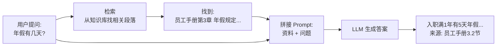
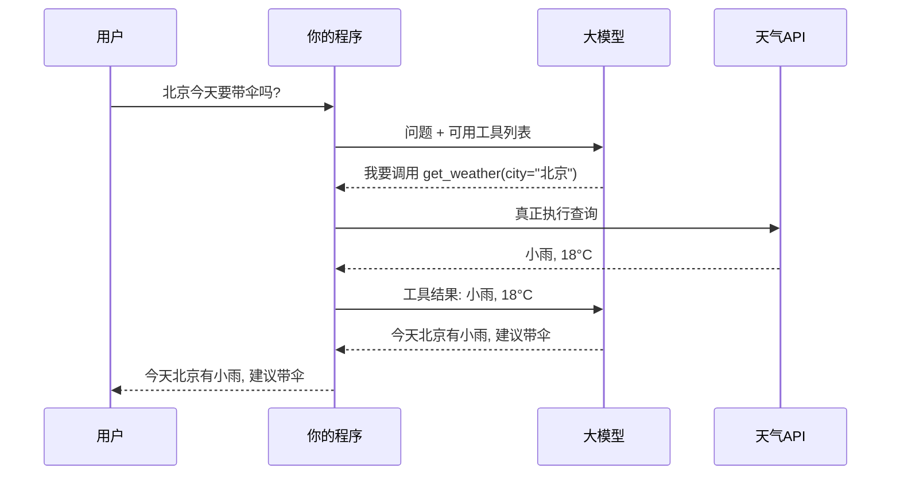
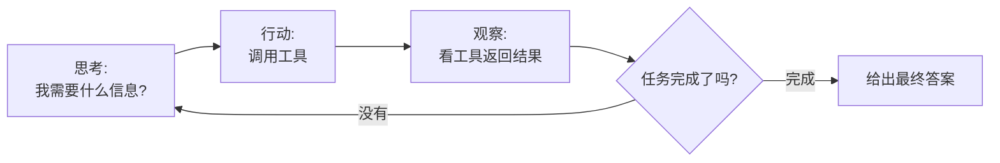
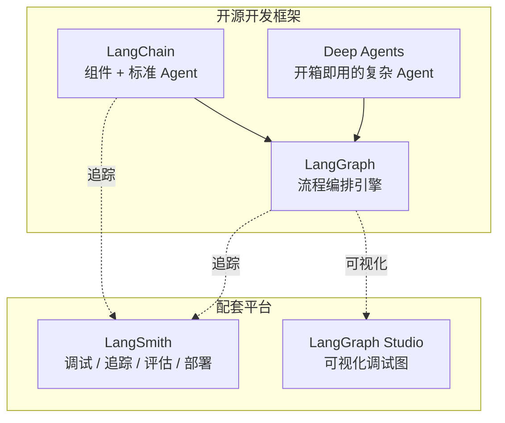

# 00 · 基础概念与术语表

> **本章目标**：在写任何代码之前，先把大模型应用开发里最常见的"行话"搞懂。后面所有章节都会用到这些词。
>
> **前置知识**：无。

---

## 一、大模型到底是什么

### 1.1 LLM（Large Language Model，大语言模型）

> 📖 **术语**：LLM 是用海量文本训练出来的神经网络，核心能力只有一个——**根据前面的文字，预测下一个最可能出现的字（词）**。

> 💡 **通俗理解**：想象一个读完了几乎整个互联网的人在玩"文字接龙"。你说"床前明月"，它接"光"；你问"Python 怎么读取文件？"，它就一个字一个字地"接"出一段答案。它之所以显得聪明，是因为见过的文字足够多，接龙接得足够好。

常见的 LLM：

| 厂商 | 模型 | 备注 |
|---|---|---|
| Anthropic | Claude（Fable / Opus / Sonnet / Haiku） | 擅长代码、长文本、Agent |
| OpenAI | GPT 系列 | 生态最广 |
| Google | Gemini | 多模态、长上下文 |
| DeepSeek | DeepSeek-V / R 系列 | 国内可直接访问，性价比高 |
| 阿里 | 通义千问 Qwen | 国内可用，有开源版本 |
| Meta | Llama | 开源，可本地部署 |

**理解 LLM 的三个关键特性**（决定了为什么需要 LangChain）：

1. **它没有记忆**：每次调用都是全新的，它不记得你上一句说过什么。想要"多轮对话"，必须每次把历史聊天记录一起发过去 → 这就是后面要学的 **Memory（记忆）**。
2. **它的知识有截止日期，且不知道你的私有数据**：它不知道你们公司的员工手册，也不知道今天的天气 → 需要 **RAG（检索增强）** 和 **Tools（工具）**。
3. **它只会输出文字**：它不能真正去查数据库、发邮件。它只能"说"自己想调用什么工具，由你的程序去执行 → 这就是 **Tool Calling（工具调用）** 和 **Agent（智能体）**。

> 🎯 **LangChain / LangGraph 存在的意义**，就是帮你系统地解决上面三个问题。

### 1.2 Token（词元）

> 📖 **术语**：Token 是模型处理文字的最小单位。模型不是按"字"而是按 Token 来读写和计费的。

- 英文：1 个 Token ≈ 0.75 个单词（`hello world` 约 2 个 Token）
- 中文：1 个汉字 ≈ 1~2 个 Token（因模型而异）

> 🎯 **为什么要关心**：
> - **计费**：API 按 Token 收费，输入、输出分开计价，输出通常更贵。
> - **限制**：每个模型能处理的 Token 总数有上限（见下一条）。

### 1.3 Context Window（上下文窗口）

> 📖 **术语**：模型一次能"看到"的 Token 总量上限，包括你发过去的所有内容 + 它要生成的回复。

> 💡 **通俗理解**：模型的"工作台"大小。台子上能摆多少资料，它就只能基于这些资料干活，放不下的就看不到。

现在主流模型的上下文窗口从 128K 到 1M Token 不等（1M Token 约等于几本长篇小说）。但**窗口大 ≠ 应该塞满**：内容越多，越慢、越贵，模型也越容易"看漏"中间的信息。

### 1.4 Prompt（提示词）

> 📖 **术语**：你发给模型的输入内容。

在聊天模型里，Prompt 通常由几种角色的**消息（Message）**组成：

| 角色 | 英文 | 作用 | 例子 |
|---|---|---|---|
| 系统消息 | System | 设定模型的身份、规则、语气 | "你是一名专业的法律顾问，回答要严谨，不确定时要说明" |
| 用户消息 | User / Human | 用户说的话 | "租房押金不退怎么办？" |
| 助手消息 | Assistant / AI | 模型之前的回复 | "根据《民法典》……" |
| 工具消息 | Tool | 工具执行完的结果，回传给模型 | `{"temperature": 23}` |

> 📖 **Prompt Engineering（提示词工程）**：通过精心设计提示词来让模型输出更好结果的技巧，比如给示例、分步骤、明确输出格式等。

### 1.5 Temperature（温度）等生成参数

> 📖 **术语**：控制模型输出"随机性"的参数，通常在 0~1（有的到 2）之间。

| 取值 | 效果 | 适合场景 |
|---|---|---|
| 0 ~ 0.3 | 稳定、确定，同一问题每次回答几乎一样 | 信息抽取、分类、写代码、RAG 问答 |
| 0.5 ~ 0.8 | 平衡 | 日常对话 |
| 0.8 以上 | 发散、有创意，但更可能胡说 | 写文案、头脑风暴、写故事 |

其他常见参数：

- **max_tokens**：最多生成多少 Token，防止输出过长、费用失控。
- **top_p**：另一种控制随机性的方式，一般和 temperature 二选一调整即可。

### 1.6 Hallucination（幻觉）

> 📖 **术语**：模型一本正经地编造不存在的事实，比如虚构一篇论文、一个 API。

> 💡 **原因**：模型本质上是"接龙"，它追求的是"说得通顺"，而不是"说得正确"。

**常见缓解手段**：RAG（给它真实资料）、要求它引用来源、降低 temperature、让它在不确定时回答"不知道"。

### 1.7 Streaming（流式输出）

> 📖 **术语**：模型一边生成一边返回，而不是等全部生成完才一次性返回。

> 🎯 **应用场景**：ChatGPT 那种"一个字一个字往外蹦"的打字机效果。对用户体验至关重要——一次完整回答可能要等 10 秒，而流式输出 0.5 秒就能看到第一个字。

---

## 二、让模型"变聪明"的核心技术

### 2.1 Embedding（嵌入 / 向量化）

> 📖 **术语**：把一段文字转换成一串数字（向量），例如 `[0.12, -0.83, 0.45, ...]`，通常有几百到几千维。

> 💡 **通俗理解**：给每段文字在"语义地图"上标一个坐标。**意思相近的文字，坐标也相近。**
> - "我想退货" 和 "怎么申请退款" → 坐标很近
> - "我想退货" 和 "今天天气不错" → 坐标很远

> 🎯 **为什么重要**：它让计算机能够按"意思"而不是"关键词"来搜索。用户搜"怎么退钱"，也能找到标题为"退款流程说明"的文档，即使两者一个字都不重合。

- **Embedding 模型**：专门负责把文字变成向量的模型（和聊天模型是两种模型），如 OpenAI 的 `text-embedding-3-small`、智源的 `bge` 系列。

### 2.2 Vector Store（向量数据库）

> 📖 **术语**：专门存储向量、并能快速找出"和某个向量最相似的 N 个向量"的数据库。

常见的有：Chroma、FAISS（轻量，适合学习和小项目）、Milvus、Qdrant、Weaviate、Pinecone（生产级），以及 PostgreSQL 的 `pgvector` 插件。

> 📖 **相似度检索（Similarity Search）**：把用户的问题也变成向量，然后在向量数据库里找"距离最近"的几段文档。常用的距离算法是**余弦相似度（Cosine Similarity）**。

### 2.3 RAG（Retrieval-Augmented Generation，检索增强生成）

> 📖 **术语**：先**检索**相关资料，再把资料和问题一起交给模型**生成**答案。

> 💡 **通俗理解**：开卷考试。模型本身记不住你们公司的规章制度，那就在它答题前，先从资料库里翻出相关的那几页，塞给它看，让它照着资料回答。

> 🎯 **应用场景**：企业知识库、智能客服、产品文档问答、法律/医疗资料查询、论文助手。**RAG 是目前企业落地最多的大模型应用形态。**

相关术语：

- **Chunk（分块）**：长文档要切成小段才能做检索，每一小段叫一个 Chunk。
- **Retriever（检索器）**：负责"给一个问题，返回相关文档"的组件。
- **Rerank（重排序）**：先粗检索出 20 条，再用更精确的模型挑出最相关的 5 条。

### 2.4 Tool Calling / Function Calling（工具调用 / 函数调用）

> 📖 **术语**：你告诉模型"有哪些工具可用、每个工具需要什么参数"，模型在需要时会输出一段结构化的"调用请求"，**由你的程序真正执行**，再把结果告诉模型。

> 💡 **通俗理解**：模型是一个只能动嘴的军师。你给他一张"可用手下名单"（查天气的、查数据库的、发邮件的）。他说"派查天气的去查一下北京"，你的程序就去执行，然后把结果汇报给他，他再根据结果给出最终答复。

### 2.5 Agent（智能体）

> 📖 **术语**：能够**自主决定**下一步做什么、调用什么工具、何时结束的 AI 程序。

> 💡 **通俗理解**：
> - **普通程序 / Chain（链）**：流程是你写死的，第 1 步做 A，第 2 步做 B，像一条流水线。
> - **Agent**：你只给目标和工具，它自己想办法。像一个员工：你说"帮我订一张下周去上海最便宜的机票"，他会自己查航班、比价格、确认时间，遇到问题再换个方法。

Agent 的核心循环通常叫 **ReAct（Reasoning + Acting，推理 + 行动）**：

> 🎯 **应用场景**：智能客服（查订单、改地址、退款）、编程助手（读代码、改代码、跑测试）、数据分析助手（写 SQL、查数据、画图）、个人助理（查日历、发邮件）。

### 2.6 Memory（记忆）

> 📖 **术语**：让 AI 应用"记住"信息的机制，分为两类：

| 类型 | 英文 | 记什么 | 例子 |
|---|---|---|---|
| 短期记忆 | Short-term Memory | 当前这一次对话的上下文 | 你刚说过"我叫小明"，下一句它还记得 |
| 长期记忆 | Long-term Memory | 跨对话、跨天的信息 | 下周你再来，它还记得你喜欢简洁的回答 |

在 LangGraph 中，短期记忆由 **Checkpointer** 实现，长期记忆由 **Store** 实现（第 09 章详解）。

### 2.7 其他常见术语

| 术语 | 解释 |
|---|---|
| **Chain（链）** | 把多个步骤（提示词 → 模型 → 解析）按固定顺序串起来执行 |
| **Structured Output（结构化输出）** | 让模型按指定格式（如 JSON）输出，方便程序直接使用 |
| **Few-shot（少样本提示）** | 在 Prompt 里给模型几个"输入 → 输出"示例，让它照着做 |
| **CoT（Chain of Thought，思维链）** | 让模型"一步步思考"后再回答，提升推理准确率 |
| **Reasoning Model（推理模型）** | 内置"先思考再回答"能力的模型，适合复杂推理，但更慢更贵 |
| **Multimodal（多模态）** | 能同时处理文字、图片、音频等多种类型的输入 |
| **Fine-tuning（微调）** | 用自己的数据继续训练模型。成本高，大多数场景用 RAG + 提示词就够了 |
| **MCP（Model Context Protocol）** | 一种让 AI 应用以统一方式接入外部工具和数据源的开放协议，可以理解为"AI 工具的 USB 接口" |
| **Guardrails（护栏）** | 对输入/输出做安全检查，防止敏感信息泄露、恶意指令等 |
| **Prompt Injection（提示词注入）** | 攻击者在输入中藏指令（如"忽略之前所有规则"），诱导模型做坏事 |
| **Human-in-the-loop（人机协同）** | 关键步骤暂停，等人工审批后再继续（如转账前要人确认） |
| **Observability（可观测性）** | 记录 AI 应用每一步的输入、输出、耗时、费用，方便排查问题 |

---

## 三、LangChain 生态全景

### 3.1 包结构

LangChain 1.x 把功能拆成了多个包，按需安装：

| 包名 | 作用 | 什么时候装 |
|---|---|---|
| `langchain` | 主包：`create_agent`、中间件、常用入口 | 必装 |
| `langchain-core` | 核心抽象：消息、提示词、Runnable 等（装 `langchain` 时自动装） | 自动 |
| `langgraph` | 图编排引擎（装 `langchain` 时自动装） | 自动 |
| `langchain-anthropic` / `langchain-openai` / `langchain-deepseek` ... | 各家模型的接入包 | 用哪家装哪家 |
| `langchain-community` | 社区维护的大量集成（文档加载器等） | 按需 |
| `langchain-text-splitters` | 文本切分器 | 做 RAG 时 |
| `langchain-chroma` / `langchain-qdrant` ... | 各向量数据库的接入包 | 做 RAG 时 |
| `langchain-classic` | 0.x 时代的旧组件（`LLMChain` 等），仅用于兼容老代码 | 一般不装 |

### 3.2 产品全家桶

- **LangChain**：提供标准化组件和 `create_agent`，覆盖 80% 的常见场景。
- **LangGraph**：底层编排引擎，适合需要精细控制流程的场景。
- **Deep Agents**：在 LangGraph 之上封装的"重型"Agent，自带任务规划、文件系统、子 Agent，适合长时间运行的复杂任务（了解即可）。
- **LangSmith**：云平台，可以看到 AI 应用每一步做了什么，用于调试、评估和监控（第 12 章）。

### 3.3 什么时候用哪个

| 你的需求 | 推荐 |
|---|---|
| 调一下模型，做个翻译、总结 | 直接用 LangChain 的模型组件（第 02~04 章） |
| 基于文档的问答 | LangChain RAG（第 06 章） |
| 能调用工具的助手 | LangChain `create_agent`（第 07 章） |
| 流程固定但有分支、循环，需要精确控制每一步 | LangGraph（第 08 章） |
| 需要暂停等人审批、断点续跑、回溯历史 | LangGraph 持久化（第 09 章） |
| 多个专业 Agent 分工协作 | LangGraph 多 Agent（第 10 章） |

---

## 四、本章小结

- LLM 本质是"文字接龙"，它**没有记忆、不知道私有数据、不能自己动手**。
- **Embedding + 向量数据库 + RAG** 解决"不知道私有数据"。
- **Tool Calling + Agent** 解决"不能动手"。
- **Memory** 解决"没有记忆"。
- **LangChain** 提供这些能力的标准零件，**LangGraph** 负责把它们编排成复杂流程。

## 五、自测题

1. 为什么和 ChatGPT 聊天时它能记住上文，而直接调用 API 时它却记不住？
2. 用户问"你们的会员能退款吗"，知识库里只有一篇叫《付费服务退订规则》的文档，关键词搜索可能搜不到，为什么向量检索能搜到？
3. 模型说"我要调用 `send_email` 工具"，邮件是谁发出去的？
4. "订单查询客服"更适合用固定的 Chain 还是 Agent？为什么？

参考答案

1. ChatGPT 网页版在背后每次都把历史消息一起发给模型；API 是无状态的，需要你自己维护历史。
2. 向量检索按语义相似度匹配，"会员退款"和"付费服务退订"语义相近，坐标接近。
3. 是你的程序。模型只输出"调用请求"，真正执行的是你写的代码。
4. 取决于复杂度：如果只是"输入订单号 → 查询 → 返回"，固定 Chain 更稳定、更便宜；如果用户会问各种问题（查订单、改地址、催发货、退款），需要灵活判断该做什么，就用 Agent。

---

**下一章** → [01 环境准备](./01-环境准备.md)
