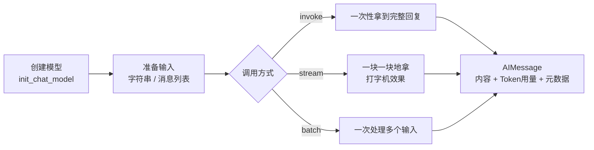
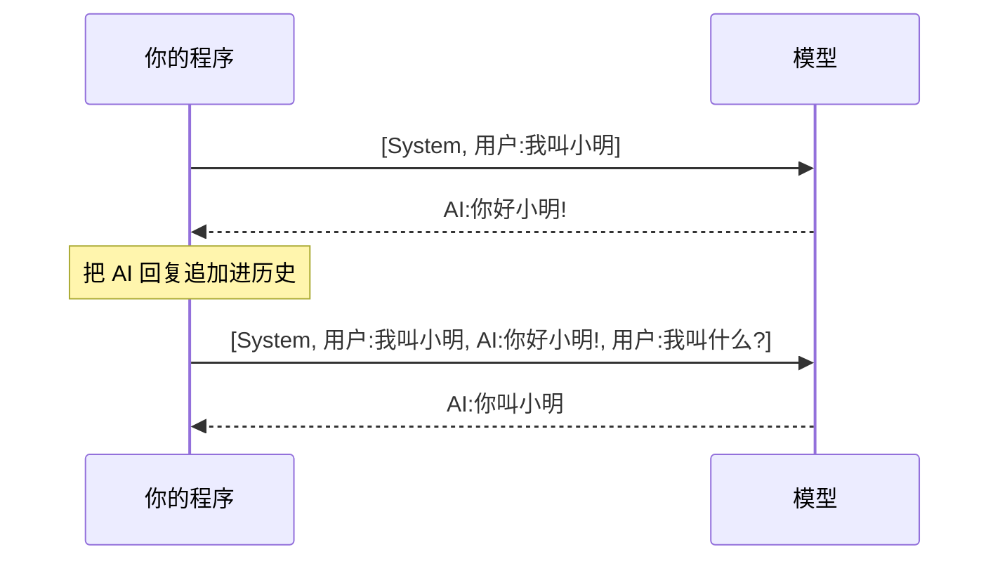

# 02 · 模型与消息

> **本章目标**：学会用 LangChain 和大模型"对话"：创建模型、调整参数、用三种方式调用（普通 / 流式 / 批量）、理解消息类型、手动实现多轮对话、读取 Token 用量、发送图片。
>
> **前置知识**：完成 [01 环境准备](./01-环境准备.md)，能跑通 Hello World。

---

## 一、本章全景



> 💡 **通俗理解**：本章要做的就是"拨通电话、说话、听回复"。模型是电话那头的人，消息是你们说的每一句话，`invoke` / `stream` / `batch` 是三种通话方式。

---

## 二、创建模型：`init_chat_model`

### 2.1 最简单的写法

```python
from dotenv import load_dotenv
from langchain.chat_models import init_chat_model

load_dotenv()

model = init_chat_model("deepseek:deepseek-flash", extra_body={"thinking": {"type": "disabled"}})
print(model.invoke("你好").content)
```

> 📖 **术语**：**Chat Model（聊天模型）** 是以"消息列表"为输入、以"一条 AI 消息"为输出的模型。现在主流大模型都是聊天模型。LangChain 里所有聊天模型都实现了同一套接口，所以换模型不用改业务代码。

### 2.2 常用参数

```python
from dotenv import load_dotenv
from langchain.chat_models import init_chat_model

load_dotenv()

model = init_chat_model(
    "deepseek:deepseek-flash",
    extra_body={"thinking": {"type": "disabled"}},
    temperature=0.2,   # 随机性：越低越稳定
    max_tokens=1000,   # 最多生成多少 Token，防止输出过长、费用失控
    timeout=30,        # 单次请求超时时间（秒）
    max_retries=3,     # 网络错误 / 429 / 5xx 时自动重试的次数
)
```

| 参数 | 作用 | 建议值 |
|---|---|---|
| `temperature` | 控制随机性（见 [00 章 1.5 节](./00-基础概念与术语表.md#15-temperature温度等生成参数)） | 抽取 / 分类 / RAG：0~0.3；聊天：0.7；创作：0.8+ |
| `max_tokens` | 输出长度上限 | 根据业务设定，聊天一般 1000~4000 |
| `timeout` | 请求超时（秒） | 30~120，长输出要设大一点 |
| `max_retries` | 自动重试次数（指数退避） | 默认值通常够用，网络不稳定或长时间运行的 Agent 可调大 |

> ⚠️ **注意**：`max_retries` 只对"可以重试的错误"生效（网络错误、`429` 限流、`5xx` 服务端错误）。`401`（Key 错误）、`404`（模型名写错）重试多少次都没用，会直接报错。

> 📖 **术语**：**指数退避（Exponential Backoff）**：失败后等 1 秒重试，再失败等 2 秒，再失败等 4 秒……避免在服务繁忙时"雪上加霜"。

### 2.3 也可以直接用厂商的类

`init_chat_model` 本质上是一个"工厂函数"，背后会创建对应厂商的类。你也可以直接用这些类，效果一样：

```python
from langchain_deepseek import ChatDeepSeek

model = ChatDeepSeek(model="deepseek-flash", temperature=0.2, extra_body={"thinking": {"type": "disabled"}})
```

| 写法 | 优点 | 适合 |
|---|---|---|
| `init_chat_model("provider:model")` | 统一入口，换模型只改字符串 | **推荐默认使用** |
| `ChatDeepSeek(...)` / `ChatOpenAI(...)` | 能用到某厂商独有的参数，IDE 提示更全 | 需要厂商特有功能时 |

---

## 三、三种调用方式

LangChain 中几乎所有组件（模型、提示词模板、链、Agent）都支持同一套调用方法，这套统一接口叫 **Runnable**（第 04 章详细讲）。模型是你接触的第一个 Runnable。

| 方法 | 作用 | 返回 |
|---|---|---|
| `invoke(input)` | 调用一次，等完整结果 | `AIMessage` |
| `stream(input)` | 流式调用，边生成边返回 | `AIMessageChunk` 的迭代器 |
| `batch([input1, input2, ...])` | 批量并发调用 | `AIMessage` 列表 |
| `ainvoke` / `astream` / `abatch` | 上面三个的**异步**版本 | 同上 |

### 3.1 `invoke`：一次性拿结果

```python
from dotenv import load_dotenv
from langchain.chat_models import init_chat_model

load_dotenv()
model = init_chat_model("deepseek:deepseek-flash", extra_body={"thinking": {"type": "disabled"}})

response = model.invoke("用三句话解释什么是向量数据库")
print(type(response))     # <class 'langchain_core.messages.ai.AIMessage'>
print(response.content)   # 回复内容
```

### 3.2 `stream`：打字机效果

```python
from dotenv import load_dotenv
from langchain.chat_models import init_chat_model

load_dotenv()
model = init_chat_model("deepseek:deepseek-flash", extra_body={"thinking": {"type": "disabled"}})

for chunk in model.stream("写一首关于程序员加班的五言绝句"):
    print(chunk.text, end="", flush=True)
print()
```

> 🎯 **应用场景**：所有面向用户的聊天界面都应该用流式输出。一次完整回答可能需要 5~20 秒，流式输出能让用户在 1 秒内看到第一个字，体感速度差别巨大。

**把碎片拼回完整消息**：`AIMessageChunk` 支持用 `+` 合并，合并后和 `invoke` 的结果用法一样。

```python
full = None
for chunk in model.stream("天空为什么是蓝色的？"):
    full = chunk if full is None else full + chunk
    print(chunk.text, end="", flush=True)

print("\n完整内容长度：", len(full.text))
```

> ⚠️ **注意**：
> - `chunk.text` 是纯文本字符串，`chunk.content` 是原始内容（某些模型可能是列表结构）。**打印文本时优先用 `.text`**。
> - `print` 要加 `end=""` 和 `flush=True`，否则每个碎片都会换行，或者被缓冲后一次性输出，看不到流式效果。

### 3.3 `batch`：批量处理

```python
from dotenv import load_dotenv
from langchain.chat_models import init_chat_model

load_dotenv()
model = init_chat_model("deepseek:deepseek-flash", extra_body={"thinking": {"type": "disabled"}}, temperature=0)

reviews = [
    "物流超快，包装也很用心，好评！",
    "用了两天就坏了，客服还不理人。",
    "一般般吧，和描述差不多。",
]

prompts = [f"判断这条评价的情感，只回答 正面/负面/中性：{r}" for r in reviews]

results = model.batch(prompts, config={"max_concurrency": 5})  # 最多同时 5 个请求

for review, res in zip(reviews, results):
    print(f"{res.text:4} | {review}")
```

> 🎯 **应用场景**：批量给商品评价打标签、批量翻译、批量生成商品描述、批量总结文档。

> ⚠️ **注意**：
> - `batch` 是在**你的程序里并发**发送多个请求，不是厂商的"批处理 API"（那种是提交任务、几小时后取结果、价格打折）。
> - 一定要设置 `max_concurrency`，否则请求量大时很容易触发 `429` 限流。

### 3.4 异步调用：`ainvoke` / `astream`

> 📖 **术语**：**异步（Async）**：发出请求后不傻等，而是先去处理别的事情，结果回来再接着处理。在 Python 里用 `async` / `await` 语法。Web 服务（如 FastAPI）里应当优先用异步版本，一个进程就能同时服务很多用户。

```python
import asyncio

from dotenv import load_dotenv
from langchain.chat_models import init_chat_model

load_dotenv()
model = init_chat_model("deepseek:deepseek-flash", extra_body={"thinking": {"type": "disabled"}})


async def main():
    # 并发发出两个请求，总耗时约等于较慢的那一个
    r1, r2 = await asyncio.gather(
        model.ainvoke("一句话介绍 Python"),
        model.ainvoke("一句话介绍 Rust"),
    )
    print(r1.text)
    print(r2.text)

    # 异步流式
    async for chunk in model.astream("数到五"):
        print(chunk.text, end="", flush=True)


asyncio.run(main())
```

> 💡 **前端同学可以这样理解**：`ainvoke` 就像返回 Promise 的 `fetch`，`asyncio.gather` 就是 `Promise.all`，`async for` 类似 `for await...of`。

---

## 四、消息（Message）：和模型对话的基本单位

### 4.1 四种消息类型

```python
from langchain.messages import AIMessage, HumanMessage, SystemMessage, ToolMessage
```

| 类 | 角色 | 谁写的 | 作用 |
|---|---|---|---|
| `SystemMessage` | system | 开发者 | 设定身份、规则、输出风格，通常放在第一条 |
| `HumanMessage` | user | 用户 | 用户的提问 |
| `AIMessage` | assistant | 模型 | 模型的回复（也可能包含工具调用请求） |
| `ToolMessage` | tool | 你的程序 | 工具执行结果，回传给模型（第 05 章详讲） |

```python
from dotenv import load_dotenv
from langchain.chat_models import init_chat_model
from langchain.messages import HumanMessage, SystemMessage

load_dotenv()
model = init_chat_model("deepseek:deepseek-flash", extra_body={"thinking": {"type": "disabled"}})

messages = [
    SystemMessage("你是一名资深前端面试官，提问简洁，每次只问一个问题。"),
    HumanMessage("我准备好了，开始吧。"),
]

response = model.invoke(messages)
print(response.text)
```

### 4.2 字典写法（等价）

不想 import 消息类时，可以用 OpenAI 风格的字典，效果完全一样：

```python
messages = [
    {"role": "system", "content": "你是一名资深前端面试官，提问简洁，每次只问一个问题。"},
    {"role": "user", "content": "我准备好了，开始吧。"},
]
response = model.invoke(messages)
```

> 💡 两种写法可以混用。直接传字符串 `model.invoke("你好")` 时，LangChain 会自动把它包装成一条 `HumanMessage`。

### 4.3 System Prompt 的写法建议

> 📖 **术语**：**System Prompt（系统提示词）**：放在 `SystemMessage` 里的内容，决定模型"是谁、该怎么做"。它是影响输出质量最重要的一段文字。

一个好的 System Prompt 通常包含：

```text
# 角色
你是「小智」，某电商平台的售后客服。

# 任务
回答用户关于退换货、物流、发票的问题。

# 规则
1. 只回答售后相关问题，其他问题礼貌拒绝。
2. 不确定的信息不要编造，引导用户联系人工客服。
3. 涉及金额时必须提醒"以订单页面显示为准"。

# 输出风格
- 语气亲切，称呼用户为"亲"。
- 回答不超过 100 字。
```

> 🎯 **应用场景**：同一个模型，换一个 System Prompt 就能变成客服、翻译、代码审查员、面试官。这是做 AI 应用成本最低的"定制"方式。

---

## 五、多轮对话：手动维护历史

[00 章](./00-基础概念与术语表.md)说过，模型**本身没有记忆**。要让它"记住"上文，必须每次把完整的历史消息一起发过去。



### 5.1 最简单的命令行聊天机器人

```python
from dotenv import load_dotenv
from langchain.chat_models import init_chat_model
from langchain.messages import HumanMessage, SystemMessage

load_dotenv()
model = init_chat_model("deepseek:deepseek-flash", extra_body={"thinking": {"type": "disabled"}}, temperature=0.7)

history = [SystemMessage("你是一个幽默的聊天伙伴，回答简短。")]

while True:
    user_input = input("你：").strip()
    if user_input in ("exit", "quit", "退出"):
        break

    history.append(HumanMessage(user_input))

    print("AI：", end="", flush=True)
    full = None
    for chunk in model.stream(history):
        print(chunk.text, end="", flush=True)
        full = chunk if full is None else full + chunk
    print()

    history.append(full)  # 关键：把 AI 的回复也存进历史
```

### 5.2 历史太长怎么办

对话越长，每次发送的 Token 越多 → **越慢、越贵，最终会超出上下文窗口**。常见策略：

| 策略 | 做法 | 优缺点 |
|---|---|---|
| 滑动窗口 | 只保留最近 N 轮 | 简单，但会忘掉早期信息 |
| 按 Token 裁剪 | 用 `trim_messages` 保留最近的 X 个 Token | 更精确地控制成本 |
| 摘要压缩 | 用模型把早期对话总结成一段话 | 保留关键信息，但要多调用一次模型 |

`langchain_core` 提供了 `trim_messages` 工具函数：

```python
from langchain_core.messages import trim_messages
from langchain_core.messages.utils import count_tokens_approximately

trimmed = trim_messages(
    history,
    strategy="last",                        # 保留最后的消息
    token_counter=count_tokens_approximately,
    max_tokens=2000,                        # 最多保留约 2000 Token
    start_on="human",                       # 裁剪后第一条必须是用户消息
    include_system=True,                    # 始终保留 SystemMessage
)
response = model.invoke(trimmed)
```

> ⚠️ **注意**：手动维护历史只适合学习和简单场景。实际项目中，多轮记忆一般交给 **Agent + Checkpointer** 自动管理（[07 章](./07-Agent智能体-create_agent.md)、[09 章](./09-LangGraph持久化-记忆与人机协同.md)），摘要压缩可直接使用 `SummarizationMiddleware`。旧教程中的 `ConversationBufferMemory`、`ConversationChain` **已废弃**，不要再用。

---

## 六、读懂 AIMessage：内容之外的信息

`invoke` 返回的 `AIMessage` 不只有文字，还有很多有用的信息：

```python
from dotenv import load_dotenv
from langchain.chat_models import init_chat_model

load_dotenv()
model = init_chat_model("deepseek:deepseek-flash", extra_body={"thinking": {"type": "disabled"}})

msg = model.invoke("你好")

print(msg.text)               # 纯文本内容
print(msg.content)            # 原始内容（字符串或内容块列表）
print(msg.content_blocks)     # 标准化的内容块列表
print(msg.usage_metadata)     # Token 用量
print(msg.response_metadata)  # 厂商返回的元数据（模型名、结束原因等）
print(msg.tool_calls)         # 工具调用请求（第 05 章），没有则为空列表
print(msg.id)                 # 消息 ID
```

### 6.1 `content` vs `text` vs `content_blocks`

| 属性 | 类型 | 说明 |
|---|---|---|
| `content` | `str` 或 `list` | 原始内容。不同厂商格式可能不同 |
| `text` | `str` | 只提取文字部分，**最常用** |
| `content_blocks` | `list[dict]` | LangChain 1.x 新增的**跨厂商统一格式**，如 `[{"type": "text", "text": "..."}]` |

> 📖 **术语**：**Content Block（内容块）**：一条消息可以由多个"块"组成：文字块、图片块、推理过程块（reasoning）、工具调用块等。`content_blocks` 把不同厂商五花八门的格式统一成同一套结构，方便你写不依赖厂商的代码。

> 🎯 **应用场景**：使用推理模型时，`content_blocks` 里可能包含 `{"type": "reasoning", ...}` 块，即模型的"思考过程"。你可以选择在界面上折叠展示，或者干脆不展示。

### 6.2 `usage_metadata`：Token 用量

```python
print(msg.usage_metadata)
# {'input_tokens': 12,
#  'output_tokens': 35,
#  'total_tokens': 47,
#  'input_token_details': {'cache_read': 0, ...},
#  'output_token_details': {...}}
```

| 字段 | 含义 |
|---|---|
| `input_tokens` | 输入（你发过去的全部消息）用了多少 Token |
| `output_tokens` | 模型生成了多少 Token |
| `total_tokens` | 合计 |
| `input_token_details.cache_read` | 命中**提示词缓存**的 Token 数（通常按很低的价格计费） |
| `output_token_details.reasoning` | 推理模型"思考"用掉的 Token（也要计费） |

### 6.3 统计多次调用的总用量

```python
from dotenv import load_dotenv
from langchain.chat_models import init_chat_model
from langchain_core.callbacks import get_usage_metadata_callback

load_dotenv()
model = init_chat_model("deepseek:deepseek-flash", extra_body={"thinking": {"type": "disabled"}})

with get_usage_metadata_callback() as cb:
    model.invoke("你好")
    model.invoke("介绍一下你自己")
    print(cb.usage_metadata)  # 按模型名汇总的用量
```

> 📖 **术语**：**Callback（回调）**：LangChain 在执行过程的关键时刻（开始调用、收到 Token、调用结束……）会通知"回调处理器"。上面的 `get_usage_metadata_callback` 就是一个专门统计 Token 的回调。

### 6.4 估算成本

```text
单次成本 = 输入 Token × 输入单价 + 输出 Token × 输出单价
```

> 💡 价格通常按"每百万 Token（MTok）"标注，例如"输入 $3 / MTok，输出 $15 / MTok"。具体价格以各厂商官网为准，并且会经常调整。

**省钱技巧**：

1. **简单任务用小模型**：分类、抽取用 Haiku 级别的小模型，复杂推理再用大模型。
2. **控制输出长度**：设置 `max_tokens`，在 Prompt 里要求"简洁回答"。
3. **裁剪历史**：多轮对话不要无限累积历史。
4. **利用提示词缓存**：长且固定的 System Prompt / 文档放在消息最前面，重复调用时可以命中缓存（具体规则看厂商文档）。

---

## 七、多模态：给模型看图片

> 📖 **术语**：**多模态（Multimodal）**：模型能同时理解文字、图片、音频、PDF 等多种类型的输入。DeepSeek（`deepseek-flash`）、Claude、GPT、Gemini、Qwen-VL 等主流模型都支持图片输入。

> ⚠️ **注意**：`deepseek-v4-pro` **不支持**图片输入，本节示例请使用 `deepseek-flash`。

### 7.1 发送网络图片

```python
from dotenv import load_dotenv
from langchain.chat_models import init_chat_model
from langchain.messages import HumanMessage

load_dotenv()
model = init_chat_model("deepseek:deepseek-flash", extra_body={"thinking": {"type": "disabled"}})

message = HumanMessage(content_blocks=[
    {"type": "text", "text": "这张图片里有什么？用中文描述。"},
    {"type": "image", "url": "https://upload.wikimedia.org/wikipedia/commons/a/a7/Camponotus_flavomarginatus_ant.jpg"},
])

print(model.invoke([message]).text)
```

### 7.2 发送本地图片（Base64）

> 📖 **术语**：**Base64**：一种把二进制文件（图片等）编码成纯文本字符串的方式，方便放进 JSON 里传输。

```python
import base64

from dotenv import load_dotenv
from langchain.chat_models import init_chat_model
from langchain.messages import HumanMessage

load_dotenv()
model = init_chat_model("deepseek:deepseek-flash", extra_body={"thinking": {"type": "disabled"}})

with open("invoice.jpg", "rb") as f:
    image_b64 = base64.b64encode(f.read()).decode("utf-8")

message = HumanMessage(content_blocks=[
    {"type": "text", "text": "识别这张发票的开票日期、金额和销售方名称。"},
    {"type": "image", "base64": image_b64, "mime_type": "image/jpeg"},  # base64 必须带 mime_type
])

print(model.invoke([message]).text)
```

> 🎯 **应用场景**：发票 / 票据识别、截图转代码（把设计稿截图转成 HTML）、商品图片审核、图表数据提取、报错截图分析。

> ⚠️ **注意**：图片也会消耗 Token（大图消耗更多）。如果只需要识别文字，可以先压缩图片尺寸再发送。

---

## 八、运行时切换模型（了解即可）

有时你希望**同一段代码在运行时决定用哪个模型**，比如免费用户用小模型、付费用户用大模型。`init_chat_model` 支持"可配置模型"：

```python
from dotenv import load_dotenv
from langchain.chat_models import init_chat_model

load_dotenv()

# 不指定模型时，model / model_provider 默认变成运行时可配置
model = init_chat_model(temperature=0, extra_body={"thinking": {"type": "disabled"}})

cheap = model.invoke(
    "一句话介绍你自己",
    config={"configurable": {"model": "deepseek:deepseek-flash"}},
)
smart = model.invoke(
    "一句话介绍你自己",
    config={"configurable": {"model": "deepseek:deepseek-v4-pro"}},
)
print(cheap.text)
print(smart.text)
```

也可以指定哪些参数可以在运行时修改：

```python
from langchain.chat_models import init_chat_model
model = init_chat_model(
    "deepseek:deepseek-flash",
    extra_body={"thinking": {"type": "disabled"}},
    temperature=0,
    configurable_fields=("model", "temperature", "max_tokens"),
)

model.invoke("写一句广告语", config={"configurable": {"temperature": 0.9}})
```

> 🎯 **应用场景**：按用户等级分配模型、A/B 测试不同模型、某个模型故障时手动切换（自动降级见 [04 章 `with_fallbacks`](./04-LCEL与Runnable链式编排.md)）。

---

## 九、综合示例：电商评论分析小工具

把本章知识串起来：用 System Prompt 设定任务、批量并发处理、流式输出总结、统计 Token 用量。

```python
from dotenv import load_dotenv
from langchain.chat_models import init_chat_model
from langchain.messages import HumanMessage, SystemMessage
from langchain_core.callbacks import get_usage_metadata_callback

load_dotenv()

# 小模型负责逐条打标签，大模型负责最终总结
tagger = init_chat_model("deepseek:deepseek-flash", extra_body={"thinking": {"type": "disabled"}}, temperature=0, max_tokens=50)
writer = init_chat_model("deepseek:deepseek-v4-pro", extra_body={"thinking": {"type": "disabled"}}, temperature=0.3)

reviews = [
    "耳机音质很好，降噪也不错，就是戴久了耳朵有点疼。",
    "发货太慢了，等了一周，客服回复也很敷衍。",
    "性价比很高，送给爸妈用的，他们很喜欢。",
    "充电盒容易刮花，其他都还行。",
    "连接经常断，退货了。",
]

TAG_PROMPT = SystemMessage(
    "你是电商评论分析助手。对每条评论输出：情感(正面/负面/中性) | 涉及方面(如音质、物流、客服、外观、质量)。"
    "只输出这一行，不要解释。"
)

with get_usage_metadata_callback() as cb:
    # 1. 批量打标签
    inputs = [[TAG_PROMPT, HumanMessage(r)] for r in reviews]
    tags = tagger.batch(inputs, config={"max_concurrency": 5})

    tagged_lines = []
    for review, tag in zip(reviews, tags):
        line = f"- {review}  =>  {tag.text.strip()}"
        tagged_lines.append(line)
        print(line)

    # 2. 流式生成总结报告
    print("\n===== 分析报告 =====")
    summary_messages = [
        SystemMessage("你是电商运营分析师，根据标注后的评论写一份简短的改进建议，分点列出，不超过 150 字。"),
        HumanMessage("\n".join(tagged_lines)),
    ]
    for chunk in writer.stream(summary_messages):
        print(chunk.text, end="", flush=True)
    print()

    # 3. 用量统计
    print("\n===== Token 用量 =====")
    for model_name, usage in cb.usage_metadata.items():
        print(f"{model_name}: 输入 {usage['input_tokens']}，输出 {usage['output_tokens']}")
```

> 🎯 **这个模式在真实业务中很常见**：**"小模型干粗活 + 大模型做总结"**，既保证效果又控制成本。类似的场景还有：批量工单分类 + 周报生成、批量简历打分 + 候选人推荐。

---

## 本章小结

- 用 `init_chat_model("provider:model", temperature=..., max_tokens=..., timeout=..., max_retries=...)` 创建模型。
- 三种调用方式：`invoke`（完整结果）、`stream`（流式）、`batch`（批量并发），以及对应的异步版本 `ainvoke` / `astream` / `abatch`。
- 四种消息：`SystemMessage`、`HumanMessage`、`AIMessage`、`ToolMessage`，也可以用 `{"role", "content"}` 字典。
- 模型**没有记忆**，多轮对话需要把历史一起发过去；历史过长要裁剪或摘要。
- `AIMessage` 上的 `.text`、`.content_blocks`、`.usage_metadata`、`.tool_calls` 是最常用的属性。
- 图片用 `content_blocks` 里的 `{"type": "image", ...}` 块发送。

## 练习

1. 用 `stream` 写一个命令行聊天机器人，并在每轮回复后打印本轮消耗的 Token 数。
2. 用 `batch` 把 10 句中文翻译成英文，对比设置 `max_concurrency=1` 和 `max_concurrency=10` 时的总耗时。
3. 给多轮聊天机器人加上 `trim_messages`，设置 `max_tokens=500`，连续聊十几轮后问它"我第一句话说了什么"，观察结果。
4. 找一张包含表格的截图，让模型把表格转换成 Markdown 格式。

<details>
<summary>练习 1、2 参考思路</summary>

1. 合并流式碎片后（`full = full + chunk`），读取 `full.usage_metadata`。部分厂商在流式模式下需要额外开启用量返回，如果拿到 `None`，可以改用 `get_usage_metadata_callback` 统计。
2. 用 `time.perf_counter()` 记录前后时间：

```python
import time

start = time.perf_counter()
model.batch(prompts, config={"max_concurrency": 10})
print(f"耗时 {time.perf_counter() - start:.1f}s")
```

并发数为 10 时耗时大约等于最慢的那一个请求，并发数为 1 时约等于所有请求耗时之和。

</details>

---

**上一章** ← [01 环境准备](./01-环境准备.md) ｜ **下一章** → [03 提示词模板与结构化输出](./03-提示词模板与结构化输出.md)
