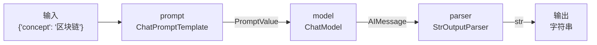
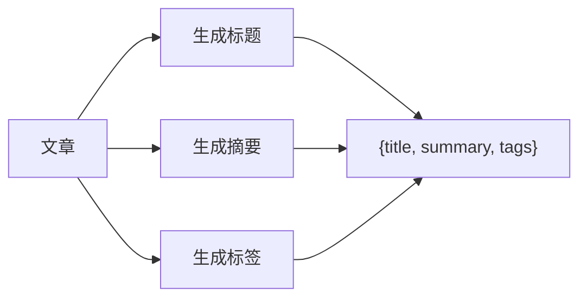
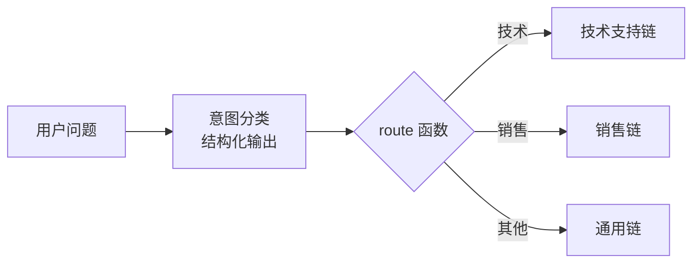
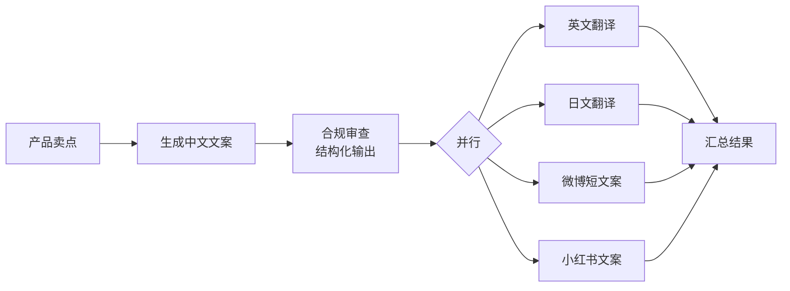

# 04 · LCEL 与 Runnable 链式编排

> **本章目标**：
> 1. 理解 LangChain 的"统一接口" **Runnable**；
> 2. 用 **`|` 管道**把提示词、模型、解析器、自定义函数串成一条链；
> 3. 掌握并行、分支路由、容错降级、自动重试、流式输出等编排能力；
> 4. 知道 LCEL 的边界：什么时候该换成 LangGraph。
>
> **前置知识**：[02 模型与消息](./02-模型与消息.md)、[03 提示词模板与结构化输出](./03-提示词模板与结构化输出.md)。

---

## 一、Runnable：LangChain 的"统一插头"

> 📖 **术语**：**Runnable（可运行对象）**：LangChain 中所有"能被执行的组件"都实现了同一个接口，叫 Runnable。提示词模板、模型、输出解析器、检索器、工具、链、甚至 Agent，都是 Runnable。

> 💡 **通俗理解**：Runnable 就像**统一规格的插头**。不管是电饭煲还是电视机，只要是标准插头，就能插进同一个插座、串到同一个插线板上。LangChain 的所有组件都是"标准插头"，所以可以随意组合。

所有 Runnable 都支持这些方法：

| 方法 | 说明 |
|---|---|
| `invoke(input)` / `ainvoke` | 执行一次 |
| `stream(input)` / `astream` | 流式执行 |
| `batch([inputs])` / `abatch` | 批量并发执行 |
| `astream_events(input)` | 流式输出**每一步**的事件（调试、精细化 UI 用） |
| `with_retry(...)` | 返回一个"失败会自动重试"的新 Runnable |
| `with_fallbacks([...])` | 返回一个"失败会切换备用方案"的新 Runnable |
| `with_config(...)` | 绑定运行配置（名称、标签、元数据等） |

这意味着：**你学会了怎么调用模型，就学会了怎么调用任何组件。**

---

## 二、LCEL 与 `|` 管道

> 📖 **术语**：**LCEL（LangChain Expression Language，LangChain 表达式语言）**：用 `|` 符号把多个 Runnable 串起来的写法。前一个组件的输出，自动成为后一个组件的输入。

> 💡 **前端同学可以这样理解**：和 Linux 的 `cat file | grep x | sort` 一样；也类似 RxJS 的 `pipe()`，或者函数式编程里的 `compose`。

### 2.1 第一条链

```python
from dotenv import load_dotenv
from langchain.chat_models import init_chat_model
from langchain_core.output_parsers import StrOutputParser
from langchain_core.prompts import ChatPromptTemplate

load_dotenv()

prompt = ChatPromptTemplate.from_template("用一句话解释什么是{concept}，让小学生也能听懂。")
model = init_chat_model("deepseek:deepseek-flash", extra_body={"thinking": {"type": "disabled"}})
parser = StrOutputParser()

chain = prompt | model | parser

print(chain.invoke({"concept": "区块链"}))
```

数据在链中的流动：



| 组件 | 输入类型 | 输出类型 |
|---|---|---|
| `ChatPromptTemplate` | `dict`（模板变量） | `PromptValue` |
| `ChatModel` | `PromptValue` / 消息列表 / 字符串 | `AIMessage` |
| `StrOutputParser` | `AIMessage` | `str` |
| `model.with_structured_output(X)` | 同 ChatModel | `X` 的实例 |

> ⚠️ **注意**：串联时要保证**上一个的输出类型 = 下一个能接收的输入类型**。最常见的错误是忘了第一个组件需要 `dict`，直接 `chain.invoke("区块链")` 而报错。

### 2.2 整条链也是 Runnable

链本身也是 Runnable，所以 `stream`、`batch` 都能直接用：

```python
# 流式
for chunk in chain.stream({"concept": "量子计算"}):
    print(chunk, end="", flush=True)   # 因为末尾是 StrOutputParser，chunk 直接是字符串

# 批量
results = chain.batch([{"concept": "云计算"}, {"concept": "机器学习"}])
```

> 💡 末尾放 `StrOutputParser` 的好处之一：流式输出的每个碎片直接是字符串，不需要再 `.text`。

---

## 三、四个核心编排组件

```python
from langchain_core.runnables import (
    RunnableLambda,       # 把普通函数变成 Runnable
    RunnableParallel,     # 并行执行多个分支
    RunnablePassthrough,  # 原样透传输入（常配合 .assign 添加字段）
    RunnableBranch,       # 条件分支（了解即可）
)
```

### 3.1 `RunnableLambda`：把普通函数接进链里

任何 Python 函数都可以包装成 Runnable，插入链的任意位置：

```python
from dotenv import load_dotenv
from langchain.chat_models import init_chat_model
from langchain_core.output_parsers import StrOutputParser
from langchain_core.prompts import ChatPromptTemplate
from langchain_core.runnables import RunnableLambda

load_dotenv()
model = init_chat_model("deepseek:deepseek-flash", extra_body={"thinking": {"type": "disabled"}})


def clean_input(text: str) -> dict:
    """预处理：去空格、截断过长输入，并转换成模板需要的 dict。"""
    return {"text": text.strip()[:2000]}


def add_footer(text: str) -> str:
    return text + "\n\n——本内容由 AI 生成，仅供参考"


prompt = ChatPromptTemplate.from_template("把下面的内容总结成 3 个要点：\n{text}")

chain = RunnableLambda(clean_input) | prompt | model | StrOutputParser() | RunnableLambda(add_footer)

print(chain.invoke("   LangChain 是一个用于开发大模型应用的框架……   "))
```

> 💡 **简写**：在 `|` 管道中，普通函数会被**自动转换**成 `RunnableLambda`，所以可以直接写 `prompt | model | StrOutputParser() | add_footer`。但如果函数在**链的第一个位置**，需要显式包装（因为 Python 不知道函数 `|` 对象该怎么处理）。

> 🎯 **应用场景**：输入清洗、敏感词过滤、格式转换、调用自己的业务接口、记录日志。

### 3.2 `RunnableParallel`：并行执行多个任务

```python
from dotenv import load_dotenv
from langchain.chat_models import init_chat_model
from langchain_core.output_parsers import StrOutputParser
from langchain_core.prompts import ChatPromptTemplate
from langchain_core.runnables import RunnableParallel

load_dotenv()
model = init_chat_model("deepseek:deepseek-flash", extra_body={"thinking": {"type": "disabled"}})
parser = StrOutputParser()

title_chain = ChatPromptTemplate.from_template("为这篇文章起一个吸引人的标题：{article}") | model | parser
summary_chain = ChatPromptTemplate.from_template("用 50 字总结这篇文章：{article}") | model | parser
tags_chain = ChatPromptTemplate.from_template("给这篇文章打 3 个标签，用逗号分隔：{article}") | model | parser

analyze = RunnableParallel(title=title_chain, summary=summary_chain, tags=tags_chain)

result = analyze.invoke({"article": "今年双十一，各大平台取消了预售，改为现货直降……"})
print(result)
# {'title': '...', 'summary': '...', 'tags': '...'}
```



- 三个分支**同时执行**，总耗时约等于最慢的那一个，而不是三者相加。
- 每个分支都收到**同一份输入**，结果合并成一个字典。

> 💡 **简写**：在管道中，**字典会被自动转换**成 `RunnableParallel`：
> ```python
> chain = {"title": title_chain, "summary": summary_chain} | some_next_step
> ```

> 🎯 **应用场景**：一篇内容同时生成标题、摘要、标签、SEO 描述；同时从多个数据源检索；同时让多个模型回答再对比。

### 3.3 `RunnablePassthrough`：透传与补充字段

> 📖 **术语**：**Passthrough（透传）**：输入是什么，输出就是什么，原样传下去。

它最常见的用法是 **`.assign()`：保留原有输入，再额外添加新字段**。

```python
from langchain_core.runnables import RunnablePassthrough

chain = RunnablePassthrough.assign(
    word_count=lambda x: len(x["text"]),
    upper=lambda x: x["text"].upper(),
)

print(chain.invoke({"text": "hello"}))
# {'text': 'hello', 'word_count': 5, 'upper': 'HELLO'}
```

> 🎯 **为什么重要**：多步骤的链里，后面的步骤经常需要**前面步骤的结果 + 最初的输入**。`.assign()` 让数据像滚雪球一样逐步累积。这正是 RAG 链的经典写法（第 06 章）：

```python
# RAG 链的经典结构预览（retriever 将在第 06 章介绍）
rag_chain = (
    {"context": retriever | format_docs, "question": RunnablePassthrough()}
    | prompt
    | model
    | StrOutputParser()
)
# 输入一个问题字符串：
#   context 分支：问题 → 检索相关文档 → 格式化成文本
#   question 分支：问题原样透传
# 两者合并成 dict 后交给 prompt
```

### 3.4 分支路由：根据条件走不同的链

> 🎯 **应用场景**：智能客服先判断用户意图——问技术问题交给"技术支持链"，问价格交给"销售链"，其他交给"通用链"。

**推荐写法：用普通函数返回不同的链**（比 `RunnableBranch` 更直观）：

```python
from typing import Literal

from dotenv import load_dotenv
from langchain.chat_models import init_chat_model
from langchain_core.output_parsers import StrOutputParser
from langchain_core.prompts import ChatPromptTemplate
from langchain_core.runnables import RunnableLambda, RunnablePassthrough
from pydantic import BaseModel

load_dotenv()
model = init_chat_model("deepseek:deepseek-flash", extra_body={"thinking": {"type": "disabled"}}, temperature=0)
parser = StrOutputParser()


# 1. 意图分类（结构化输出）
class Intent(BaseModel):
    intent: Literal["技术", "销售", "其他"]


classify = (
    ChatPromptTemplate.from_template("判断用户问题属于哪一类：技术问题 / 销售咨询 / 其他。\n问题：{question}")
    | model.with_structured_output(Intent)
)

# 2. 三条处理链
tech_chain = ChatPromptTemplate.from_template("你是技术支持工程师，专业地解答：{question}") | model | parser
sales_chain = ChatPromptTemplate.from_template("你是热情的销售顾问，介绍产品价值并引导购买：{question}") | model | parser
general_chain = ChatPromptTemplate.from_template("你是友好的客服，简短回答：{question}") | model | parser


# 3. 路由函数：返回一个 Runnable，LangChain 会自动执行它
def route(x: dict):
    match x["intent"].intent:
        case "技术":
            return tech_chain
        case "销售":
            return sales_chain
        case _:
            return general_chain


chain = RunnablePassthrough.assign(intent=classify) | RunnableLambda(route)

print(chain.invoke({"question": "你们的 API 支持 WebSocket 吗？"}))
print(chain.invoke({"question": "企业版多少钱一年？有折扣吗？"}))
```



> 💡 **关键点**：`RunnableLambda` 里的函数如果**返回的是一个 Runnable**，LangChain 会**接着执行它**并返回其结果。这就是"动态路由"的原理。

<details>
<summary>了解：RunnableBranch 写法</summary>

```python
from langchain_core.runnables import RunnableBranch

branch = RunnableBranch(
    (lambda x: x["intent"].intent == "技术", tech_chain),
    (lambda x: x["intent"].intent == "销售", sales_chain),
    general_chain,  # 默认分支
)
chain = RunnablePassthrough.assign(intent=classify) | branch
```

效果一样，但分支多了以后可读性不如普通函数，官方也更推荐函数写法。

</details>

---

## 四、生产必备：容错、重试与配置

### 4.1 `with_fallbacks`：主模型挂了自动切换备用

> 📖 **术语**：**Fallback（降级 / 兜底）**：主方案失败时自动切换到备用方案，保证服务可用。

```python
from dotenv import load_dotenv
from langchain.chat_models import init_chat_model

load_dotenv()

primary = init_chat_model("deepseek:deepseek-v4-pro", extra_body={"thinking": {"type": "disabled"}}, max_retries=1)
backup = init_chat_model("deepseek:deepseek-flash", extra_body={"thinking": {"type": "disabled"}}, max_retries=1)  # 生产中建议用另一家厂商做备份

model = primary.with_fallbacks([backup])

print(model.invoke("你好").text)
```

执行顺序：先用 `primary`，失败了换 `backup`，全部失败才抛出异常。`with_fallbacks` 的列表可以放多个备用模型，按顺序依次尝试。

**也可以对整条链做降级**：

```python
fast_chain = prompt | small_model | parser
safe_chain = prompt | big_model | parser

chain = fast_chain.with_fallbacks([safe_chain])
```

> 🎯 **应用场景**：
> - **多厂商容灾**：某家 API 故障或限流时自动切换到另一家，用户无感知。
> - **超长输入兜底**：小上下文模型报"超长"错误时，降级到长上下文模型。
> - **结构化输出兜底**：解析失败时，切换到更强的模型再试一次。

> ⚠️ **注意**：给主模型设置较小的 `max_retries`，否则它会先自己重试很多次，导致切换备用模型前要等待很久。

### 4.2 `with_retry`：自定义重试策略

模型自带 `max_retries`，而 `with_retry` 可以给**任意 Runnable**（包括你自己的函数、整条链）加重试：

```python
import random

from langchain_core.runnables import RunnableLambda


def flaky_api(x: str) -> str:
    if random.random() < 0.6:
        raise ConnectionError("第三方接口偶发失败")
    return f"处理成功：{x}"


robust = RunnableLambda(flaky_api).with_retry(
    stop_after_attempt=4,                        # 最多尝试 4 次
    wait_exponential_jitter=True,                # 指数退避 + 随机抖动
    retry_if_exception_type=(ConnectionError,),  # 只对这类异常重试
)

print(robust.invoke("订单 123"))
```

> ⚠️ **注意**：只对**临时性错误**（网络抖动、限流）重试。参数错误、权限错误重试也没用，反而浪费时间和费用。

### 4.3 `config`：给运行打标签、命名、传元数据

每次调用都可以传入 `config`，用于**追踪、调试、控制并发**：

```python
result = chain.invoke(
    {"question": "怎么重置密码？"},
    config={
        "run_name": "customer_service",          # 在 LangSmith 中显示的名称
        "tags": ["prod", "v2"],                   # 标签，便于筛选
        "metadata": {"user_id": "u_123", "channel": "app"},  # 自定义元数据
        "max_concurrency": 5,                     # batch / 并行时的最大并发
    },
)
```

也可以用 `with_config` 把配置**绑定**到某个组件上：

```python
summary_chain = (prompt | model | parser).with_config(run_name="summary_chain", tags=["summary"])
```

> 🎯 **应用场景**：在 LangSmith 中按用户、渠道、版本筛选调用记录，快速定位"某个用户反馈的那次回答为什么不对"（第 12 章）。

### 4.4 `@chain` 装饰器：复杂逻辑用函数写

当逻辑有 `if`、循环、多次调用模型时，用 `|` 拼会很别扭。可以直接写一个函数，用 `@chain` 装饰器把它变成 Runnable：

```python
from dotenv import load_dotenv
from langchain.chat_models import init_chat_model
from langchain_core.output_parsers import StrOutputParser
from langchain_core.prompts import ChatPromptTemplate
from langchain_core.runnables import chain

load_dotenv()
model = init_chat_model("deepseek:deepseek-flash", extra_body={"thinking": {"type": "disabled"}})
parser = StrOutputParser()

draft_prompt = ChatPromptTemplate.from_template("写一段关于{topic}的产品介绍，100 字左右。")
review_prompt = ChatPromptTemplate.from_template(
    "检查下面的文案是否有夸大宣传（如'最''第一''100%'等违反广告法的词汇）。"
    "如果有，输出修改后的版本；如果没有，原样输出。只输出文案本身。\n\n{draft}"
)


@chain
def write_with_review(inputs: dict) -> str:
    draft = (draft_prompt | model | parser).invoke(inputs)
    return (review_prompt | model | parser).invoke({"draft": draft})


print(write_with_review.invoke({"topic": "智能保温杯"}))
```

> 💡 `@chain` 装饰后的函数拥有 Runnable 的全部能力（`stream`、`batch`、`with_retry`……），并且在 LangSmith 中会显示为一个完整的步骤。

---

## 五、流式输出进阶

### 5.1 链的流式输出

只要链里的每个组件都支持流式，整条链就能流式输出：

```python
for chunk in (prompt | model | StrOutputParser()).stream({"concept": "黑洞"}):
    print(chunk, end="", flush=True)
```

> ⚠️ **注意**：如果链中有一个普通函数（`RunnableLambda`），它需要等**上游全部完成**才能执行，流式效果会在这里被"截断"。所以**会对文本做处理的函数，尽量放在模型之前**，或者改写成生成器函数。

### 5.2 `astream_events`：拿到每一步的事件

当你想在界面上展示"正在检索文档…""正在生成回答…"这种中间状态时，可以用 `astream_events`：

```python
import asyncio


async def main():
    async for event in chain.astream_events({"concept": "黑洞"}, version="v2"):
        kind = event["event"]
        if kind == "on_chat_model_start":
            print("\n[模型开始生成]")
        elif kind == "on_chat_model_stream":
            print(event["data"]["chunk"].text, end="", flush=True)
        elif kind == "on_chain_end" and event["name"] == "RunnableSequence":
            print("\n[整条链完成]")


asyncio.run(main())
```

常见事件类型：

| 事件 | 触发时机 |
|---|---|
| `on_chain_start` / `on_chain_end` | 链（或子链）开始 / 结束 |
| `on_chat_model_start` / `on_chat_model_stream` / `on_chat_model_end` | 模型开始 / 每个 Token / 结束 |
| `on_retriever_start` / `on_retriever_end` | 检索开始 / 结束 |
| `on_tool_start` / `on_tool_end` | 工具调用开始 / 结束 |

> 🎯 **应用场景**：在聊天界面展示 AI 的"思考步骤"，比如 Perplexity 那种"正在搜索 → 找到 5 个来源 → 正在生成答案"的效果。

---

## 六、可视化与调试链

```python
# 打印链的结构（Mermaid 格式，可以粘贴到 https://mermaid.live 查看）
print(chain.get_graph().draw_mermaid())
```

更推荐的方式是开启 **LangSmith**（[01 章第五节](./01-环境准备.md#五配置-langsmith强烈推荐)）：每一步的输入、输出、耗时都能看到，嵌套的子链会显示为树状结构。

---

## 七、LCEL 的边界：什么时候该用 LangGraph

LCEL 本质上是一个**有向无环图（DAG）**：数据从头流到尾，可以分叉、合并，但**不能回头**。

> 📖 **术语**：**DAG（Directed Acyclic Graph，有向无环图）**：节点之间有方向、但不存在循环的图。像流水线，只能往前走。

| 需求 | LCEL | LangGraph |
|---|---|---|
| 固定步骤：提示词 → 模型 → 解析 | ✅ 最合适 | 可以，但过重 |
| 并行处理、简单分支 | ✅ 合适 | 可以 |
| **循环**（如"写 → 检查 → 不合格重写 → 再检查"） | ❌ 很难 | ✅ |
| Agent（反复决定调用哪个工具） | ❌ | ✅（`create_agent` 底层就是它） |
| 中途**暂停等人审批**再继续 | ❌ | ✅ |
| 保存运行状态、断点续跑、回溯历史 | ❌ | ✅ |
| 多个 Agent 协作 | ❌ | ✅ |

> 💡 **经验法则**：
> - **LCEL** 用来写"零件"：一个小而确定的处理单元，比如"总结链""翻译链""RAG 检索链"。
> - **LangGraph** 用来写"整机"：需要循环、状态、人工介入的完整业务流程。LangGraph 的节点里可以直接调用 LCEL 链。

> ⚠️ **注意**：旧教程中的 `LLMChain`、`SequentialChain`、`RetrievalQA` 等"预制链"类**已废弃**（移入 `langchain-classic`），新代码请用本章的 LCEL 写法或直接用 LangGraph。

---

## 八、综合示例：多语言营销文案流水线

**业务背景**：运营同学输入一个产品卖点，系统需要：

1. 生成中文文案；
2. 合规检查（广告法违禁词）；
3. **并行**翻译成英文、日文；
4. 并行生成适配不同平台的短文案；
5. 主模型故障时自动降级，第三方接口失败时自动重试。



```python
from dotenv import load_dotenv
from langchain.chat_models import init_chat_model
from langchain_core.output_parsers import StrOutputParser
from langchain_core.prompts import ChatPromptTemplate
from langchain_core.runnables import RunnableParallel, RunnablePassthrough
from pydantic import BaseModel, Field

load_dotenv()

# ---------- 模型：主模型 + 降级 ----------
main_model = init_chat_model("deepseek:deepseek-v4-pro", extra_body={"thinking": {"type": "disabled"}}, temperature=0.7, max_retries=1).with_fallbacks(
    [init_chat_model("deepseek:deepseek-flash", extra_body={"thinking": {"type": "disabled"}}, temperature=0.7)]
)
strict_model = init_chat_model("deepseek:deepseek-flash", extra_body={"thinking": {"type": "disabled"}}, temperature=0)
parser = StrOutputParser()

# ---------- 步骤 1：生成中文文案 ----------
draft_chain = (
    ChatPromptTemplate.from_template(
        "你是资深文案策划。根据产品卖点写一段 120 字以内的中文营销文案。\n产品：{product}\n卖点：{selling_points}"
    )
    | main_model
    | parser
).with_config(run_name="draft")


# ---------- 步骤 2：合规审查 ----------
class ComplianceResult(BaseModel):
    passed: bool = Field(description="是否合规")
    violations: list[str] = Field(description="发现的违规词，没有则为空列表")
    fixed_copy: str = Field(description="修正后的文案；如果合规则与原文相同")


compliance_chain = (
    ChatPromptTemplate.from_template(
        "检查以下文案是否违反《广告法》（如使用'最''第一''国家级''100%''绝对'等极限词）。\n<copy>{draft}</copy>"
    )
    | strict_model.with_structured_output(ComplianceResult)
).with_config(run_name="compliance")


# ---------- 步骤 3 & 4：并行翻译和改写 ----------
def make_chain(template: str):
    return ChatPromptTemplate.from_template(template) | main_model | parser


fan_out = RunnableParallel(
    en=make_chain("把下面的营销文案翻译成地道的英文，保留营销语气：\n{final_copy}"),
    ja=make_chain("把下面的营销文案翻译成自然的日文：\n{final_copy}"),
    weibo=make_chain("改写成一条适合微博的短文案，40 字以内，带 1~2 个话题标签：\n{final_copy}"),
    xhs=make_chain("改写成小红书风格的种草笔记开头，口语化、带 emoji，80 字以内：\n{final_copy}"),
).with_config(run_name="fan_out")

# ---------- 组装整条流水线 ----------
pipeline = (
    RunnablePassthrough.assign(draft=draft_chain)
    | RunnablePassthrough.assign(compliance=compliance_chain)
    | RunnablePassthrough.assign(final_copy=lambda x: x["compliance"].fixed_copy)
    | RunnablePassthrough.assign(outputs=fan_out)
)

result = pipeline.invoke(
    {"product": "智能保温杯", "selling_points": "12 小时保温；杯盖触摸显示水温；316 不锈钢内胆"},
    config={"tags": ["marketing"], "metadata": {"operator": "运营小王"}},
)

print("【初稿】", result["draft"])
print("【合规】", "通过" if result["compliance"].passed else f"已修正，违规词：{result['compliance'].violations}")
print("【终稿】", result["final_copy"])
for platform, text in result["outputs"].items():
    print(f"\n【{platform}】\n{text}")
```

**本示例覆盖的知识点**：`|` 管道、`RunnablePassthrough.assign` 逐步累积数据、结构化输出、`RunnableParallel` 并行、`with_fallbacks` 降级、`with_config` 命名、调用时 `config` 传标签与元数据。

> 💡 **思考**：如果需求变成"合规检查不通过时，回到第 1 步重新生成，最多 3 次"——这就出现了**循环**。用 LCEL 写会很别扭，而这正是 LangGraph 的拿手好戏（[08 章](./08-LangGraph核心概念.md)）。

---

## 本章小结

- **Runnable** 是 LangChain 的统一接口：所有组件都支持 `invoke` / `stream` / `batch` 及异步版本。
- **LCEL** 用 `|` 把组件串成链；函数自动变 `RunnableLambda`，字典自动变 `RunnableParallel`。
- **`RunnableParallel`** 并行执行，**`RunnablePassthrough.assign`** 保留输入并追加字段，**返回 Runnable 的函数**实现动态路由。
- **`with_fallbacks`** 做降级，**`with_retry`** 做重试，**`config` / `with_config`** 做命名、打标签和并发控制。
- **`@chain`** 装饰器适合写包含 `if`、多次调用的复杂逻辑。
- LCEL 适合**固定的无环流程**；需要循环、状态、人工介入时，用 **LangGraph**。

## 练习

1. 写一条链：输入一段英文 → 翻译成中文 → 再提取 3 个关键词，最终输出 `{"translation": ..., "keywords": [...]}`。
2. 用 `RunnableParallel` 让同一个问题同时问两个不同模型，再用第三次模型调用比较两个回答，选出更好的一个。
3. 给练习 1 的链加上 `with_fallbacks`，并故意把主模型名写错（比如 `"deepseek:not-exist"`），验证是否自动切换到备用模型。
4. 改造第三节的路由示例，新增一个"投诉"类别，并把投诉类问题路由到一条会输出"已为您转接人工客服"的链。

<details>
<summary>练习 1、2 参考答案</summary>

练习 1：

```python
from pydantic import BaseModel


class Keywords(BaseModel):
    keywords: list[str]


translate = ChatPromptTemplate.from_template("把下面的英文翻译成中文，只输出译文：\n{text}") | model | parser
extract = ChatPromptTemplate.from_template("从下面的文本中提取 3 个关键词：\n{translation}") | model.with_structured_output(Keywords)

chain = (
    RunnablePassthrough.assign(translation=translate)
    | RunnablePassthrough.assign(keywords=lambda x: extract.invoke(x).keywords)
    | (lambda x: {"translation": x["translation"], "keywords": x["keywords"]})
)
```

练习 2：

```python
from langchain.chat_models import init_chat_model
model_a = init_chat_model("deepseek:deepseek-flash", extra_body={"thinking": {"type": "disabled"}})
model_b = init_chat_model("deepseek:deepseek-v4-pro", extra_body={"thinking": {"type": "disabled"}})

answer_prompt = ChatPromptTemplate.from_template("{question}")
judge_prompt = ChatPromptTemplate.from_template(
    "问题：{question}\n\n回答A：{a}\n\n回答B：{b}\n\n哪个回答更好？说明理由，并输出更好的那个回答。"
)

chain = (
    RunnablePassthrough.assign(
        a=answer_prompt | model_a | parser,
        b=answer_prompt | model_b | parser,
    )  # assign 中的多个字段会并行计算
    | judge_prompt
    | model_a
    | parser
)
```

</details>

---

**上一章** ← [03 提示词模板与结构化输出](./03-提示词模板与结构化输出.md) ｜ **下一章** → [05 工具调用](./05-工具调用.md)
