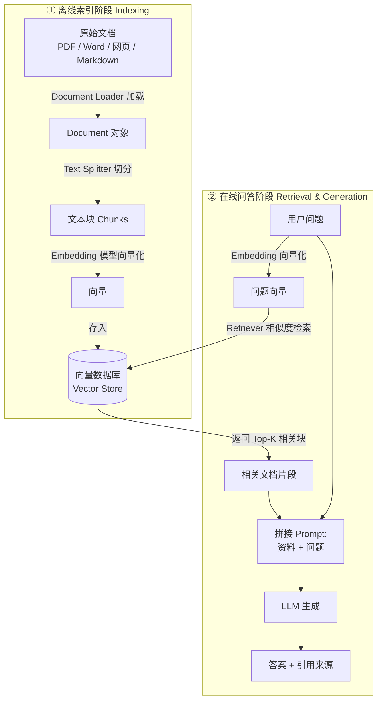
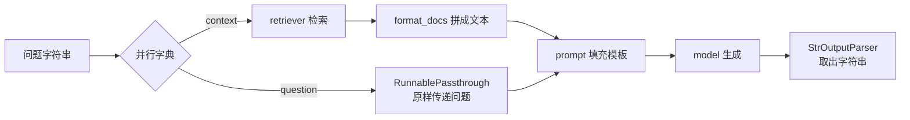

# 06 · RAG 检索增强生成

> **本章目标**：从零搭建一个"基于你自己文档回答问题"的知识库问答系统，理解 RAG 的每一个环节（加载 → 切分 → 向量化 → 存储 → 检索 → 生成），并掌握常用的效果优化手段。
>
> **前置知识**：[00 章](./00-基础概念与术语表.md)中的 Embedding、向量数据库、RAG 概念；[03 章](./03-提示词模板与结构化输出.md)的提示词模板；[04 章](./04-LCEL与Runnable链式编排.md)的 LCEL 管道语法。

---

## 一、RAG 回顾：为什么要"开卷考试"

> 💡 **通俗理解**：大模型像一个博学但没进过你们公司的顾问。问它"我们公司年假几天"，它要么说不知道，要么瞎编（幻觉）。RAG 的做法是：**先去资料柜里翻出相关的几页纸，递给顾问，让他照着资料回答。**

为什么不直接把所有文档塞进 Prompt？

| 方案 | 问题 |
|---|---|
| 把全部文档塞进 Prompt | 文档动辄几百万字，超出上下文窗口；即使放得下，也又贵又慢，模型还容易"看漏" |
| 微调（Fine-tuning）模型 | 成本高、周期长，文档一更新就要重新训练，且仍然可能幻觉 |
| **RAG** | **每次只取最相关的几段**，便宜、快、文档随时更新、还能给出引用来源 ✅ |

> 🎯 **应用场景**：
> - **企业知识库**：员工手册、报销制度、IT 运维文档
> - **智能客服**：产品说明书、FAQ、售后政策
> - **专业领域助手**：法律条文、医学指南、财报分析
> - **开发者文档问答**：API 文档、内部技术 Wiki
> - **个人知识管理**：笔记、论文、读书摘录

---

## 二、RAG 全流程

RAG 分为两个阶段：**离线建索引**（提前做一次，文档更新时再做）和**在线问答**（每次用户提问都执行）。



下面逐个环节讲解，第八节再把它们组装起来。

先安装本章需要的依赖：

```bash
uv add langchain langchain-deepseek langchain-huggingface sentence-transformers langchain-community \
       langchain-text-splitters langchain-chroma pypdf beautifulsoup4 python-dotenv
```

---

## 三、第 1 步：加载文档（Document Loader）

### 3.1 Document 对象

> 📖 **术语**：**Document**：LangChain 中表示"一段文档"的标准对象，只有两个核心字段：
> - `page_content`：文本内容（字符串）
> - `metadata`：元数据（字典），记录来源、页码、作者、日期等附加信息

```python
from langchain_core.documents import Document

doc = Document(
    page_content="员工入职满一年后，每年享有 5 天带薪年假。",
    metadata={"source": "员工手册.pdf", "page": 12, "department": "HR"},
)
print(doc.page_content)
print(doc.metadata)
```

> 💡 **metadata 很重要**：它不参与语义检索，但能用来**标注引用来源**（"答案来自员工手册第 12 页"）和**过滤检索范围**（"只在 HR 部门的文档里找"）。

### 3.2 常用加载器

> 📖 **术语**：**Document Loader（文档加载器）**：把各种格式的文件读取成 `Document` 列表的组件。LangChain 社区提供了上百种加载器。

```python
from langchain_community.document_loaders import PyPDFLoader, TextLoader, WebBaseLoader

# 纯文本 / Markdown
docs = TextLoader("data/员工手册.md", encoding="utf-8").load()

# PDF：每一页生成一个 Document，metadata 自动带上 page 页码
docs = PyPDFLoader("data/产品说明书.pdf").load()
print(len(docs), docs[0].metadata)  # 例如 32 {'source': 'data/产品说明书.pdf', 'page': 0, ...}

# 网页（需要 beautifulsoup4）
docs = WebBaseLoader("https://python.langchain.com/docs/introduction/").load()
```

批量加载整个目录：

```python
from langchain_community.document_loaders import DirectoryLoader, TextLoader

loader = DirectoryLoader(
    "data/",
    glob="**/*.md",                       # 匹配所有子目录下的 md 文件
    loader_cls=TextLoader,
    loader_kwargs={"encoding": "utf-8"},
)
docs = loader.load()
```

常见格式与加载器速查：

| 格式 | 加载器 | 依赖包 |
|---|---|---|
| `.txt` / `.md` | `TextLoader` | 无 |
| `.pdf` | `PyPDFLoader` | `pypdf` |
| `.docx` | `Docx2txtLoader` | `docx2txt` |
| `.csv` | `CSVLoader`（每行一个 Document） | 无 |
| 网页 | `WebBaseLoader` | `beautifulsoup4` |
| 复杂排版 PDF / 扫描件 / 表格 | `UnstructuredLoader` 等 | `langchain-unstructured` |

> ⚠️ **注意**：
> - **扫描版 PDF 是图片**，普通加载器读出来是空的，需要 OCR（文字识别）工具。
> - 表格、多栏排版的 PDF 解析效果参差不齐，**加载完一定要打印几条 `page_content` 检查**。"垃圾进，垃圾出"——RAG 效果差，一半原因出在文档解析上。

---

## 四、第 2 步：切分文档（Text Splitter）

### 4.1 为什么要切分

> 📖 **术语**：**Chunk（文本块）**：把长文档切成的一小段一小段。检索时以 Chunk 为单位返回。

- **太长**：一个 Chunk 包含多个主题，向量"语义模糊"，检索不准；塞给模型也浪费 Token。
- **太短**：一句话被切成两半，丢失上下文，模型看不懂。

> 💡 **通俗理解**：像给一本书做索引卡片。一张卡片写一整章，查找时不知道具体在哪；一张卡片只写半句话，看了也不明白。**每张卡片最好讲清楚一个完整的知识点。**

### 4.2 RecursiveCharacterTextSplitter（最常用）

> 📖 **术语**：**RecursiveCharacterTextSplitter（递归字符切分器）**：按照一组分隔符的优先级"递归"地切分——先尝试按段落切，段落还太长就按句子切，句子还太长再按字符切，尽量保证语义完整。

```python
from langchain_core.documents import Document
from langchain_text_splitters import RecursiveCharacterTextSplitter

text = """第三章 休假制度

3.1 年假
员工入职满一年后，每年享有 5 天带薪年假。入职满五年后，年假增加至 10 天。年假需提前 3 个工作日在 OA 系统申请。

3.2 病假
员工因病需要休假的，应提供二级以上医院的病假证明。病假期间工资按基本工资的 80% 发放。
"""

splitter = RecursiveCharacterTextSplitter(
    chunk_size=100,       # 每块最多 100 个字符
    chunk_overlap=20,     # 相邻块重叠 20 个字符
    separators=["\n\n", "\n", "。", "！", "？", "；", "，", " ", ""],  # 中文友好的分隔符
)

chunks = splitter.split_documents([Document(page_content=text, metadata={"source": "员工手册.md"})])
for i, c in enumerate(chunks):
    print(f"--- Chunk {i} ({len(c.page_content)} 字) ---\n{c.page_content}")
```

切分后每个 Chunk 会**继承原文档的 metadata**，所以来源信息不会丢。

> ⚠️ **注意**：默认分隔符是 `["\n\n", "\n", " ", ""]`，是为英文设计的。中文没有空格分词，**一定要加上 `。！？；，` 等中文标点**，否则长段落会被从句子中间硬切。

### 4.3 两个参数怎么选

> 📖 **术语**：
> - **chunk_size**：每个块的最大长度（默认按字符数计算）。
> - **chunk_overlap**：相邻两块之间重叠的长度，防止关键信息恰好被切断在两块交界处。

| 文档类型 | 建议 chunk_size（中文字符） | 建议 overlap |
|---|---|---|
| FAQ、短条目 | 200~400 | 0~50 |
| 规章制度、产品手册 | 400~800 | 50~100 |
| 论文、长篇技术文档 | 800~1500 | 100~200 |

经验法则：**overlap 取 chunk_size 的 10%~20%**。最终数值要用真实问题测试调整（见第十一节评估）。

### 4.4 按文档结构切分

Markdown、HTML、代码等有结构的文档，可以按标题层级切分，效果通常更好：

```python
from langchain_text_splitters import MarkdownHeaderTextSplitter

md = """# 员工手册
## 休假制度
### 年假
入职满一年享有 5 天年假。
### 病假
需提供病假证明。
## 报销制度
单笔超过 5000 元需总监审批。
"""

splitter = MarkdownHeaderTextSplitter(
    headers_to_split_on=[("#", "h1"), ("##", "h2"), ("###", "h3")]
)
for d in splitter.split_text(md):
    print(d.metadata, "→", d.page_content)
# {'h1': '员工手册', 'h2': '休假制度', 'h3': '年假'} → 入职满一年享有 5 天年假。
# ...
```

标题自动进入 metadata，既能用于过滤，也能在回答时说明"出自《休假制度 - 年假》"。如果某一节仍然很长，可以对结果再用 `RecursiveCharacterTextSplitter` 二次切分。

> 🎯 **应用场景**：内部 Wiki、技术文档、Notion 导出的 Markdown，都非常适合按标题切分。

---

## 五、第 3 步：向量化（Embeddings）

> 📖 **术语**：**Embedding 模型**：专门把文本转成向量的模型，和聊天模型是两类东西。同一个知识库的**入库和查询必须用同一个 Embedding 模型**，否则"坐标系"不一致，检索结果毫无意义。

### 5.1 本地免费：HuggingFace 开源模型（本教程默认）

> 💡 **DeepSeek 不提供 Embedding 模型**，聊天模型和 Embedding 模型分属不同厂商很常见，两者可以随意搭配。本教程学习阶段统一用本地 BGE 模型：免费、不需要额外的 Key、国内可用。

```bash
uv add langchain-huggingface sentence-transformers
```

> ⚠️ **注意**：`sentence-transformers` 会连带安装 PyTorch，首次安装约 1GB，耐心等待即可。

```python
from langchain_huggingface import HuggingFaceEmbeddings

# 智源 BGE 中文小模型，约 100MB，首次运行自动下载，CPU 即可运行
embeddings = HuggingFaceEmbeddings(model_name="BAAI/bge-small-zh-v1.5")
```

> 💡 国内下载 HuggingFace 模型慢时，可以设置环境变量 `HF_ENDPOINT=https://hf-mirror.com` 使用镜像。

### 5.2 国内替代：通义千问 Embedding（OpenAI 兼容接口）

```python
import os

from dotenv import load_dotenv
from langchain_openai import OpenAIEmbeddings

load_dotenv()

embeddings = OpenAIEmbeddings(
    model="text-embedding-v4",
    base_url="https://dashscope.aliyuncs.com/compatible-mode/v1",
    api_key=os.environ["DASHSCOPE_API_KEY"],
    check_embedding_ctx_length=False,  # 关闭 OpenAI 专用的 tiktoken 预切分，兼容接口需要
)
```

> ⚠️ **注意**：模型名和参数以阿里云百炼控制台文档为准。如果遇到"输入格式错误"之类的报错，通常就是没加 `check_embedding_ctx_length=False`。也可以安装 `langchain-community` 使用 `DashScopeEmbeddings`。

### 5.3 OpenAI Embeddings

```python
from dotenv import load_dotenv
from langchain_openai import OpenAIEmbeddings

load_dotenv()

embeddings = OpenAIEmbeddings(model="text-embedding-3-small")  # 需要 OPENAI_API_KEY

vec = embeddings.embed_query("年假有几天？")
print(len(vec), vec[:5])  # 1536 [0.0123, -0.0456, ...]

vecs = embeddings.embed_documents(["文档一", "文档二"])  # 批量向量化
```

> 💡 需要境外网络和 `OPENAI_API_KEY`，`uv add langchain-openai`。

### 5.4 如何选择

| 方案 | 优点 | 缺点 | 适合 |
|---|---|---|---|
| BGE 等本地模型（**教程默认**） | 免费、数据不出本机 | 占资源，大模型需 GPU | 学习、数据敏感场景 |
| 通义 / 智谱等国内 API | 中文效果好、国内访问快 | 按量计费 | 国内生产项目 |
| OpenAI `text-embedding-3-small` | 效果好、便宜、多语言 | 需境外网络 | 海外项目 |

---

## 六、第 4 步：存入向量数据库（Vector Store）

### 6.1 InMemoryVectorStore：学习用

```python
from dotenv import load_dotenv
from langchain_core.documents import Document
from langchain_core.vectorstores import InMemoryVectorStore
from langchain_huggingface import HuggingFaceEmbeddings

load_dotenv()

embeddings = HuggingFaceEmbeddings(model_name="BAAI/bge-small-zh-v1.5")
vector_store = InMemoryVectorStore(embeddings)

docs = [
    Document("员工入职满一年后，每年享有 5 天带薪年假。", metadata={"source": "员工手册", "category": "休假"}),
    Document("病假需提供二级以上医院证明，工资按 80% 发放。", metadata={"source": "员工手册", "category": "休假"}),
    Document("单笔报销超过 5000 元需部门总监审批。", metadata={"source": "财务制度", "category": "报销"}),
    Document("差旅住宿标准：一线城市每晚不超过 500 元。", metadata={"source": "财务制度", "category": "报销"}),
]
vector_store.add_documents(docs)  # 内部自动调用 embeddings 向量化

results = vector_store.similarity_search("我能休几天假？", k=2)
for doc in results:
    print(doc.metadata["source"], "|", doc.page_content)

# 带相似度分数
for doc, score in vector_store.similarity_search_with_score("出差住酒店能报多少？", k=2):
    print(f"{score:.3f}", doc.page_content)
```

> ⚠️ **注意**：`InMemoryVectorStore` 的数据在程序退出后就消失了，每次都要重新向量化（花钱、花时间），**只适合学习和测试**。

### 6.2 Chroma：本地持久化

> 📖 **术语**：**Chroma**：一个轻量级开源向量数据库，可以直接把数据存在本地文件夹里，无需单独部署服务，非常适合中小型项目。

```python
from dotenv import load_dotenv
from langchain_chroma import Chroma
from langchain_huggingface import HuggingFaceEmbeddings

load_dotenv()

vector_store = Chroma(
    collection_name="company_kb",            # 集合名，类似数据库里的"表"
    embedding_function=HuggingFaceEmbeddings(model_name="BAAI/bge-small-zh-v1.5"),
    persist_directory="./chroma_db",          # 数据保存到本地目录，重启后仍在
)

# 首次运行时入库；之后再运行可以直接检索
# vector_store.add_documents(chunks, ids=[...])

print(vector_store.similarity_search("年假", k=2))
```

> ⚠️ **注意**：重复运行 `add_documents` 会**重复入库**。生产中应给每个 Chunk 指定稳定的 `ids`（例如 `文件路径 + 块序号` 的哈希），重复写入时会覆盖而不是新增。

### 6.3 向量数据库选型

| 数据库 | 类型 | 适合 |
|---|---|---|
| `InMemoryVectorStore` | 内存 | 学习、单元测试 |
| Chroma / FAISS | 本地嵌入式 | 原型、个人项目、小规模（十万级 Chunk 以内） |
| PostgreSQL + pgvector | 数据库插件 | 已有 PG 的团队，向量和业务数据放一起 |
| Milvus / Qdrant / Weaviate | 独立服务 | 大规模生产、需要高并发和分布式 |
| Elasticsearch / OpenSearch | 搜索引擎 | 需要**关键词 + 向量混合检索** |

LangChain 对它们提供了**统一接口**（`add_documents`、`similarity_search`、`as_retriever`），换数据库基本只改初始化那几行。

---

## 七、第 5 步：检索器（Retriever）

> 📖 **术语**：**Retriever（检索器）**：一个标准接口——输入一个问题字符串，输出相关 `Document` 列表。它是一个 Runnable（第 04 章），所以可以直接放进 LCEL 管道。

```python
retriever = vector_store.as_retriever(
    search_type="similarity",   # 检索方式
    search_kwargs={"k": 4},     # 返回 4 条
)
docs = retriever.invoke("年假怎么申请？")
```

### 7.1 三种检索方式

| `search_type` | 说明 | 何时用 |
|---|---|---|
| `"similarity"`（默认） | 返回最相似的 k 条 | 大多数情况 |
| `"mmr"` | 在相似的基础上**兼顾多样性**，避免返回 4 条几乎一样的内容 | 文档重复度高（多版本制度、相似 FAQ） |
| `"similarity_score_threshold"` | 只返回相似度高于阈值的结果 | 宁可说"不知道"也不要返回不相关内容 |

> 📖 **术语**：**MMR（Maximal Marginal Relevance，最大边际相关性）**：先找出最相关的 `fetch_k` 条候选，再从中挑出"彼此不太像"的 `k` 条。

```python
# MMR：从 20 条候选中挑出 4 条既相关又不重复的
retriever = vector_store.as_retriever(
    search_type="mmr",
    search_kwargs={"k": 4, "fetch_k": 20},
)

# 相似度阈值
retriever = vector_store.as_retriever(
    search_type="similarity_score_threshold",
    search_kwargs={"score_threshold": 0.5, "k": 4},
)
```

### 7.2 元数据过滤

```python
# Chroma 的过滤语法：只在"报销"类文档中检索
retriever = vector_store.as_retriever(
    search_kwargs={"k": 3, "filter": {"category": "报销"}}
)
```

> ⚠️ **注意**：不同向量库的 `filter` 语法不一样（Chroma 用字典，`InMemoryVectorStore` 用一个接收 `Document` 返回布尔值的函数，Qdrant / Milvus 各有自己的表达式），使用前查对应集成的文档。

> 🎯 **应用场景**：
> - **多租户 / 权限**：`filter={"tenant_id": 当前用户公司}`，A 公司员工永远查不到 B 公司的文档。**这是 RAG 系统最重要的安全措施之一。**
> - **按产品线、版本、年份**：用户在"iPhone 16"页面提问，只检索该型号的说明书。

---

## 八、第 6 步：组装 RAG 链（LCEL）

现在把所有环节组装起来。

### 8.1 基础版

```python
from dotenv import load_dotenv
from langchain.chat_models import init_chat_model
from langchain_core.documents import Document
from langchain_core.output_parsers import StrOutputParser
from langchain_core.prompts import ChatPromptTemplate
from langchain_core.runnables import RunnablePassthrough
from langchain_core.vectorstores import InMemoryVectorStore
from langchain_huggingface import HuggingFaceEmbeddings

load_dotenv()

# ---------- 准备知识库 ----------
vector_store = InMemoryVectorStore(HuggingFaceEmbeddings(model_name="BAAI/bge-small-zh-v1.5"))
vector_store.add_documents([
    Document("员工入职满一年后，每年享有 5 天带薪年假；满五年后增加至 10 天。", metadata={"source": "员工手册 3.1"}),
    Document("年假需提前 3 个工作日在 OA 系统提交申请，由直属上级审批。", metadata={"source": "员工手册 3.1"}),
    Document("单笔报销超过 5000 元需部门总监审批。", metadata={"source": "财务制度 2.4"}),
])
retriever = vector_store.as_retriever(search_kwargs={"k": 3})

# ---------- 提示词 ----------
prompt = ChatPromptTemplate.from_messages([
    ("system",
     "你是公司内部知识库助手。请**只根据**下面提供的参考资料回答问题。\n"
     "如果资料中没有答案，直接回答\"知识库中没有找到相关信息\"，不要编造。\n\n"
     "参考资料：\n{context}"),
    ("human", "{question}"),
])


def format_docs(docs: list[Document]) -> str:
    return "\n\n".join(f"[{d.metadata['source']}] {d.page_content}" for d in docs)


model = init_chat_model("deepseek:deepseek-flash", extra_body={"thinking": {"type": "disabled"}}, temperature=0)

# ---------- 组装 ----------
rag_chain = (
    {"context": retriever | format_docs, "question": RunnablePassthrough()}
    | prompt
    | model
    | StrOutputParser()
)

print(rag_chain.invoke("我入职两年了，有几天年假？怎么申请？"))
print(rag_chain.invoke("公司食堂几点开饭？"))  # 应回答"没有找到相关信息"
```

逐段理解这条链：



> 💡 回顾第 04 章：字典 `{...}` 在 LCEL 里会被自动转成 `RunnableParallel`，两个分支同时拿到"问题字符串"作为输入。

> ⚠️ **注意**：网上旧教程里的 `RetrievalQA`、`ConversationalRetrievalChain`、`create_retrieval_chain` 等都是 0.x 时代的写法，**已废弃（移入 `langchain-classic`）**。1.x 推荐用上面的 LCEL 自己组装，或者用第九节的 Agentic RAG。

### 8.2 进阶版：返回结构化答案 + 引用来源

只返回一段文字，前端很难展示"引用来源"。结合第 03 章的结构化输出：

```python
from pydantic import BaseModel, Field
from langchain_core.runnables import RunnableParallel


class AnswerWithSources(BaseModel):
    answer: str = Field(description="对用户问题的回答")
    sources: list[str] = Field(description="回答所依据的资料来源，例如 ['员工手册 3.1']")
    found: bool = Field(description="参考资料中是否找到了答案")


structured_model = model.with_structured_output(AnswerWithSources)

rag_chain_with_sources = (
    RunnableParallel(context=retriever | format_docs, question=RunnablePassthrough())
    | prompt
    | structured_model
)

result = rag_chain_with_sources.invoke("年假怎么申请？")
print(result.answer)
print("来源：", result.sources)
print("是否命中：", result.found)
```

> 🎯 **应用场景**：前端可以把 `sources` 渲染成可点击的引用标签；`found=False` 时显示"转人工客服"按钮，或记录下来作为知识库的补充清单。

---

## 九、Agentic RAG：把检索变成 Agent 的工具

第八节的链是"**每次都检索**"的固定流程。但真实对话中：

- 用户说"你好"、"谢谢"——根本不需要检索；
- 用户问"年假和病假分别怎么规定？"——最好检索两次；
- 第一次检索结果不理想——应该换个关键词再查。

> 📖 **术语**：**Agentic RAG**：把"检索知识库"做成一个**工具**交给 Agent，由模型自己决定**要不要查、查什么、查几次**。

```python
from dotenv import load_dotenv
from langchain.agents import create_agent
from langchain.tools import tool
from langchain_core.documents import Document
from langchain_core.vectorstores import InMemoryVectorStore
from langchain_huggingface import HuggingFaceEmbeddings
from langchain.chat_models import init_chat_model

load_dotenv()

vector_store = InMemoryVectorStore(HuggingFaceEmbeddings(model_name="BAAI/bge-small-zh-v1.5"))
vector_store.add_documents([
    Document("员工入职满一年后，每年享有 5 天带薪年假；满五年后增加至 10 天。", metadata={"source": "员工手册 3.1"}),
    Document("病假需提供二级以上医院证明，工资按 80% 发放。", metadata={"source": "员工手册 3.2"}),
    Document("单笔报销超过 5000 元需部门总监审批。", metadata={"source": "财务制度 2.4"}),
])


@tool
def search_company_docs(query: str) -> str:
    """在公司内部知识库（员工手册、财务制度等）中检索相关条款。
    回答任何关于公司制度、流程、福利的问题前，都应先调用此工具。
    query 应是简洁的检索关键词或问题，复杂问题可拆成多次检索。
    """
    docs = vector_store.similarity_search(query, k=3)
    return "\n\n".join(f"[{d.metadata['source']}] {d.page_content}" for d in docs)


agent = create_agent(
    model=init_chat_model("deepseek:deepseek-flash", extra_body={"thinking": {"type": "disabled"}}),
    tools=[search_company_docs],
    system_prompt="你是公司 HR 助手。回答制度问题必须基于知识库检索结果，并注明来源；查不到就如实说明。",
)

result = agent.invoke({"messages": [{"role": "user", "content": "年假和病假分别是怎么规定的？"}]})
print(result["messages"][-1].content)
```

观察 LangSmith 追踪，你会看到模型可能分别检索了"年假规定"和"病假规定"两次。

| 对比 | 固定 RAG 链 | Agentic RAG |
|---|---|---|
| 检索时机 | 每次都检索 | 模型按需决定 |
| 检索次数 | 固定 1 次 | 0 次到多次 |
| 速度 / 成本 | 快、便宜、可预测 | 稍慢，多一轮或几轮模型调用 |
| 复杂问题 | 一般 | 好（能拆解、能重试） |
| 适合 | 单一问答框、搜索框 | 对话式助手、复杂问题 |

> 💡 `create_agent` 的细节在[第 07 章](./07-Agent智能体-create_agent.md)讲解；带"检索结果评分 → 不相关就改写问题重查"的完整 Agentic RAG 流程，会在[第 11 章实战项目](./11-实战项目.md)里用 LangGraph 实现。

---

## 十、进阶优化：让 RAG 更准

做出能跑的 RAG 很容易，做出**好用**的 RAG 难。下面是最常用的优化手段，按"投入产出比"从高到低排列。


### 10.1 先优化数据（最重要）

- 检查文档解析质量：表格、页眉页脚、乱码。
- 选择合适的切分策略和 chunk_size（第四节）。
- 给 Chunk 补充上下文：例如在每块开头加上"《员工手册》-第三章 休假制度："，让孤立的片段也有主题。
- 补充丰富的 metadata：来源、章节、日期、部门、产品型号……

### 10.2 元数据过滤

先缩小范围、再做语义检索（见 7.2 节）。在多产品、多版本、多租户场景中，效果提升往往比换模型还明显。

> 💡 本节的代码片段承接第八节 8.1 的示例（复用其中的 `vector_store`、`retriever`、`model`、`prompt` 等变量），`chunks` 指第四节切分得到的文本块列表。

### 10.3 混合检索（Hybrid Search）

> 📖 **术语**：**混合检索**：同时使用**关键词检索**（如 BM25 算法，擅长精确匹配型号、编号、专有名词）和**向量检索**（擅长理解语义），再合并结果。

> 💡 **为什么需要**：用户搜 "错误码 E1024"，向量检索可能返回一堆"错误处理"相关内容，却漏掉恰好包含 "E1024" 的那一条；关键词检索正好补上这个短板。

```python
# uv add rank_bm25
from langchain_community.retrievers import BM25Retriever

bm25_retriever = BM25Retriever.from_documents(chunks, k=4)   # 关键词检索
vector_retriever = vector_store.as_retriever(search_kwargs={"k": 4})


def hybrid_search(query: str):
    """合并两路结果并去重（简化版；生产中常用 RRF 倒数排名融合算法打分）"""
    seen, merged = set(), []
    for doc in bm25_retriever.invoke(query) + vector_retriever.invoke(query):
        if doc.page_content not in seen:
            seen.add(doc.page_content)
            merged.append(doc)
    return merged
```

> ⚠️ **注意**：`BM25Retriever` 默认按空格分词，**对中文效果差**，需要通过 `preprocess_func` 参数传入中文分词函数（例如 `jieba.lcut`）。生产环境更推荐直接用原生支持混合检索的数据库（Elasticsearch、Milvus、Qdrant、Weaviate 等）。

### 10.4 查询改写 / 多查询（Query Rewriting / Multi-Query）

用户的提问往往口语化、不完整（"那个报销多少要领导批来着？"）。可以先让模型把问题改写成更适合检索的形式，甚至生成多个不同角度的问题分别检索：

```python
from pydantic import BaseModel, Field


class Queries(BaseModel):
    queries: list[str] = Field(description="3 个用于检索的不同表述的问题")


query_gen = (
    ChatPromptTemplate.from_template(
        "把用户问题改写成 3 个适合在公司制度文档中检索的、表述不同的问题。\n用户问题：{question}"
    )
    | model.with_structured_output(Queries)
)


def multi_query_retrieve(question: str) -> list[Document]:
    queries = query_gen.invoke({"question": question}).queries
    seen, docs = set(), []
    for q in [question, *queries]:
        for d in retriever.invoke(q):
            if d.page_content not in seen:
                seen.add(d.page_content)
                docs.append(d)
    return docs
```

> 🎯 **应用场景**：多轮对话中特别有用。用户问"那病假呢？"——单独检索这句话毫无意义，需要结合历史改写成"公司病假制度是怎样的？"再检索。

### 10.5 Rerank（重排序）

> 📖 **术语**：**Rerank（重排序）**：向量检索速度快但不够精确。可以先粗检索出 20~50 条，再用专门的**重排序模型（Cross-Encoder）** 逐条精确打分，留下最相关的 3~5 条。

> 💡 **通俗理解**：海选 + 复试。向量检索负责快速海选，Rerank 模型负责仔细面试。

常见的 Rerank 服务 / 模型：Cohere Rerank（`langchain-cohere`）、Jina Reranker、智源 `bge-reranker`（可本地部署）、阿里 `gte-rerank`。

```python
# 以 Cohere 为例：uv add langchain-cohere，需要 COHERE_API_KEY
from langchain_cohere import CohereRerank

reranker = CohereRerank(model="rerank-v3.5", top_n=4)
candidates = vector_store.as_retriever(search_kwargs={"k": 20}).invoke("年假怎么申请")
best_docs = reranker.compress_documents(candidates, query="年假怎么申请")
```

### 10.6 父子文档（Parent-Child / Small-to-Big）

> 📖 **术语**：用**小块**做检索（语义精准），但返回给模型时换成它所属的**大块**（上下文完整）。

> 💡 **通俗理解**：用书的"索引关键词"精准定位，然后把**整页**撕下来给模型看，而不是只给那一行。

实现思路：切分时给每个小块记录 `parent_id`（metadata），检索到小块后，按 `parent_id` 去文档库里取出完整的父块。LangChain 的 `langchain-classic` 中有现成的 `ParentDocumentRetriever`，但自己用 metadata 实现更灵活，也更好理解。

### 10.7 优化手段速查

| 症状 | 可能原因 | 优化手段 |
|---|---|---|
| 搜不到明明存在的内容 | 关键词/编号类问题、问题表述差异大 | 混合检索、查询改写、多查询 |
| 搜到了但排序靠后 | 向量检索精度不够 | Rerank |
| 检索结果高度重复 | 相似文档多 | MMR |
| 检索到的片段"没头没尾" | 切分太碎 | 增大 chunk_size、父子文档、按标题切分 |
| 检索到了其他产品 / 其他客户的资料 | 没有范围限制 | 元数据过滤 |
| 资料是对的，回答还是错 | 提示词不够约束、资料太多太杂 | 强化提示词、减少 k、要求引用 |

---

## 十一、RAG 效果评估

"感觉好像变好了"不算数。改了 chunk_size、换了 Embedding 模型之后，需要有数据说明效果。

### 11.1 准备评估集

整理 30~100 个**真实用户会问的问题**，并标注标准答案和应该命中的文档：

```python
eval_set = [
    {"question": "入职两年有几天年假？", "answer": "5 天", "source": "员工手册 3.1"},
    {"question": "报销 6000 元要谁批？", "answer": "部门总监", "source": "财务制度 2.4"},
    # ...
]
```

### 11.2 关键指标

| 环节 | 指标 | 含义 |
|---|---|---|
| 检索 | **命中率（Hit Rate / Recall@K）** | 正确的文档有没有出现在前 K 条结果中 |
| 检索 | **MRR**（平均倒数排名） | 正确文档排得有多靠前 |
| 生成 | **忠实度（Faithfulness）** | 回答是否完全基于检索到的资料，有没有编造 |
| 生成 | **答案相关性（Answer Relevance）** | 回答是否切中问题 |
| 生成 | **正确率** | 和标准答案是否一致（常用"LLM 当裁判"自动打分） |

```python
# 最简单的检索命中率评估
hits = 0
for item in eval_set:
    docs = retriever.invoke(item["question"])
    if any(d.metadata["source"] == item["source"] for d in docs):
        hits += 1
print(f"命中率：{hits / len(eval_set):.0%}")
```

> 💡 **先评估检索，再评估生成**。检索都没找对，生成环节再怎么调也没用。更系统的评估方法（LangSmith 数据集、LLM-as-Judge、Ragas 等工具）见[第 12 章](./12-调试评估与生产部署.md)。

---

## 十二、综合示例：可持久化的企业知识库问答

把本章内容串成一个可以直接改造使用的小项目：**读取 `data/` 目录下的 Markdown 和 PDF → 切分 → 存入本地 Chroma → 带来源的问答**。

```
kb_demo/
├── .env
├── data/
│   ├── 员工手册.md
│   └── 产品说明书.pdf
├── ingest.py      # 建索引（文档更新时运行）
└── ask.py         # 问答
```

**`ingest.py`**：

```python
import hashlib
from pathlib import Path

from dotenv import load_dotenv
from langchain_chroma import Chroma
from langchain_community.document_loaders import PyPDFLoader, TextLoader
from langchain_huggingface import HuggingFaceEmbeddings
from langchain_text_splitters import RecursiveCharacterTextSplitter

load_dotenv()

DATA_DIR = Path("data")


def load_all():
    docs = []
    for path in DATA_DIR.rglob("*"):
        if path.suffix == ".md":
            docs += TextLoader(str(path), encoding="utf-8").load()
        elif path.suffix == ".pdf":
            docs += PyPDFLoader(str(path)).load()
    return docs


splitter = RecursiveCharacterTextSplitter(
    chunk_size=500,
    chunk_overlap=80,
    separators=["\n\n", "\n", "。", "！", "？", "；", "，", " ", ""],
)

docs = load_all()
chunks = splitter.split_documents(docs)

# 每块给稳定 ID：同一文件同一位置重复入库时覆盖，而不是新增
ids = []
for i, c in enumerate(chunks):
    c.metadata["chunk_index"] = i
    raw = f"{c.metadata['source']}-{c.metadata.get('page', 0)}-{c.page_content}"
    ids.append(hashlib.md5(raw.encode()).hexdigest())

vector_store = Chroma(
    collection_name="company_kb",
    embedding_function=HuggingFaceEmbeddings(model_name="BAAI/bge-small-zh-v1.5"),
    persist_directory="./chroma_db",
)
vector_store.add_documents(chunks, ids=ids)
print(f"已入库：{len(docs)} 个文档，{len(chunks)} 个文本块")
```

**`ask.py`**：

```python
from dotenv import load_dotenv
from langchain.chat_models import init_chat_model
from langchain_chroma import Chroma
from langchain_core.documents import Document
from langchain_core.prompts import ChatPromptTemplate
from langchain_core.runnables import RunnableParallel, RunnablePassthrough
from langchain_huggingface import HuggingFaceEmbeddings
from pydantic import BaseModel, Field

load_dotenv()

vector_store = Chroma(
    collection_name="company_kb",
    embedding_function=HuggingFaceEmbeddings(model_name="BAAI/bge-small-zh-v1.5"),
    persist_directory="./chroma_db",
)
retriever = vector_store.as_retriever(search_type="mmr", search_kwargs={"k": 4, "fetch_k": 20})


class Answer(BaseModel):
    answer: str = Field(description="回答内容，使用中文，条理清晰")
    sources: list[str] = Field(description="引用的资料编号，例如 ['[1]', '[3]']")
    found: bool = Field(description="资料中是否包含答案")


def format_docs(docs: list[Document]) -> str:
    parts = []
    for i, d in enumerate(docs, 1):
        src = d.metadata.get("source", "未知")
        page = d.metadata.get("page")
        loc = f"{src} 第{page + 1}页" if page is not None else src
        parts.append(f"[{i}]（{loc}）\n{d.page_content}")
    return "\n\n".join(parts)


prompt = ChatPromptTemplate.from_messages([
    ("system",
     "你是企业知识库助手。只能依据参考资料回答，并在 sources 中列出引用的资料编号。\n"
     "资料不足以回答时，found 设为 false，answer 说明\"知识库中暂无相关信息\"。\n\n"
     "参考资料：\n{context}"),
    ("human", "{question}"),
])

model = init_chat_model("deepseek:deepseek-flash", extra_body={"thinking": {"type": "disabled"}}, temperature=0)

chain = (
    RunnableParallel(docs=retriever, question=RunnablePassthrough())
    | RunnableParallel(
        answer=(
            {"context": lambda x: format_docs(x["docs"]), "question": lambda x: x["question"]}
            | prompt
            | model.with_structured_output(Answer)
        ),
        docs=lambda x: x["docs"],  # 原始文档一并返回，方便展示引用详情
    )
)

if __name__ == "__main__":
    while True:
        q = input("\n请输入问题（q 退出）：").strip()
        if q == "q":
            break
        result = chain.invoke(q)
        ans: Answer = result["answer"]
        print("\n" + ans.answer)
        if ans.found:
            print("\n参考来源：")
            for ref in ans.sources:
                idx = int(ref.strip("[]")) - 1
                if 0 <= idx < len(result["docs"]):
                    print(f"  {ref} {result['docs'][idx].metadata.get('source')}")
```

这个示例用到了：多格式加载、中文切分、稳定 ID 去重入库、Chroma 持久化、MMR 检索、结构化输出、引用回溯。把 `data/` 换成你自己的文档，就是一个可用的内部知识库原型。

---

## 十三、常见问题

| 问题 | 排查思路 |
|---|---|
| **答非所问** | 先单独运行 `retriever.invoke(问题)` 看检索结果。检索错了 → 优化切分 / 混合检索 / 改写；检索对了 → 优化提示词 |
| **回答"资料中没有"，但明明有** | 检查文档是否解析成功（打印 `page_content`）、k 是否太小、是否被错误的 filter 过滤掉 |
| **切分不当，答案被截断** | 调大 chunk_size、加大 overlap、改用按标题切分、加中文分隔符 |
| **仍然有幻觉** | 提示词明确"只根据资料回答"；`temperature=0`；要求引用来源；用结构化输出加 `found` 字段兜底 |
| **换了 Embedding 模型后检索全乱了** | 入库和查询必须用同一个 Embedding 模型，换模型后**要全部重新入库** |
| **数据重复** | 入库时指定稳定 `ids`；文档更新时先删除旧文件对应的块 |
| **速度慢** | Embedding 批量入库；减小 k；缓存高频问题的答案；用更快的模型做查询改写 |
| **多轮对话中"它呢""那个呢"检索不到** | 先结合历史把问题改写成完整问题（10.4 节），或使用 Agentic RAG |

---

## 本章小结

- RAG = **离线建索引**（加载 → 切分 → 向量化 → 入库）+ **在线问答**（检索 → 拼 Prompt → 生成）。
- `Document` 由 `page_content` + `metadata` 组成，**metadata 用于引用来源和过滤**。
- 中文切分用 `RecursiveCharacterTextSplitter` 并**加上中文标点分隔符**；有结构的文档按标题切。
- **入库和查询必须使用同一个 Embedding 模型**；DeepSeek 不提供 Embedding，本教程用本地 BGE 模型。
- 学习用 `InMemoryVectorStore`，本地项目用 Chroma，生产按规模选 pgvector / Milvus / Qdrant 等。
- 用 **LCEL** 组装 RAG 链，配合结构化输出返回答案 + 引用；旧的 `RetrievalQA` 等已废弃。
- **Agentic RAG** 让模型自己决定何时检索、检索几次。
- 优化顺序：**数据质量 → 元数据过滤 → 混合检索 / 查询改写 → Rerank**，并用评估集量化效果。

## 练习

1. 准备 3~5 篇你自己的 Markdown 笔记，用第十二节的代码建一个个人知识库，问 5 个问题，记录哪些答对、哪些答错。
2. 对同一批文档，分别用 `chunk_size=200` 和 `chunk_size=1000` 建索引，比较同一组问题的检索结果有什么区别。
3. 给 6.1 节的示例加上元数据过滤，实现"只在财务制度中检索"。
4. 思考：一个面向多家企业客户的 SaaS 知识库产品，如何保证 A 公司的员工绝对检索不到 B 公司的文档？

<details>
<summary>参考答案</summary>

1. 答错的问题，先打印 `retriever.invoke(问题)` 的结果，判断是"检索没找到"还是"找到了但模型答错了"，再对症优化。
2. 小块检索更精确，但片段可能缺少上下文，回答不完整；大块上下文完整，但一个块混杂多个主题，排序可能不准、Token 消耗更大。通常需要在中间找平衡点，或使用父子文档策略。
3. `InMemoryVectorStore` 的 `filter` 接收函数：`vector_store.similarity_search("报销", k=2, filter=lambda doc: doc.metadata["source"] == "财务制度")`；Chroma 则使用 `filter={"source": "财务制度"}`。
4. 入库时每个 Chunk 写入 `tenant_id` 元数据；检索时 `filter` 中的 `tenant_id` **必须由后端根据登录态强制注入**，绝不能由用户输入或模型决定（参见第 05 章 `ToolRuntime` 的思路）。更严格的做法是每个租户使用独立的 collection 或独立的数据库。

</details>

---

**上一章** ← [05 工具调用](./05-工具调用.md) ｜ **下一章** → [07 Agent 智能体](./07-Agent智能体-create_agent.md)
