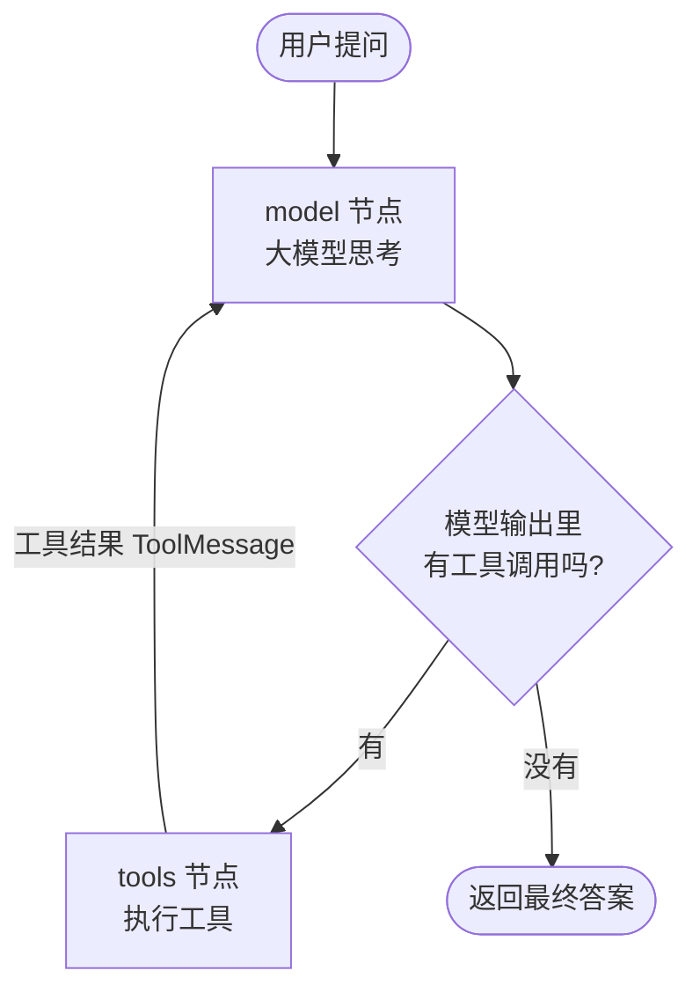
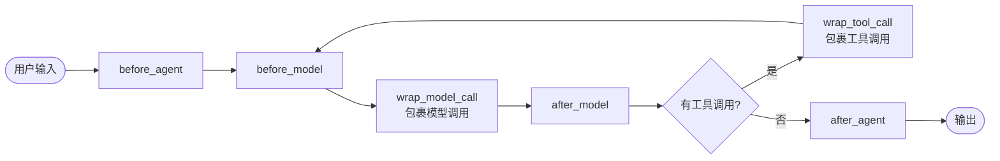
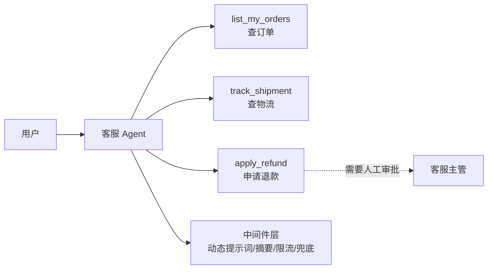

# 07 · Agent 智能体：create_agent

> **本章目标**：理解 Agent 的工作原理，用 LangChain 1.x 的 `create_agent` 搭建能自主调用工具、有多轮记忆、能结构化输出、可被中间件增强的智能体，并完成一个电商客服 Agent。
>
> **前置知识**：[02 模型与消息](./02-模型与消息.md)、[05 工具调用](./05-工具调用.md)。最好也看过 [06 RAG](./06-RAG检索增强生成.md)。

---

## 一、从"工具调用"到"Agent"

在第 05 章，我们手写过一个"工具调用循环"：

1. 把问题和工具列表发给模型；
2. 模型说"我要调用某个工具"；
3. 程序执行工具，把结果作为 `ToolMessage` 回传；
4. 重复，直到模型不再调用工具、直接给出答案。

**这个循环本身，就是 Agent 的核心。** `create_agent` 做的事情就是把这个循环封装好，并额外提供记忆、结构化输出、中间件等生产级能力。

> 📖 **术语**：**Agent（智能体）**——由大模型自主决定"下一步做什么、调用哪个工具、什么时候结束"的程序。和 Chain（链）的区别是：Chain 的步骤是写死的，Agent 的步骤是模型动态决定的。

> 💡 **通俗理解**：Chain 像自动售货机，投币 → 选货 → 出货，流程固定；Agent 像一个新来的实习生，你给他目标和一套工具（电话、电脑、公司系统账号），他自己决定先打哪个电话、查哪个系统，遇到问题换个办法，办完了来汇报。

### 1.1 Agent 循环原理



举个具体例子，用户问"我的订单 A1001 到哪了？如果还没发货就帮我取消"：

| 轮次 | 模型在想什么 | 动作 |
|---|---|---|
| 1 | 需要先知道订单状态 | 调用 `query_order("A1001")` |
| 2 | 工具返回"待发货"，用户要求未发货就取消 | 调用 `cancel_order("A1001")` |
| 3 | 工具返回"取消成功" | 不再调用工具，回复"已为您取消订单 A1001……" |

> 📖 **术语**：**ReAct（Reasoning + Acting）**——"思考 → 行动 → 观察结果 → 再思考"的循环模式，是目前最主流的 Agent 范式。`create_agent` 实现的就是 ReAct 模式。

### 1.2 create_agent 的底层是 LangGraph

`create_agent` 返回的对象其实是一个**编译好的 LangGraph 图**（`CompiledStateGraph`）。上面那张图里的 `model` 节点和 `tools` 节点，就是图里真实存在的两个节点。

这意味着：

- 它天然支持 LangGraph 的能力：持久化记忆、流式输出、人机协同、在 LangGraph Studio 中可视化；
- 学完第 08 章你会发现，自己用 LangGraph 也能写出一个一模一样的 Agent。

> ⚠️ **注意**：旧教程里常见的 `langgraph.prebuilt.create_react_agent` 和更早的 `initialize_agent`、`AgentExecutor`，**在 1.x 中都已被 `langchain.agents.create_agent` 取代**。新项目请统一使用 `create_agent`。

---

## 二、第一个 Agent

```python
from dotenv import load_dotenv
from langchain.agents import create_agent
from langchain.tools import tool
from langchain.chat_models import init_chat_model

load_dotenv()


@tool
def get_weather(city: str) -> str:
    """查询指定城市今天的天气。city 为城市中文名，例如“北京”。"""
    fake_db = {"北京": "小雨，18°C", "上海": "晴，26°C", "杭州": "多云，23°C"}
    return fake_db.get(city, f"暂无{city}的天气数据")


@tool
def calculator(expression: str) -> str:
    """计算一个数学表达式，例如 '3 * (4 + 5)'。"""
    # 仅为演示；生产环境不要对用户输入使用 eval
    return str(eval(expression, {"__builtins__": {}}))


agent = create_agent(
    model=init_chat_model("deepseek:deepseek-flash", extra_body={"thinking": {"type": "disabled"}}),
    tools=[get_weather, calculator],
    system_prompt="你是一个乐于助人的中文助手。需要实时信息或计算时，优先使用工具。",
)

result = agent.invoke(
    {"messages": [{"role": "user", "content": "北京和上海今天哪个更暖和？温差多少度？"}]}
)

# result 是最终状态，messages 里是完整的对话过程
for msg in result["messages"]:
    msg.pretty_print()
```

运行后你会看到类似这样的过程（`pretty_print` 会把每条消息格式化输出）：

```
================================ Human Message =================================
北京和上海今天哪个更暖和？温差多少度？
================================== Ai Message ==================================
Tool Calls:
  get_weather (call_1)  Args: city: 北京
  get_weather (call_2)  Args: city: 上海
================================= Tool Message =================================
小雨，18°C
================================= Tool Message =================================
晴，26°C
================================== Ai Message ==================================
Tool Calls:
  calculator (call_3)  Args: expression: 26 - 18
================================= Tool Message =================================
8
================================== Ai Message ==================================
上海更暖和（26°C），北京 18°C，温差 8 度。
```

注意几点：

- 模型**一次发起了两个并行工具调用**（北京和上海同时查），这是现代模型的常见能力。
- 最终答案在 `result["messages"][-1].content`。
- 工具的**文档字符串（docstring）非常重要**，模型就是靠它来判断"什么时候用这个工具、参数怎么填"的。

> 🎯 **应用场景**：任何"需要根据情况决定查什么、做什么"的助手——客服、运维助手、数据查询助手、个人效率助手。

---

## 三、create_agent 参数详解

```python
agent = create_agent(
    model=...,            # 必填：模型
    tools=[...],          # 工具列表
    system_prompt=...,    # 系统提示词
    response_format=...,  # 结构化输出格式
    checkpointer=...,     # 短期记忆（多轮对话）
    store=...,            # 长期记忆（第 09 章）
    state_schema=...,     # 自定义状态字段
    context_schema=...,   # 运行时上下文（如当前用户 ID）
    middleware=[...],     # 中间件
    name=...,             # Agent 名称（多 Agent 时有用）
)
```

### 3.1 model：字符串或模型实例

```python
from langchain.chat_models import init_chat_model

# 写法一：字符串（最简单）
# 但 DeepSeek 无法用这种写法关闭思考模式，一调用工具就会报 400，仅作了解
# agent = create_agent(model="deepseek:deepseek-flash", tools=[])

# 写法二：模型实例（本教程统一使用，可以自定义任意参数）
model = init_chat_model("deepseek:deepseek-flash", extra_body={"thinking": {"type": "disabled"}}, temperature=0, max_tokens=2000, timeout=30)
agent = create_agent(model=model, tools=[])
```

> 💡 换用 Claude 等不需要额外参数的模型时，字符串写法最省事，例如 `create_agent(model="anthropic:claude-sonnet-5", tools=[])`。为什么 DeepSeek 必须关闭思考模式，见 [01 章 4.1 节](./01-环境准备.md#41-deepseek本教程默认)。

### 3.2 tools：工具列表

可以传：

- 用 `@tool` 装饰的函数（推荐，能精细控制名称、描述、参数）；
- 普通 Python 函数（带类型注解和 docstring，会自动转换成工具）；
- 第 05 章学过的其他工具形式。

`tools=[]` 时，Agent 就退化成一个普通的聊天机器人（但依然享有记忆、中间件等能力）。

### 3.3 system_prompt：给 Agent 立规矩

```python
SYSTEM_PROMPT = """你是"小智"，某电商平台的售后客服。

## 职责
- 帮用户查询订单、物流，处理取消和退款申请。

## 规则
1. 涉及具体订单时，必须先调用工具查询，不能凭空编造订单信息。
2. 退款金额超过 500 元时，告知用户需人工审核。
3. 与售后无关的问题，礼貌拒绝。

## 风格
- 简洁、亲切，每次回复不超过 100 字。
"""
```

> 💡 好的系统提示词 = **身份 + 职责 + 规则 + 风格**。规则写得越具体，Agent 的行为越可控。

### 3.4 response_format：结构化输出

很多时候我们希望 Agent 最终返回的不是一段话，而是**程序能直接使用的数据**。

```python
from dotenv import load_dotenv
from pydantic import BaseModel, Field
from langchain.agents import create_agent
from langchain.tools import tool
from langchain.chat_models import init_chat_model

load_dotenv()


@tool
def search_company(name: str) -> str:
    """搜索公司的公开信息。"""
    return f"{name}：成立于 2015 年，总部杭州，员工约 1200 人，主营 SaaS 软件，2025 年营收约 8 亿元。"


class CompanyProfile(BaseModel):
    """公司画像"""
    name: str = Field(description="公司名称")
    founded_year: int = Field(description="成立年份")
    city: str = Field(description="总部城市")
    employees: int = Field(description="员工人数")
    business: str = Field(description="主营业务，10 字以内")


agent = create_agent(
    model=init_chat_model("deepseek:deepseek-flash", extra_body={"thinking": {"type": "disabled"}}),
    tools=[search_company],
    response_format=CompanyProfile,
)

result = agent.invoke({"messages": [{"role": "user", "content": "帮我整理一下“云帆科技”的公司画像"}]})

profile: CompanyProfile = result["structured_response"]
print(profile)
print(profile.employees + 100)  # 是真正的 int，可以直接参与计算
```

- 结构化结果在 **`result["structured_response"]`** 中，是一个 Pydantic 对象。
- Agent 会先正常调用工具收集信息，最后一步再按格式输出。

> 🎯 **应用场景**：信息抽取（简历解析、合同要素提取）、调研报告生成、表单自动填写、把 Agent 的结果写入数据库。

> 💡 LangChain 会根据模型能力自动选择实现方式：模型原生支持结构化输出时用原生能力（`ProviderStrategy`），否则用"伪装成工具调用"的方式（`ToolStrategy`）。一般无需关心，需要手动指定时可从 `langchain.agents.structured_output` 导入。

### 3.5 checkpointer + thread_id：多轮对话记忆

默认情况下，每次 `invoke` 都是全新的对话：

```python
agent.invoke({"messages": [{"role": "user", "content": "我叫小明"}]})
agent.invoke({"messages": [{"role": "user", "content": "我叫什么？"}]})  # 它不知道
```

要让它记住上下文，需要两样东西：

> 📖 **术语**：**Checkpointer（检查点保存器）**——在每一步执行后自动保存 Agent 的完整状态（包括所有消息）。下一次调用时，先把之前的状态读出来再继续。

> 📖 **术语**：**thread_id（会话线程 ID）**——区分不同对话的标识。同一个 `thread_id` 共享历史，不同的 `thread_id` 互不干扰。类似聊天软件里的"会话"。

```python
from dotenv import load_dotenv
from langchain.agents import create_agent
from langgraph.checkpoint.memory import InMemorySaver
from langchain.chat_models import init_chat_model

load_dotenv()

agent = create_agent(
    model=init_chat_model("deepseek:deepseek-flash", extra_body={"thinking": {"type": "disabled"}}),
    tools=[],
    checkpointer=InMemorySaver(),  # 存在内存里，程序退出就没了
)

config_a = {"configurable": {"thread_id": "user-a-session-1"}}
config_b = {"configurable": {"thread_id": "user-b-session-1"}}

agent.invoke({"messages": [{"role": "user", "content": "我叫小明，喜欢打篮球"}]}, config_a)

r1 = agent.invoke({"messages": [{"role": "user", "content": "我叫什么？爱好是什么？"}]}, config_a)
print(r1["messages"][-1].content)  # 你叫小明，喜欢打篮球

r2 = agent.invoke({"messages": [{"role": "user", "content": "我叫什么？"}]}, config_b)
print(r2["messages"][-1].content)  # 我不知道你的名字……
```

> ⚠️ **注意**：
> - 每次 `invoke` 只需要传**新的那条消息**，历史消息由 checkpointer 自动拼接，不要自己重复传历史。
> - `InMemorySaver` 只适合开发调试。生产环境要用 `SqliteSaver`、`PostgresSaver` 等持久化方案，详见 [第 09 章](./09-LangGraph持久化-记忆与人机协同.md)。
> - 对话越长，每次发给模型的消息越多，费用越高。后面的 `SummarizationMiddleware` 专门解决这个问题。

> 🎯 **应用场景**：所有聊天类产品。前端每个"对话窗口"对应一个 `thread_id`，通常用 `用户ID + 会话ID` 组合生成。

### 3.6 context_schema：运行时上下文

有些信息**不属于对话内容**，但工具和提示词需要用到，比如"当前登录用户是谁"、"用户是 VIP 吗"、"当前语言"。这些信息不应该让模型去"猜"或"问"，而是由你的程序直接传入。

> 📖 **术语**：**Runtime Context（运行时上下文）**——每次调用时由程序传入的、只读的附加信息。它不会进入对话记录，模型也看不到（除非你主动放进提示词）。

```python
from dataclasses import dataclass

from dotenv import load_dotenv
from langchain.agents import create_agent
from langchain.tools import tool, ToolRuntime
from langchain.chat_models import init_chat_model

load_dotenv()


@dataclass
class UserContext:
    user_id: str
    is_vip: bool


ORDERS = {
    "u001": ["A1001: 机械键盘 ¥399 已发货", "A1002: 鼠标垫 ¥29 已签收"],
    "u002": ["B2001: 显示器 ¥1299 待发货"],
}


@tool
def list_my_orders(runtime: ToolRuntime[UserContext]) -> str:
    """查询当前登录用户的全部订单。"""
    user_id = runtime.context.user_id  # 从上下文拿用户 ID，而不是让模型传
    return "\n".join(ORDERS.get(user_id, ["暂无订单"]))


agent = create_agent(
    model=init_chat_model("deepseek:deepseek-flash", extra_body={"thinking": {"type": "disabled"}}),
    tools=[list_my_orders],
    context_schema=UserContext,
)

result = agent.invoke(
    {"messages": [{"role": "user", "content": "我最近买了啥？"}]},
    context=UserContext(user_id="u001", is_vip=True),
)
print(result["messages"][-1].content)
```

关键点：

- 工具函数里声明一个类型为 `ToolRuntime[...]` 的参数，LangChain 会**自动注入**，并且**不会把它暴露给模型**（模型看到的工具参数里没有 `runtime`）。
- 通过 `runtime.context` 读上下文，通过 `runtime.state` 读当前状态，通过 `runtime.store` 读长期记忆。

> ⚠️ **注意（安全）**：用户 ID 这类**身份信息一定要从 context 传**，绝不能作为工具参数让模型填写。否则用户只要说一句"帮我查一下 u002 的订单"，模型就可能越权查询别人的数据。

> 🎯 **应用场景**：多租户 SaaS（租户 ID）、权限控制（用户角色）、个性化（语言、会员等级）、传入数据库连接等依赖。

### 3.7 state_schema：自定义状态

Agent 的默认状态只有 `messages`。如果你想在对话过程中**记录额外的信息**，可以扩展状态：

```python
from langchain.agents import AgentState


class CustomerServiceState(AgentState):
    # 在 messages 之外，额外记录本次会话涉及的订单号和用户情绪
    order_ids: list[str]
    sentiment: str
```

```python
from langchain.chat_models import init_chat_model
agent = create_agent(model=init_chat_model("deepseek:deepseek-flash", extra_body={"thinking": {"type": "disabled"}}), tools=[...], state_schema=CustomerServiceState)

agent.invoke({"messages": [...], "order_ids": [], "sentiment": "neutral"})
```

工具可以通过 `runtime.state` 读取这些字段；中间件也可以读写它们。

> 💡 **context 与 state 怎么选**：
>
> | | context | state |
> |---|---|---|
> | 谁提供 | 调用方程序 | Agent 执行过程中产生和修改 |
> | 能否修改 | 只读 | 可读写 |
> | 是否被 checkpointer 保存 | 否 | 是 |
> | 例子 | 用户 ID、权限、语言 | 消息历史、已收集的订单号、当前步骤 |

---

## 四、调用方式：invoke 与 stream

### 4.1 invoke：等全部完成再返回

前面的例子都是 `invoke`。对于需要几秒甚至几十秒的 Agent 来说，用户干等着体验很差。

### 4.2 stream：边执行边返回

`stream` 支持几种 `stream_mode`，最常用的两种：

| stream_mode | 每次返回什么 | 适合 |
|---|---|---|
| `"updates"` | 每个节点（model / tools）执行完后的**状态增量** | 展示"正在查询订单…""正在计算…"之类的进度 |
| `"messages"` | 模型生成的**每一个 Token** | 打字机效果 |
| `"values"` | 每一步之后的**完整状态** | 调试 |

**按步骤流式（updates）**：

```python
from dotenv import load_dotenv
from langchain.agents import create_agent
from langchain.tools import tool
from langchain.chat_models import init_chat_model

load_dotenv()


@tool
def get_weather(city: str) -> str:
    """查询指定城市今天的天气。"""
    return f"{city}：晴，25°C"


agent = create_agent(model=init_chat_model("deepseek:deepseek-flash", extra_body={"thinking": {"type": "disabled"}}), tools=[get_weather])

for chunk in agent.stream(
    {"messages": [{"role": "user", "content": "广州天气怎么样？"}]},
    stream_mode="updates",
):
    for node_name, update in chunk.items():
        last = update["messages"][-1]
        if node_name == "model" and last.tool_calls:
            print(f"🤔 决定调用工具：{[c['name'] for c in last.tool_calls]}")
        elif node_name == "tools":
            print(f"🔧 工具返回：{last.content}")
        else:
            print(f"✅ 最终回答：{last.content}")
```

**逐 Token 流式（messages）**：

```python
for token, metadata in agent.stream(
    {"messages": [{"role": "user", "content": "写一首关于秋天的五言绝句"}]},
    stream_mode="messages",
):
    # 只输出模型节点产生的文本，过滤掉工具消息
    if metadata["langgraph_node"] == "model" and token.text:
        print(token.text, end="", flush=True)
```

> 💡 两种模式可以组合：`stream_mode=["updates", "messages"]`，此时每次返回 `(mode, data)` 元组，适合"既要打字机效果、又要显示工具调用进度"的界面。

> 🎯 **应用场景**：几乎所有面向用户的聊天界面都应该用流式输出。第 12 章会讲如何通过 FastAPI + SSE 把流式结果推送到前端。

### 4.3 异步版本

在 FastAPI 等异步框架中，使用对应的异步方法：`await agent.ainvoke(...)`、`async for chunk in agent.astream(...)`。

---

## 五、中间件（Middleware）

### 5.1 什么是中间件

> 📖 **术语**：**Middleware（中间件）**——插在 Agent 执行流程中的"钩子"，可以在模型调用前后、工具调用前后执行自定义逻辑，而不用改 Agent 本身的代码。

> 💡 **通俗理解**：如果你写过 Express / Koa，这里的中间件就是同一个思路：请求经过一层层中间件，每一层都可以检查、修改、拦截。在 Agent 里，"请求"就是每一次模型调用和工具调用。



中间件解决的典型问题：

| 问题 | 中间件方案 |
|---|---|
| 对话太长，费用飙升、超出上下文窗口 | 自动摘要旧消息 |
| 危险操作（转账、删库、发邮件）不能让 AI 直接做 | 执行前暂停，等人审批 |
| Agent 陷入死循环，反复调用工具 | 限制调用次数 |
| 模型服务偶尔超时 | 自动重试、切换备用模型 |
| 用户输入里有手机号、邮箱等隐私 | 自动脱敏 |
| 根据用户身份动态调整提示词 | 动态提示词 |

### 5.2 内置中间件

所有内置中间件都从 `langchain.agents.middleware` 导入。

#### ① SummarizationMiddleware：自动摘要长对话

```python
from langchain.agents import create_agent
from langchain.agents.middleware import SummarizationMiddleware
from langgraph.checkpoint.memory import InMemorySaver
from langchain.chat_models import init_chat_model

agent = create_agent(
    model=init_chat_model("deepseek:deepseek-flash", extra_body={"thinking": {"type": "disabled"}}),
    tools=[],
    checkpointer=InMemorySaver(),
    middleware=[
        SummarizationMiddleware(
            model=init_chat_model("deepseek:deepseek-flash", extra_body={"thinking": {"type": "disabled"}}),  # 用便宜的模型做摘要
            trigger=("tokens", 4000),             # 历史超过 4000 Token 时触发
            keep=("messages", 20),                # 保留最近 20 条原始消息
        ),
    ],
)
```

触发后，较早的消息会被压缩成一段摘要，最近的消息原样保留。

> 🎯 **应用场景**：长时间陪聊、长期运行的客服会话、需要很多轮工具调用的复杂任务。

#### ② HumanInTheLoopMiddleware：人工审批

> 📖 **术语**：**Human-in-the-loop（人机协同 / 人在回路）**——在关键步骤暂停自动流程，等人确认、修改或拒绝后再继续。

```python
from dotenv import load_dotenv
from langchain.agents import create_agent
from langchain.agents.middleware import HumanInTheLoopMiddleware
from langchain.tools import tool
from langgraph.checkpoint.memory import InMemorySaver
from langgraph.types import Command
from langchain.chat_models import init_chat_model

load_dotenv()


@tool
def read_balance(account: str) -> str:
    """查询账户余额。"""
    return f"{account} 余额：12,800 元"


@tool
def transfer(to_account: str, amount: float) -> str:
    """向指定账户转账。"""
    return f"已向 {to_account} 转账 {amount} 元"


agent = create_agent(
    model=init_chat_model("deepseek:deepseek-flash", extra_body={"thinking": {"type": "disabled"}}),
    tools=[read_balance, transfer],
    checkpointer=InMemorySaver(),  # 人机协同必须有 checkpointer，才能"暂停后恢复"
    middleware=[
        HumanInTheLoopMiddleware(
            interrupt_on={
                "transfer": {"allowed_decisions": ["approve", "edit", "reject"]},  # 转账要审批
                "read_balance": False,                                            # 查余额不用
            }
        ),
    ],
)

config = {"configurable": {"thread_id": "finance-001"}}

# 第一次调用：Agent 想转账，被暂停
result = agent.invoke(
    {"messages": [{"role": "user", "content": "给张三的账户 6222-0001 转 500 元"}]},
    config=config,
)

if "__interrupt__" in result:
    request = result["__interrupt__"][0].value
    for action in request["action_requests"]:
        print(f"⏸️ 待审批：{action['name']} {action['args']}")

    # 模拟人工决策：把金额改成 300 元再执行
    result = agent.invoke(
        Command(
            resume={
                "decisions": [
                    {
                        "type": "edit",
                        "edited_action": {
                            "name": "transfer",
                            "args": {"to_account": "6222-0001", "amount": 300},
                        },
                    }
                ]
            }
        ),
        config=config,  # 必须是同一个 thread_id
    )

print(result["messages"][-1].content)
```

三种决策：

| 决策 | 写法 | 效果 |
|---|---|---|
| 批准 | `{"type": "approve"}` | 按原参数执行 |
| 修改 | `{"type": "edit", "edited_action": {"name": ..., "args": {...}}}` | 按修改后的参数执行 |
| 拒绝 | `{"type": "reject", "message": "金额过大，不允许"}` | 不执行，把拒绝理由告诉模型 |

> ⚠️ **注意**：
> - 一次暂停里可能有多个待审批动作（模型并行调用了多个工具），`decisions` 要**按顺序一一对应**。
> - 修改参数时尽量保守，改动过大可能让模型后续行为出乎意料。

> 🎯 **应用场景**：转账付款、发送邮件/短信、删除数据、执行 SQL 写操作、发布内容、调用生产环境 API——**凡是"做了就难以撤回"的操作，都应该加人工审批。**

#### ③ ModelCallLimitMiddleware / ToolCallLimitMiddleware：防止死循环

```python
from langchain.agents.middleware import ModelCallLimitMiddleware, ToolCallLimitMiddleware

middleware = [
    # 单次调用最多 10 次模型调用；整个会话最多 50 次
    ModelCallLimitMiddleware(run_limit=10, thread_limit=50, exit_behavior="end"),
    # 所有工具合计单次最多 20 次
    ToolCallLimitMiddleware(run_limit=20),
    # 针对某个昂贵工具单独限制
    ToolCallLimitMiddleware(tool_name="web_search", run_limit=3),
]
```

- `run_limit`：单次 `invoke` 内的上限；`thread_limit`：整个会话（同一 `thread_id`）的上限，需要 checkpointer。
- `exit_behavior="end"`：达到上限后优雅结束；`"error"`：抛出异常。

> 🎯 **应用场景**：控制成本，防止 Agent "钻牛角尖"反复搜索；限制昂贵或有配额的第三方 API。

#### ④ ModelRetryMiddleware / ModelFallbackMiddleware：容错

```python
from langchain.agents.middleware import ModelFallbackMiddleware, ModelRetryMiddleware
from langchain.chat_models import init_chat_model

middleware = [
    # 模型调用失败时，指数退避重试最多 3 次（等待 1s、2s、4s……）
    ModelRetryMiddleware(max_retries=3, backoff_factor=2.0, initial_delay=1.0),
    # 重试仍失败时，依次切换到备用模型
    ModelFallbackMiddleware(init_chat_model("deepseek:deepseek-v4-pro", extra_body={"thinking": {"type": "disabled"}})),
]
```

> 📖 **术语**：**指数退避（Exponential Backoff）**——每次重试的等待时间成倍增长，避免在服务繁忙时"雪上加霜"。

> 💡 工具调用失败也有对应的 `ToolRetryMiddleware`，用法类似。

#### ⑤ PIIMiddleware：隐私信息脱敏

> 📖 **术语**：**PII（Personally Identifiable Information，个人身份信息）**——能识别到具体个人的信息，如邮箱、手机号、身份证号、银行卡号。

```python
from langchain.agents.middleware import PIIMiddleware

middleware = [
    PIIMiddleware("email", strategy="redact", apply_to_input=True),        # 替换为 [REDACTED_EMAIL]
    PIIMiddleware("credit_card", strategy="mask", apply_to_input=True),    # 部分遮盖 ****1234
    PIIMiddleware(
        "cn_phone",
        detector=r"1[3-9]\d{9}",   # 自定义类型：用正则识别中国大陆手机号
        strategy="mask",
        apply_to_input=True,
    ),
]
```

策略：`block`（发现就报错拦截）、`redact`（替换成占位符）、`mask`（部分遮盖）、`hash`（替换成哈希值）。

> 🎯 **应用场景**：金融、医疗、政务等对数据合规要求高的行业；避免把用户隐私发送给第三方模型服务。

#### ⑥ TodoListMiddleware：任务规划

```python
from langchain.agents.middleware import TodoListMiddleware
from langchain.chat_models import init_chat_model

agent = create_agent(model=init_chat_model("deepseek:deepseek-flash", extra_body={"thinking": {"type": "disabled"}}), tools=[...], middleware=[TodoListMiddleware()])
```

它会给 Agent 增加一个 `write_todos` 工具，让 Agent 在处理复杂任务时**先列计划、再逐项完成并更新进度**，显著提升多步骤任务的完成率。

> 🎯 **应用场景**：编程助手（"实现一个登录功能"拆成多步）、调研报告、数据分析等长任务。

#### 内置中间件速查

| 中间件 | 作用 |
|---|---|
| `SummarizationMiddleware` | 长对话自动摘要 |
| `HumanInTheLoopMiddleware` | 工具调用前人工审批 |
| `ModelCallLimitMiddleware` | 限制模型调用次数 |
| `ToolCallLimitMiddleware` | 限制工具调用次数 |
| `ModelRetryMiddleware` / `ToolRetryMiddleware` | 失败自动重试 |
| `ModelFallbackMiddleware` | 失败切换备用模型 |
| `PIIMiddleware` | 隐私信息检测与脱敏 |
| `TodoListMiddleware` | 任务规划与进度跟踪 |
| `LLMToolSelectorMiddleware` | 工具很多时，先用小模型挑出相关工具，减少 Token |
| `ContextEditingMiddleware` | 清理旧的工具调用结果，控制上下文长度 |

### 5.3 自定义中间件

内置中间件不够用时，可以用装饰器快速写自己的中间件。主要有两类钩子：

| 类型 | 装饰器 | 运行时机 | 典型用途 |
|---|---|---|---|
| 节点式 | `@before_agent` / `@after_agent` | 每次调用开始前 / 结束后，各一次 | 加载用户资料、保存结果 |
| 节点式 | `@before_model` / `@after_model` | 每次模型调用前 / 后 | 校验、修改状态、提前结束 |
| 包裹式 | `@wrap_model_call` | 包住每次模型调用 | 换模型、重试、缓存、改请求 |
| 包裹式 | `@wrap_tool_call` | 包住每次工具调用 | 工具报错兜底、记录日志、鉴权 |
| 便捷式 | `@dynamic_prompt` | 每次模型调用前生成系统提示词 | 按用户身份/时间动态调整提示词 |

#### ① @dynamic_prompt：动态提示词

```python
from dataclasses import dataclass
from datetime import date

from langchain.agents.middleware import ModelRequest, dynamic_prompt


@dataclass
class UserContext:
    user_name: str
    is_vip: bool


@dynamic_prompt
def personalized_prompt(request: ModelRequest) -> str:
    ctx = request.runtime.context
    prompt = f"你是电商客服。今天是 {date.today()}。请称呼用户为“{ctx.user_name}”。"
    if ctx.is_vip:
        prompt += "该用户是 VIP 会员，可享受优先处理和免运费退货。"
    return prompt
```

#### ② @before_model：调用模型前检查

```python
from typing import Any

from langchain.agents.middleware import AgentState, before_model
from langchain.messages import AIMessage
from langgraph.runtime import Runtime


@before_model(can_jump_to=["end"])
def block_sensitive_words(state: AgentState, runtime: Runtime) -> dict[str, Any] | None:
    last = state["messages"][-1]
    if any(word in str(last.content) for word in ["炸弹", "黑客攻击"]):
        # 返回新消息并跳到结束，不再调用模型
        return {"messages": [AIMessage("抱歉，这个问题我无法回答。")], "jump_to": "end"}
    return None  # 返回 None 表示不做修改，继续正常流程
```

#### ③ @after_model：模型调用后处理

```python
from langchain.agents.middleware import AgentState, after_model
from langgraph.runtime import Runtime


@after_model
def log_token_usage(state: AgentState, runtime: Runtime) -> None:
    last = state["messages"][-1]
    if last.usage_metadata:
        print(f"📊 本次调用 Token：{last.usage_metadata['total_tokens']}")
    return None
```

#### ④ @wrap_model_call：动态切换模型

```python
from typing import Callable

from langchain.agents.middleware import ModelRequest, ModelResponse, wrap_model_call
from langchain.chat_models import init_chat_model

small_model = init_chat_model("deepseek:deepseek-flash", extra_body={"thinking": {"type": "disabled"}})
large_model = init_chat_model("deepseek:deepseek-flash", extra_body={"thinking": {"type": "disabled"}})


@wrap_model_call
def choose_model(request: ModelRequest, handler: Callable[[ModelRequest], ModelResponse]) -> ModelResponse:
    # 对话较短时用小模型省钱，变长变复杂后切换到大模型
    model = large_model if len(request.messages) > 10 else small_model
    return handler(request.override(model=model))
```

> 💡 包裹式中间件的核心是 `handler(request)`：调用它就是"放行，真正去调用模型"。你可以在调用前修改 `request`，在调用后处理返回结果，甚至不调用它（比如命中缓存直接返回）。这和 Koa 的 `await next()` 是同一个思路。

#### ⑤ @wrap_tool_call：工具异常兜底

```python
from langchain.agents.middleware import wrap_tool_call
from langchain.messages import ToolMessage


@wrap_tool_call
def handle_tool_errors(request, handler):
    try:
        return handler(request)
    except Exception as e:
        # 不让异常中断整个 Agent，而是把错误告诉模型，让它换个方式处理
        return ToolMessage(
            content=f"工具执行失败：{e}。请检查参数后重试，或告知用户稍后再试。",
            tool_call_id=request.tool_call["id"],
        )
```

#### 中间件的执行顺序

```python
agent = create_agent(model=..., tools=[...], middleware=[m1, m2, m3])
```

- `before_*` 钩子：按 m1 → m2 → m3 的顺序执行；
- `after_*` 钩子：按 m3 → m2 → m1 的**逆序**执行；
- `wrap_*` 钩子：m1 包在最外层，m3 最靠近真正的模型调用（洋葱模型）。

---

## 六、综合示例：电商售后客服 Agent

把本章的知识点组合起来，做一个接近真实业务的客服 Agent：

- 根据登录用户查询订单（context，防止越权）
- 查询物流、申请退款（工具）
- 退款需要人工审批（HumanInTheLoopMiddleware）
- 多轮对话记忆（checkpointer）
- 长对话自动摘要、防死循环、工具报错兜底（中间件）
- 根据 VIP 身份动态调整话术（dynamic_prompt）



```python
# customer_service_agent.py
from dataclasses import dataclass

from dotenv import load_dotenv
from langchain.agents import create_agent
from langchain.agents.middleware import (
    HumanInTheLoopMiddleware,
    ModelCallLimitMiddleware,
    ModelRequest,
    SummarizationMiddleware,
    dynamic_prompt,
    wrap_tool_call,
)
from langchain.messages import ToolMessage
from langchain.tools import ToolRuntime, tool
from langgraph.checkpoint.memory import InMemorySaver
from langgraph.types import Command
from langchain.chat_models import init_chat_model

load_dotenv()

# ---------------- 模拟数据库 ----------------
ORDERS = {
    "u001": {
        "A1001": {"item": "机械键盘", "price": 399, "status": "已发货", "tracking": "SF123456"},
        "A1002": {"item": "4K 显示器", "price": 1899, "status": "已签收", "tracking": "JD987654"},
    }
}
SHIPMENTS = {
    "SF123456": "【杭州】已到达杭州转运中心，预计明天送达",
    "JD987654": "已签收，签收人：本人",
}


# ---------------- 运行时上下文 ----------------
@dataclass
class UserContext:
    user_id: str
    user_name: str
    is_vip: bool


# ---------------- 工具 ----------------
@tool
def list_my_orders(runtime: ToolRuntime[UserContext]) -> str:
    """列出当前用户的全部订单，包括订单号、商品、金额和状态。"""
    orders = ORDERS.get(runtime.context.user_id, {})
    if not orders:
        return "该用户暂无订单"
    return "\n".join(
        f"{oid}：{o['item']}，¥{o['price']}，{o['status']}，运单号 {o['tracking']}"
        for oid, o in orders.items()
    )


@tool
def track_shipment(tracking_no: str) -> str:
    """根据运单号查询物流进度。"""
    if tracking_no not in SHIPMENTS:
        raise ValueError(f"运单号 {tracking_no} 不存在")
    return SHIPMENTS[tracking_no]


@tool
def apply_refund(order_id: str, reason: str, runtime: ToolRuntime[UserContext]) -> str:
    """为当前用户的指定订单提交退款申请。reason 为退款原因。"""
    orders = ORDERS.get(runtime.context.user_id, {})
    if order_id not in orders:
        return f"订单 {order_id} 不属于当前用户，无法退款"
    return f"订单 {order_id} 退款申请已提交（¥{orders[order_id]['price']}），原因：{reason}，预计 1-3 个工作日到账"


# ---------------- 中间件 ----------------
@dynamic_prompt
def customer_service_prompt(request: ModelRequest) -> str:
    ctx = request.runtime.context
    vip_rule = "该用户是 VIP，退货免运费，语气要格外热情。" if ctx.is_vip else ""
    return f"""你是"小智"，电商平台售后客服，正在服务用户“{ctx.user_name}”。
规则：
1. 涉及订单信息必须调用工具查询，严禁编造。
2. 用户要退款时，先确认订单号和原因，再调用 apply_refund。
3. 只处理售后相关问题，其他问题礼貌拒绝。
4. 回复简洁亲切，不超过 120 字。
{vip_rule}"""


@wrap_tool_call
def tool_error_fallback(request, handler):
    try:
        return handler(request)
    except Exception as e:
        return ToolMessage(content=f"查询失败：{e}", tool_call_id=request.tool_call["id"])


# ---------------- 组装 Agent ----------------
agent = create_agent(
    model=init_chat_model("deepseek:deepseek-flash", extra_body={"thinking": {"type": "disabled"}}),
    tools=[list_my_orders, track_shipment, apply_refund],
    context_schema=UserContext,
    checkpointer=InMemorySaver(),
    middleware=[
        customer_service_prompt,
        tool_error_fallback,
        SummarizationMiddleware(
            model=init_chat_model("deepseek:deepseek-flash", extra_body={"thinking": {"type": "disabled"}}),
            trigger=("tokens", 6000),
            keep=("messages", 20),
        ),
        ModelCallLimitMiddleware(run_limit=8),
        HumanInTheLoopMiddleware(
            interrupt_on={"apply_refund": {"allowed_decisions": ["approve", "reject"]}}
        ),
    ],
)


# ---------------- 命令行对话 ----------------
def chat():
    ctx = UserContext(user_id="u001", user_name="小明", is_vip=True)
    config = {"configurable": {"thread_id": "u001-session-1"}}

    while True:
        user_input = input("\n👤 你：").strip()
        if user_input in {"exit", "quit", "退出"}:
            break

        result = agent.invoke(
            {"messages": [{"role": "user", "content": user_input}]},
            config=config,
            context=ctx,
        )

        # 处理退款审批
        while "__interrupt__" in result:
            request = result["__interrupt__"][0].value
            decisions = []
            for action in request["action_requests"]:
                answer = input(f"⏸️ [主管审批] {action['name']} {action['args']}，是否批准？(y/n)：")
                if answer.lower() == "y":
                    decisions.append({"type": "approve"})
                else:
                    decisions.append({"type": "reject", "message": "主管未批准该退款申请"})
            result = agent.invoke(Command(resume={"decisions": decisions}), config=config, context=ctx)

        print(f"🤖 小智：{result['messages'][-1].content}")


if __name__ == "__main__":
    chat()
```

可以试试这样的对话：

```
👤 你：我买的键盘到哪了？
🤖 小智：小明您好～您的机械键盘（A1001）已到达杭州转运中心，预计明天送达哦！
👤 你：显示器有坏点，我想退了
⏸️ [主管审批] apply_refund {'order_id': 'A1002', 'reason': '显示器有坏点'}，是否批准？(y/n)：y
🤖 小智：已为您提交显示器（A1002）的退款申请，¥1899 预计 1-3 个工作日到账。作为 VIP，退货运费由我们承担～
👤 你：帮我写首诗
🤖 小智：抱歉，我只能处理售后相关的问题哦，有订单方面的需要随时找我～
```

> 💡 **思考**：这个 Agent 离上线还差什么？——持久化的 checkpointer（第 09 章）、接入真实数据库和知识库（第 06 章 RAG 可以作为一个工具接进来）、Web 接口与流式输出、LangSmith 监控与评估（第 12 章）。第 11 章的实战项目会把这些补齐。

---

## 七、什么时候该从 create_agent 转向 LangGraph

`create_agent` 的流程是固定的"模型 ⇄ 工具"循环。中间件让它非常灵活，但当你遇到下面这些需求时，就该用 LangGraph 自己画流程了：

| 需求 | create_agent | LangGraph |
|---|---|---|
| 模型自主决定调用哪些工具 | ✅ 最擅长 | ✅ |
| 流程**必须**按固定顺序执行（先审核再发布，不能跳过） | ⚠️ 只能靠提示词约束，不可靠 | ✅ 用边强制保证 |
| 多个分支并行执行再汇总 | ❌ | ✅ |
| 多个专业 Agent 分工协作 | ⚠️ 可以把子 Agent 包装成工具 | ✅ 更灵活 |
| 复杂循环（写作 → 审核 → 不合格退回修改，最多 3 次） | ❌ | ✅ |
| 流程中多个节点需要人工介入、修改中间状态 | ⚠️ 仅工具调用前 | ✅ 任意位置 |

> 💡 **经验法则**：先用 `create_agent` 快速做出来；当你发现自己在提示词里写"你必须先做 A 再做 B，绝对不能……"并且模型仍然不听话时，就是把流程交给 LangGraph 的时候了。

---

## 本章小结

- Agent = 模型 + 工具 + **循环**；`create_agent` 封装了这个循环，底层是一个 LangGraph 图（`model` 节点 + `tools` 节点）。
- 关键参数：`model`、`tools`、`system_prompt`、`response_format`（结果在 `structured_response`）、`checkpointer` + `thread_id`（多轮记忆）、`context_schema`（运行时上下文，身份信息必须从这里传）、`state_schema`（自定义状态）。
- 用 `stream` 的 `"updates"` 模式展示步骤进度，用 `"messages"` 模式做打字机效果。
- **中间件**是 `create_agent` 的扩展机制：内置的摘要、审批、限流、重试、脱敏、任务规划开箱即用；自定义用 `@before_model`、`@after_model`、`@wrap_model_call`、`@wrap_tool_call`、`@dynamic_prompt`。
- 旧的 `create_react_agent`、`AgentExecutor` 已被 `create_agent` 取代。

## 练习

1. 给第二节的天气 Agent 加上 `checkpointer`，先问"北京天气"，再问"那上海呢？"，观察它能否理解"那"指代的是天气。
2. 用 `response_format` 做一个"简历解析 Agent"：输入一段简历文本，输出姓名、工作年限、技能列表（`list[str]`）。
3. 写一个自定义中间件，当用户消息超过 500 字时直接回复"消息过长，请精简后再试"，不调用模型。
4. 给电商客服 Agent 增加一个 `cancel_order` 工具，并要求只有"待发货"状态的订单才能取消，取消操作需要人工审批。

<details>
<summary>参考思路</summary>

1. `create_agent(..., checkpointer=InMemorySaver())`，两次调用使用同一个 `thread_id`。
2. 定义 `class Resume(BaseModel): name: str; years: int; skills: list[str]`，传给 `response_format`，从 `result["structured_response"]` 取结果。可以不需要工具（`tools=[]`）。
3. 用 `@before_model(can_jump_to=["end"])`，检查 `state["messages"][-1].content` 的长度，超长时返回 `{"messages": [AIMessage("消息过长……")], "jump_to": "end"}`。
4. 在工具内部校验订单状态（不要只依赖提示词），然后在 `HumanInTheLoopMiddleware` 的 `interrupt_on` 中加入 `"cancel_order"`。

</details>

---

**上一章** ← [06 RAG 检索增强生成](./06-RAG检索增强生成.md) ｜ **下一章** → [08 LangGraph 核心概念](./08-LangGraph核心概念.md)
