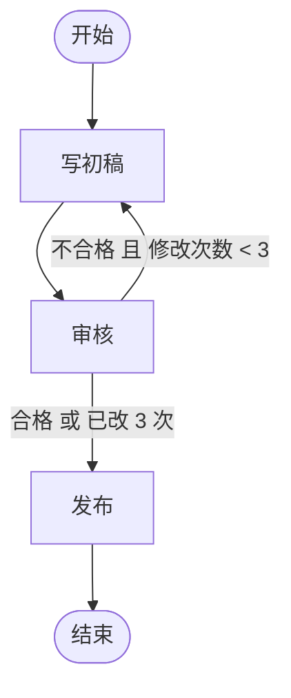
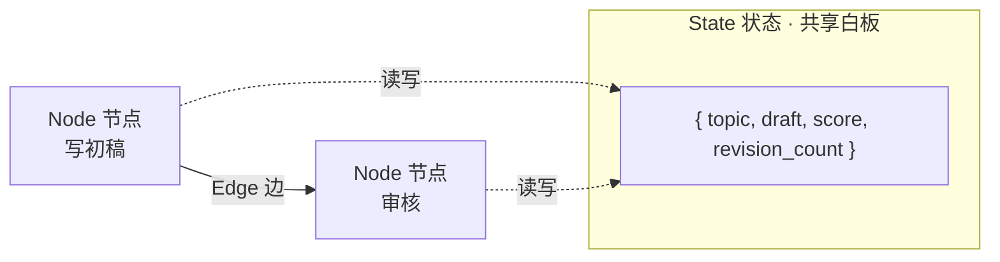
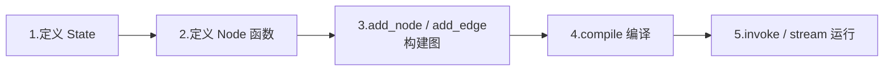
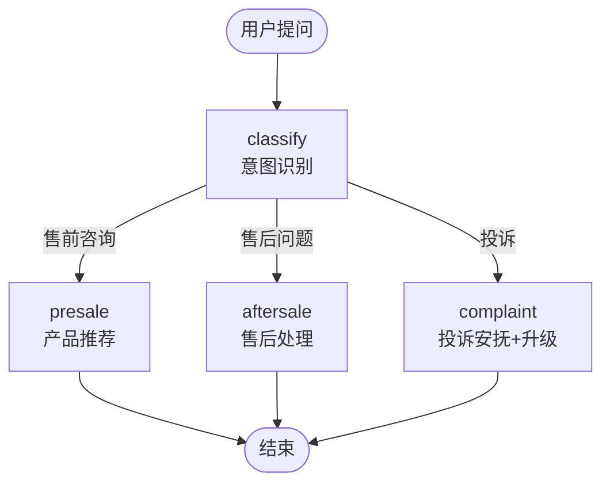
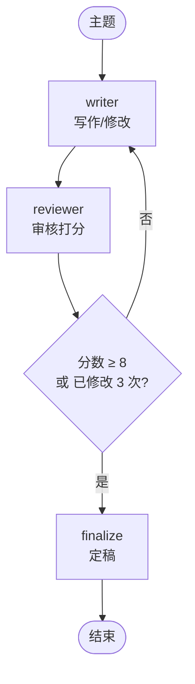
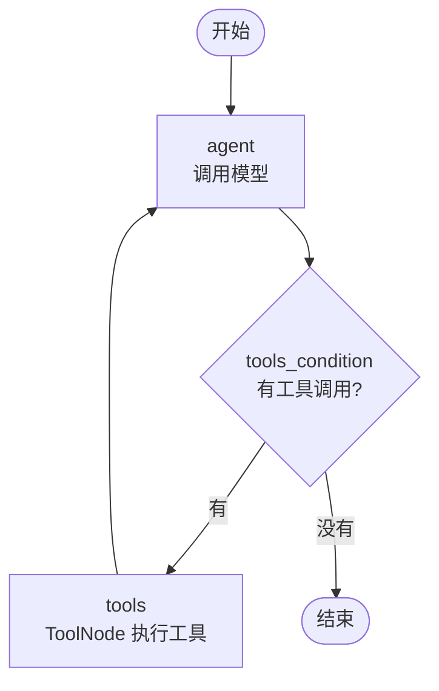

# 08 · LangGraph 核心概念

> **本章目标**：理解 LangGraph 的三大核心概念：State（状态）、Node（节点）、Edge（边），学会用 `StateGraph` 画出带分支和循环的 AI 工作流，并从零手写一个 ReAct Agent。
>
> **前置知识**：[02 模型与消息](./02-模型与消息.md)、[05 工具调用](./05-工具调用.md)、[07 Agent 智能体](./07-Agent智能体-create_agent.md)。

---

## 一、为什么需要 LangGraph

### 1.1 Chain 和 Agent 的局限

到目前为止，我们学过两种组织 AI 应用的方式：

| 方式 | 特点 | 局限 |
|---|---|---|
| **Chain（第 04 章）** | 流程写死：A → B → C | 不能分支、不能循环、不能"回头" |
| **Agent（第 07 章）** | 模型自己决定下一步 | 流程不可控，模型可能跳过关键步骤 |

真实业务往往介于两者之间：**大方向的流程是确定的，但其中某些环节需要 AI 灵活判断。**

比如一个"AI 写公众号文章"的流程：

1. 根据主题写初稿（AI）
2. 审核文章质量（AI）
3. **如果不合格，退回第 1 步修改；最多改 3 次**（确定的规则）
4. 合格后，等编辑人工确认（人）
5. 发布（程序）

用 Chain 做不了"退回修改"的循环；用 Agent 则可能出现"模型觉得写得挺好，直接跳过审核就发布了"。

### 1.2 LangGraph 的思路：把流程画成图

> 📖 **术语**：**图（Graph）**——由**节点（Node）**和连接节点的**边（Edge）**组成的结构。流程图、地铁线路图都是图。

> 💡 **通俗理解**：LangGraph 就是让你用代码画一张流程图。每个方框（节点）是一个步骤，箭头（边）决定下一步去哪；箭头可以带条件（"审核不通过就走这条"），也可以指回前面形成循环。所有方框共享一块"白板"（状态），每一步都可以读写白板上的内容。



**LangGraph 的核心价值**：

| 能力 | 说明 |
|---|---|
| 🎛️ 可控 | 流程由你定义，关键步骤不会被跳过 |
| 🔁 支持循环 | 天然支持"重试""反复修改""Agent 循环" |
| 💾 持久化 | 每一步自动保存状态，可断点续跑、回溯历史（第 09 章） |
| ✋ 人机协同 | 任意步骤都能暂停等人确认（第 09 章） |
| 🌊 流式输出 | 每一步、每个 Token 都能实时推送（第 10 章） |
| 🧩 可组合 | 一个图可以作为另一个图的节点（子图，第 10 章） |

> 🎯 **应用场景**：审批流、内容生产流水线、多步骤数据处理、复杂客服（不同问题走不同处理流程）、多 Agent 协作、需要长时间运行并可恢复的任务。

---

## 二、三大核心概念



### 2.1 State（状态）

> 📖 **术语**：**State（状态）**——在整个图中流转的共享数据。每个节点都能读取完整状态，并返回需要更新的部分。

最常用的定义方式是 Python 的 `TypedDict`：

```python
from typing import TypedDict


class ArticleState(TypedDict):
    topic: str           # 文章主题
    draft: str           # 当前草稿
    feedback: str        # 审核意见
    revision_count: int  # 已修改次数
```

> 📖 **术语**：**TypedDict**——带类型注解的字典。本质还是普通的 `dict`，只是告诉编辑器和 LangGraph 每个字段是什么类型。

也可以用 Pydantic（会在运行时校验数据类型，更严格但稍慢）：

```python
from pydantic import BaseModel


class ArticleState(BaseModel):
    topic: str
    draft: str = ""
    feedback: str = ""
    revision_count: int = 0
```

> 💡 **怎么选**：入门和大多数场景用 `TypedDict` 就够了；需要严格的输入校验或默认值时用 Pydantic。注意 Pydantic 状态在节点里要用 `state.topic` 访问，`TypedDict` 用 `state["topic"]`。

### 2.2 Node（节点）

> 📖 **术语**：**Node（节点）**——图中的一个步骤，本质是一个**普通的 Python 函数**：接收当前状态，返回**要更新的字段**。

```python
def write_draft(state: ArticleState) -> dict:
    draft = f"关于《{state['topic']}》的文章初稿……"
    return {"draft": draft}  # 只返回要更新的字段，其他字段保持不变
```

关键规则：

- 节点**不需要返回完整状态**，只返回要修改的字段，LangGraph 会自动合并。
- 节点**不要直接修改** `state`（比如 `state["draft"] = ...`），而是通过返回值来更新。
- 节点里可以做任何事：调用模型、调用工具、查数据库、发 HTTP 请求……

### 2.3 Edge（边）

> 📖 **术语**：**Edge（边）**——连接节点的箭头，决定一个节点执行完后下一步去哪。

| 类型 | 写法 | 说明 |
|---|---|---|
| 普通边 | `add_edge("A", "B")` | A 执行完**一定**去 B |
| 条件边 | `add_conditional_edges("A", 路由函数)` | A 执行完，由路由函数根据状态决定去哪 |
| 入口 | `add_edge(START, "A")` | 图从 A 开始执行 |
| 出口 | `add_edge("A", END)` | A 执行完后结束 |

`START` 和 `END` 是两个特殊的虚拟节点，从 `langgraph.graph` 导入。

---

## 三、第一个图：线性流程

先从最简单的开始，不调用模型，只感受 LangGraph 的运行机制：

```python
from typing import TypedDict

from langgraph.graph import END, START, StateGraph


# 1. 定义状态
class State(TypedDict):
    name: str
    greeting: str
    result: str


# 2. 定义节点
def make_greeting(state: State) -> dict:
    return {"greeting": f"你好，{state['name']}！"}


def add_emoji(state: State) -> dict:
    return {"result": state["greeting"] + " 👋"}


# 3. 构建图
builder = StateGraph(State)
builder.add_node("make_greeting", make_greeting)
builder.add_node("add_emoji", add_emoji)

builder.add_edge(START, "make_greeting")
builder.add_edge("make_greeting", "add_emoji")
builder.add_edge("add_emoji", END)

# 4. 编译
graph = builder.compile()

# 5. 运行
result = graph.invoke({"name": "小明"})
print(result)
# {'name': '小明', 'greeting': '你好，小明！', 'result': '你好，小明！ 👋'}
```

LangGraph 开发的固定五步：



> 📖 **术语**：**compile（编译）**——检查图的结构是否合法（比如有没有孤立的节点、边指向不存在的节点），并生成可运行的图对象。编译时还可以挂载 checkpointer 等能力（第 09 章）。

> 💡 `add_node` 可以省略名字，直接 `builder.add_node(make_greeting)`，此时节点名就是函数名。

### 3.1 可视化

图结构复杂之后，画出来看最直观：

```python
print(graph.get_graph().draw_mermaid())
```

会输出一段 Mermaid 代码，粘贴到 [Mermaid Live Editor](https://mermaid.live) 或任何支持 Mermaid 的 Markdown 编辑器里就能看到流程图。在 Jupyter 中还可以直接显示图片：

```python
from IPython.display import Image, display

display(Image(graph.get_graph().draw_mermaid_png()))
```

> 💡 `draw_mermaid_png()` 默认会调用在线服务渲染图片，网络不通时用 `draw_mermaid()` 输出文本即可。

---

## 四、Reducer：状态如何合并

### 4.1 默认行为：覆盖

节点返回 `{"draft": "新内容"}` 时，默认会**覆盖**旧值。但有些字段我们希望**追加**而不是覆盖，比如日志、消息列表。

> 📖 **术语**：**Reducer（归并函数）**——定义"新值如何与旧值合并"的函数。如果你用过 Redux 或 `Array.reduce`，概念是相通的。

用 `Annotated[类型, reducer函数]` 为字段指定 reducer：

```python
import operator
from typing import Annotated, TypedDict

from langgraph.graph import END, START, StateGraph


class State(TypedDict):
    logs: Annotated[list[str], operator.add]  # 列表追加：旧列表 + 新列表
    total: Annotated[int, operator.add]       # 数字累加
    status: str                               # 无 reducer：直接覆盖


def step_1(state: State) -> dict:
    return {"logs": ["步骤1完成"], "total": 10, "status": "step1"}


def step_2(state: State) -> dict:
    return {"logs": ["步骤2完成"], "total": 5, "status": "step2"}


builder = StateGraph(State)
builder.add_node(step_1)
builder.add_node(step_2)
builder.add_edge(START, "step_1")
builder.add_edge("step_1", "step_2")
builder.add_edge("step_2", END)
graph = builder.compile()

print(graph.invoke({"logs": ["开始"], "total": 0, "status": "init"}))
# {'logs': ['开始', '步骤1完成', '步骤2完成'], 'total': 15, 'status': 'step2'}
```

> ⚠️ **注意**：多个节点**并行**写同一个字段时，该字段必须有 reducer，否则 LangGraph 不知道该保留谁的值，会报 `InvalidUpdateError`。并行在第 10 章详细讲。

### 4.2 add_messages：消息专用 reducer

对话类应用的状态里一定有消息列表，LangGraph 提供了专门的 `add_messages`：

```python
from typing import Annotated, TypedDict

from langchain.messages import AnyMessage
from langgraph.graph.message import add_messages


class ChatState(TypedDict):
    messages: Annotated[list[AnyMessage], add_messages]
```

`add_messages` 比 `operator.add` 更智能：

| 能力 | 说明 |
|---|---|
| 追加 | 新消息追加到末尾 |
| 按 ID 更新 | 如果新消息的 `id` 和已有消息相同，就**替换**它（用于修改历史消息） |
| 删除 | 配合 `RemoveMessage` 删除指定消息（第 09 章） |
| 格式转换 | 自动把 `{"role": "user", "content": "..."}` 这样的字典转换成消息对象 |

### 4.3 MessagesState：开箱即用的消息状态

因为太常用，LangGraph 直接内置了一个 `MessagesState`，等价于上面的 `ChatState`。需要更多字段时继承它：

```python
from langgraph.graph import MessagesState


class MyState(MessagesState):
    user_intent: str  # 在 messages 之外，额外加一个字段
```

---

## 五、接入大模型：最简单的聊天图

```python
from dotenv import load_dotenv
from langchain.chat_models import init_chat_model
from langgraph.graph import END, START, MessagesState, StateGraph

load_dotenv()

model = init_chat_model("deepseek:deepseek-flash", extra_body={"thinking": {"type": "disabled"}})


def chatbot(state: MessagesState) -> dict:
    response = model.invoke(state["messages"])
    return {"messages": [response]}  # add_messages 会把它追加到历史中


builder = StateGraph(MessagesState)
builder.add_node("chatbot", chatbot)
builder.add_edge(START, "chatbot")
builder.add_edge("chatbot", END)
graph = builder.compile()

result = graph.invoke({"messages": [{"role": "user", "content": "用三个词形容秋天"}]})
print(result["messages"][-1].content)
```

---

## 六、条件边：让流程分岔

> 📖 **术语**：**路由函数（Router）**——条件边使用的函数，接收当前状态，返回下一个节点的名字。

### 6.1 示例：客服意图路由

用户的问题先由 AI 分类，再交给不同的处理节点：



```python
from typing import Literal

from dotenv import load_dotenv
from langchain.chat_models import init_chat_model
from langgraph.graph import END, START, MessagesState, StateGraph
from pydantic import BaseModel, Field

load_dotenv()

model = init_chat_model("deepseek:deepseek-flash", extra_body={"thinking": {"type": "disabled"}}, temperature=0)


class State(MessagesState):
    intent: str


class Intent(BaseModel):
    intent: Literal["presale", "aftersale", "complaint"] = Field(
        description="presale=售前咨询，aftersale=售后问题，complaint=投诉"
    )


def classify(state: State) -> dict:
    classifier = model.with_structured_output(Intent)
    result = classifier.invoke(
        [{"role": "system", "content": "判断用户消息的意图类别。"}, state["messages"][-1]]
    )
    return {"intent": result.intent}


def presale(state: State) -> dict:
    reply = model.invoke([{"role": "system", "content": "你是售前顾问，热情地推荐产品。"}] + state["messages"])
    return {"messages": [reply]}


def aftersale(state: State) -> dict:
    reply = model.invoke([{"role": "system", "content": "你是售后专员，耐心解决问题。"}] + state["messages"])
    return {"messages": [reply]}


def complaint(state: State) -> dict:
    reply = model.invoke(
        [{"role": "system", "content": "你是投诉专员，先真诚道歉安抚，并告知已升级给主管，24 小时内回电。"}]
        + state["messages"]
    )
    return {"messages": [reply]}


# 路由函数：返回值必须是节点名之一
def route_by_intent(state: State) -> Literal["presale", "aftersale", "complaint"]:
    return state["intent"]


builder = StateGraph(State)
builder.add_node(classify)
builder.add_node(presale)
builder.add_node(aftersale)
builder.add_node(complaint)

builder.add_edge(START, "classify")
builder.add_conditional_edges("classify", route_by_intent)
builder.add_edge("presale", END)
builder.add_edge("aftersale", END)
builder.add_edge("complaint", END)

graph = builder.compile()

for question in ["你们的扫地机器人哪款适合养猫家庭？", "收到的耳机左边没声音", "快递员态度太差了，我要投诉！"]:
    result = graph.invoke({"messages": [{"role": "user", "content": question}]})
    print(f"【{result['intent']}】{result['messages'][-1].content[:60]}…\n")
```

要点：

- 路由函数的返回类型写成 `Literal[...]`，LangGraph 就能知道所有可能的去向，画图时会显示出所有分支。
- 也可以用映射字典：`add_conditional_edges("classify", route_fn, {"a": "node_a", "b": "node_b"})`，路由函数返回字典的键，LangGraph 映射到对应节点。
- 路由函数可以返回 `END`，表示直接结束。

> 🎯 **应用场景**：意图分流（客服、工单系统）、根据风险等级走不同审批流、根据文档类型选择不同解析方式、RAG 中判断"检索结果是否相关，不相关就改写问题重新检索"。

> 💡 **对比第 07 章**：这里的分流是**你**通过图结构强制保证的。投诉一定会走投诉节点、一定会告知"已升级主管"，不依赖模型是否"听话"。

---

## 七、循环：实现"写作 → 审核 → 修改"

条件边可以指回前面的节点，从而形成循环。这是 LangGraph 区别于 Chain 的关键能力。



```python
from typing import Literal, TypedDict

from dotenv import load_dotenv
from langchain.chat_models import init_chat_model
from langgraph.graph import END, START, StateGraph
from pydantic import BaseModel, Field

load_dotenv()

writer_model = init_chat_model("deepseek:deepseek-flash", extra_body={"thinking": {"type": "disabled"}}, temperature=0.8)
reviewer_model = init_chat_model("deepseek:deepseek-flash", extra_body={"thinking": {"type": "disabled"}}, temperature=0)

MAX_REVISIONS = 3
PASS_SCORE = 8


class ArticleState(TypedDict):
    topic: str
    draft: str
    score: int
    feedback: str
    revision_count: int


class Review(BaseModel):
    score: int = Field(description="1-10 分，8 分及以上为合格", ge=1, le=10)
    feedback: str = Field(description="具体的修改建议，合格时可以为空")


def writer(state: ArticleState) -> dict:
    if state.get("feedback"):
        prompt = (
            f"请根据审核意见修改文章。\n\n原文：\n{state['draft']}\n\n"
            f"审核意见：\n{state['feedback']}\n\n直接输出修改后的全文。"
        )
    else:
        prompt = f"写一篇 300 字左右的公众号短文，主题：{state['topic']}。要求标题吸引人、有具体例子。"
    draft = writer_model.invoke(prompt).content
    return {"draft": draft, "revision_count": state.get("revision_count", 0) + 1}


def reviewer(state: ArticleState) -> dict:
    review = reviewer_model.with_structured_output(Review).invoke(
        "你是严格的公众号主编，从标题吸引力、内容具体性、逻辑清晰度三方面审核以下文章并打分。\n\n"
        + state["draft"]
    )
    print(f"📝 第 {state['revision_count']} 版得分：{review.score}")
    return {"score": review.score, "feedback": review.feedback}


def should_continue(state: ArticleState) -> Literal["writer", "finalize"]:
    if state["score"] >= PASS_SCORE or state["revision_count"] >= MAX_REVISIONS:
        return "finalize"
    return "writer"


def finalize(state: ArticleState) -> dict:
    return {"draft": state["draft"] + f"\n\n——（经过 {state['revision_count']} 版打磨，终审 {state['score']} 分）"}


builder = StateGraph(ArticleState)
builder.add_node(writer)
builder.add_node(reviewer)
builder.add_node(finalize)

builder.add_edge(START, "writer")
builder.add_edge("writer", "reviewer")
builder.add_conditional_edges("reviewer", should_continue)
builder.add_edge("finalize", END)

graph = builder.compile()

result = graph.invoke({"topic": "为什么程序员应该学会写作"})
print(result["draft"])
```

> ⚠️ **注意**：**循环一定要有退出条件**（这里是"合格"或"最多 3 次"）。LangGraph 还有一个保险：`recursion_limit`（最大执行步数，1.0.6 起默认 1000 步），超过会抛出 `GraphRecursionError`。默认值很宽松，建议按业务调小，避免失控循环烧钱：`graph.invoke(inputs, {"recursion_limit": 30})`（注意它是 config 的顶层键，不在 `configurable` 里）。

> 🎯 **应用场景**：内容生成 + 质检（文章、代码、翻译）、"生成 SQL → 执行 → 报错则修正"、"规划 → 执行 → 检查 → 重新规划"类的自我纠错流程。这类"生成-评估-修正"模式也叫 **Reflection（反思）** 模式。

---

## 八、从零手写一个 ReAct Agent

第 07 章说过，`create_agent` 底层就是一个 LangGraph 图。现在我们亲手把它写出来，彻底搞懂 Agent 的原理。



### 8.1 手写版（理解原理）

```python
from typing import Literal

from dotenv import load_dotenv
from langchain.chat_models import init_chat_model
from langchain.messages import ToolMessage
from langchain.tools import tool
from langgraph.graph import END, START, MessagesState, StateGraph

load_dotenv()


@tool
def get_stock_price(symbol: str) -> str:
    """查询股票当前价格。symbol 为股票代码，如 AAPL。"""
    prices = {"AAPL": 238.5, "TSLA": 412.3, "NVDA": 186.7}
    return f"{symbol} 当前价格 ${prices.get(symbol.upper(), '未知')}"


tools = [get_stock_price]
tools_by_name = {t.name: t for t in tools}
model = init_chat_model("deepseek:deepseek-flash", extra_body={"thinking": {"type": "disabled"}}).bind_tools(tools)


def agent(state: MessagesState) -> dict:
    return {"messages": [model.invoke(state["messages"])]}


def run_tools(state: MessagesState) -> dict:
    results = []
    for call in state["messages"][-1].tool_calls:
        output = tools_by_name[call["name"]].invoke(call["args"])
        results.append(ToolMessage(content=output, tool_call_id=call["id"]))
    return {"messages": results}


def should_continue(state: MessagesState) -> Literal["tools", "__end__"]:
    return "tools" if state["messages"][-1].tool_calls else END


builder = StateGraph(MessagesState)
builder.add_node("agent", agent)
builder.add_node("tools", run_tools)
builder.add_edge(START, "agent")
builder.add_conditional_edges("agent", should_continue)
builder.add_edge("tools", "agent")  # 工具执行完回到模型 → 形成循环
graph = builder.compile()

result = graph.invoke({"messages": [{"role": "user", "content": "苹果和英伟达现在股价分别多少？差多少？"}]})
print(result["messages"][-1].content)
```

### 8.2 使用预置组件（推荐）

工具执行和"是否继续"的判断非常通用，LangGraph 提供了现成的组件：

- **`ToolNode`**：执行最后一条 AI 消息里的所有工具调用（支持并行、自动处理错误），返回 `ToolMessage`。
- **`tools_condition`**：现成的路由函数，有工具调用返回 `"tools"`，否则返回 `END`。

```python
from dotenv import load_dotenv
from langchain.chat_models import init_chat_model
from langchain.tools import tool
from langgraph.graph import START, MessagesState, StateGraph
from langgraph.prebuilt import ToolNode, tools_condition

load_dotenv()


@tool
def get_stock_price(symbol: str) -> str:
    """查询股票当前价格。symbol 为股票代码，如 AAPL。"""
    prices = {"AAPL": 238.5, "TSLA": 412.3, "NVDA": 186.7}
    return f"{symbol} 当前价格 ${prices.get(symbol.upper(), '未知')}"


tools = [get_stock_price]
model = init_chat_model("deepseek:deepseek-flash", extra_body={"thinking": {"type": "disabled"}}).bind_tools(tools)


def agent(state: MessagesState) -> dict:
    return {"messages": [model.invoke(state["messages"])]}


builder = StateGraph(MessagesState)
builder.add_node("agent", agent)
builder.add_node("tools", ToolNode(tools))
builder.add_edge(START, "agent")
builder.add_conditional_edges("agent", tools_condition)
builder.add_edge("tools", "agent")
graph = builder.compile()

print(graph.invoke({"messages": [{"role": "user", "content": "特斯拉股价多少？"}]})["messages"][-1].content)
```

> 💡 **手写 Agent 有什么用？** 当你需要 `create_agent` 做不到的定制时——比如"工具执行后先经过一个合规检查节点再回到模型"、"某个工具的结果需要人工确认"、"根据工具结果走完全不同的分支"——你就可以在这张图上自由增加节点和边。

---

## 九、Runtime 与 Context：传入运行时信息

和第 07 章的 `context_schema` 一样，LangGraph 的图也可以接收**运行时上下文**（如用户 ID、配置项），节点通过 `runtime` 参数读取：

```python
from dataclasses import dataclass

from dotenv import load_dotenv
from langchain.chat_models import init_chat_model
from langgraph.graph import END, START, MessagesState, StateGraph
from langgraph.runtime import Runtime

load_dotenv()


@dataclass
class Context:
    user_name: str
    language: str = "中文"


model = init_chat_model("deepseek:deepseek-flash", extra_body={"thinking": {"type": "disabled"}})


def chatbot(state: MessagesState, runtime: Runtime[Context]) -> dict:
    system = f"你在和 {runtime.context.user_name} 对话，请使用{runtime.context.language}回答。"
    reply = model.invoke([{"role": "system", "content": system}] + state["messages"])
    return {"messages": [reply]}


builder = StateGraph(MessagesState, context_schema=Context)
builder.add_node(chatbot)
builder.add_edge(START, "chatbot")
builder.add_edge("chatbot", END)
graph = builder.compile()

result = graph.invoke(
    {"messages": [{"role": "user", "content": "推荐一本书"}]},
    context=Context(user_name="Alice", language="English"),
)
print(result["messages"][-1].content)
```

- 节点函数增加一个 `runtime: Runtime[Context]` 参数，LangGraph 会自动注入。
- `runtime.context`：运行时上下文；`runtime.store`：长期记忆存储（第 09 章）；`runtime.stream_writer`：自定义流式输出（第 10 章）。

---

## 十、Graph API 与 Functional API

前面用的都是 **Graph API**（`StateGraph` + 节点 + 边）。LangGraph 还提供另一种写法——**Functional API**：用普通的 Python 函数和控制流（`if`、`for`、`while`）来写流程，同样享有持久化、人机协同、流式输出能力。

```python
from dotenv import load_dotenv
from langchain.chat_models import init_chat_model
from langgraph.func import entrypoint, task

load_dotenv()

model = init_chat_model("deepseek:deepseek-flash", extra_body={"thinking": {"type": "disabled"}})


@task
def write(topic: str) -> str:
    return model.invoke(f"写一句关于{topic}的广告语").content


@task
def polish(text: str) -> str:
    return model.invoke(f"把这句广告语改得更简洁有力：{text}").content


@entrypoint()
def slogan_workflow(topic: str) -> str:
    draft = write(topic).result()   # task 返回一个 future，.result() 取结果
    return polish(draft).result()


print(slogan_workflow.invoke("智能手表"))
```

> 📖 **术语**：**`@task`**——工作流中的一个工作单元，其结果会被保存（恢复执行时不会重复运行已完成的 task）。**`@entrypoint`**——工作流的入口函数。

| 对比项 | Graph API | Functional API |
|---|---|---|
| 写法 | 声明节点和边 | 普通函数 + `if`/`for` |
| 流程可视化 | ✅ 可以画出完整流程图 | ❌ 流程藏在代码里 |
| 状态管理 | 显式定义 State 和 reducer | 函数作用域内的普通变量 |
| 学习曲线 | 需要理解图的概念 | 几乎没有新概念 |
| 适合 | 复杂分支、多 Agent、需要团队协作和可视化调试 | 给已有代码快速加上持久化/人机协同，线性为主的流程 |

> 💡 **建议**：先把 Graph API 学扎实（官方文档、社区示例绝大多数用它），Functional API 作为补充了解即可。两者可以混用：图的节点里可以调用 entrypoint，反之亦然。

---

## 十一、常见错误速查

| 报错 / 现象 | 原因与解决 |
|---|---|
| `ValueError: Found edge starting at unknown node` | 边引用了不存在的节点名，检查拼写 |
| `InvalidUpdateError: ... can receive only one value per step` | 多个并行节点写同一字段但没有 reducer，给字段加 `Annotated[..., reducer]` |
| `GraphRecursionError` | 循环没有正确退出，检查退出条件；确实需要更多步数时调整 `recursion_limit` |
| 节点返回后状态没变 | 节点直接修改了 `state` 而没有 `return` 更新内容 |
| `KeyError` 读取状态字段 | 初始输入没有提供该字段，用 `state.get("x", 默认值)` 读取，或改用带默认值的 Pydantic 状态 |
| 节点未执行到 | 节点没有入边（孤立节点），检查 `add_edge` |

---

## 本章小结

- LangGraph 用**图**来编排流程：**State** 是共享白板，**Node** 是读写白板的函数，**Edge** 决定下一步去哪。
- 开发五步：定义 State → 定义 Node → 添加节点和边 → `compile()` → `invoke()`。
- 节点只返回**要更新的字段**；字段默认覆盖，用 **reducer**（`operator.add`、`add_messages`）实现追加；对话场景直接用 `MessagesState`。
- **条件边**实现分支，条件边指回前面的节点实现**循环**；循环必须有退出条件。
- `ToolNode` + `tools_condition` 可以快速搭出 ReAct Agent，这正是 `create_agent` 的底层原理。
- 节点通过 `runtime: Runtime[Context]` 获取运行时上下文。
- Functional API（`@entrypoint` / `@task`）是另一种不画图的写法。

## 练习

1. 在第三节的线性图中加一个 `add_time` 节点，在问候语后追加当前时间，并用 `draw_mermaid()` 打印流程图。
2. 修改"写作 → 审核"工作流：把每一版草稿都保存在一个 `history: Annotated[list[str], operator.add]` 字段中，最后打印所有版本对比。
3. 在手写 ReAct Agent 的 `tools` 节点和 `agent` 节点之间加一个 `audit` 节点，打印每次工具调用的名字和参数（模拟审计日志）。
4. 设计一个"智能工单分流"图：识别工单类型（技术问题 / 账单问题 / 其他），技术问题再判断紧急程度，紧急的走"立即通知值班工程师"节点。先画出 Mermaid 流程图，再写代码。

<details>
<summary>参考思路</summary>

1. 新增节点后，把 `add_emoji → END` 改为 `add_emoji → add_time → END`。
2. 在 `writer` 节点的返回值里加上 `"history": [draft]`，reducer 会自动追加。
3. 把 `builder.add_edge("tools", "agent")` 改为 `tools → audit → agent`；`audit` 节点读取 `state["messages"]` 中最近的 AI 消息的 `tool_calls`，打印后返回 `{}`（不更新任何字段）。
4. 两层条件边：`classify → (tech | billing | other)`，`tech → assess_urgency → (notify_oncall | normal_queue)`。

</details>

---

**上一章** ← [07 Agent 智能体](./07-Agent智能体-create_agent.md) ｜ **下一章** → [09 持久化、记忆与人机协同](./09-LangGraph持久化-记忆与人机协同.md)
