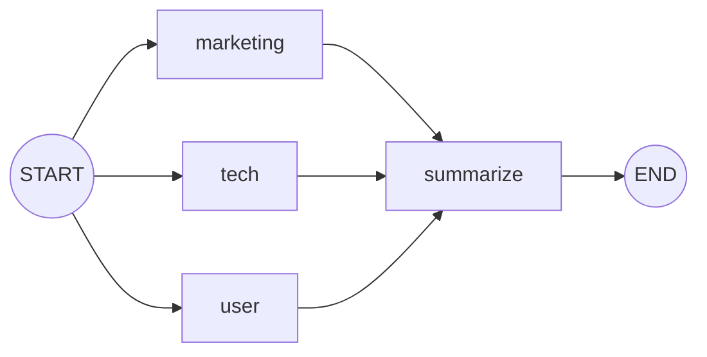
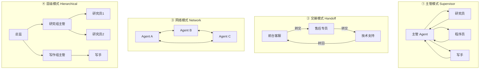

# 10 · LangGraph 高级模式：流式、子图、并行与多 Agent

> **本章目标**：掌握构建复杂 AI 系统所需的高级能力——流式输出、子图拆分、并行执行与 Map-Reduce、多 Agent 协作，以及重试、缓存、递归限制等生产级配置。
>
> **前置知识**：[08 LangGraph 核心概念](./08-LangGraph核心概念.md)（State / Node / Edge / Reducer）、[09 持久化与人机协同](./09-LangGraph持久化-记忆与人机协同.md)（Checkpointer、`Command`）、[07 Agent](./07-Agent智能体-create_agent.md)（`create_agent`）。

---

## 一、流式输出（Streaming）

### 1.1 为什么图也要流式

第 02 章学过模型的流式输出（逐字返回）。但在 LangGraph 里，一次运行可能经过 5 个节点、调用 3 次模型、执行 4 次工具，总共耗时 30 秒。如果用户只能干等最终结果，体验会很差。

> 💡 **通俗理解**：就像外卖 App 的订单进度条——"商家已接单 → 骑手已取餐 → 距你 500 米"。流式输出就是让用户看到 AI 流程的"实时进度"，以及模型正在"打字"的内容。

> 🎯 **应用场景**：
> - 聊天界面的打字机效果（`messages` 模式）
> - 展示"正在搜索资料… 正在撰写报告…"这类进度提示（`updates` / `custom` 模式）
> - 调试时观察每一步状态的完整变化（`values` / `debug` 模式）

### 1.2 五种常用 stream_mode

| 模式 | 每次产出什么 | 典型用途 |
|---|---|---|
| `values` | 每一步执行完后的**完整状态** | 调试、需要随时拿到全量状态 |
| `updates` | 每个节点**本次更新了哪些字段** | 进度展示（"xx 节点完成"） |
| `messages` | 模型生成的**逐个 Token** + 元数据 | 打字机效果 |
| `custom` | 你在节点/工具里**主动发出的自定义数据** | 自定义进度、百分比、中间结果 |
| `debug` | 尽可能详细的执行信息 | 深度排查问题 |

> 📖 **术语**：**元数据（Metadata）**——描述数据的数据。在 `messages` 模式下，元数据告诉你这个 Token 来自哪个节点（`langgraph_node`）、带什么标签等。

### 1.3 准备一个示例图

下面这个图有两个节点：先"生成大纲"，再"根据大纲写短文"。后面几个小节都用它演示。

```python
# ch10_stream.py
from typing import TypedDict

from dotenv import load_dotenv
from langchain.chat_models import init_chat_model
from langgraph.config import get_stream_writer
from langgraph.graph import END, START, StateGraph

load_dotenv()

model = init_chat_model("deepseek:deepseek-flash", extra_body={"thinking": {"type": "disabled"}})


class State(TypedDict):
    topic: str
    outline: str
    article: str


def make_outline(state: State):
    writer = get_stream_writer()
    writer({"progress": "正在生成大纲…"})
    outline = model.invoke(f"为主题「{state['topic']}」列一个三点大纲，只输出大纲").text
    writer({"progress": "大纲完成"})
    return {"outline": outline}


def write_article(state: State):
    writer = get_stream_writer()
    writer({"progress": "正在撰写正文…"})
    article = model.invoke(f"根据以下大纲写一段 200 字短文：\n{state['outline']}").text
    return {"article": article}


builder = StateGraph(State)
builder.add_node("make_outline", make_outline)
builder.add_node("write_article", write_article)
builder.add_edge(START, "make_outline")
builder.add_edge("make_outline", "write_article")
builder.add_edge("write_article", END)
graph = builder.compile()
```

> 💡 `model.invoke(...).text` 取出消息里的纯文本内容。有些模型的 `content` 是"内容块列表"而不是字符串，用 `.text` 更保险。

### 1.4 updates：看每个节点做了什么

```python
for chunk in graph.stream({"topic": "早睡的好处"}, stream_mode="updates"):
    # chunk 形如 {"make_outline": {"outline": "..."}}
    for node_name, update in chunk.items():
        print(f"✅ 节点 {node_name} 完成，更新字段：{list(update.keys())}")
```

### 1.5 values：每一步的完整状态

```python
for state in graph.stream({"topic": "早睡的好处"}, stream_mode="values"):
    print("当前状态包含字段：", list(state.keys()))
```

第一次输出的是初始输入，之后每个节点执行完都会输出一次全量状态。

### 1.6 messages：逐 Token 打字机效果

```python
for token, metadata in graph.stream({"topic": "早睡的好处"}, stream_mode="messages"):
    # 只展示"写正文"节点的输出，大纲节点的 Token 不显示
    if metadata["langgraph_node"] == "write_article" and token.text:
        print(token.text, end="", flush=True)
print()
```

> ⚠️ **注意**：即使节点里用的是 `model.invoke()`（不是 `model.stream()`），`messages` 模式也能拿到逐 Token 输出——LangGraph 会自动帮你"截获"模型的流。

### 1.7 custom：自定义进度消息

节点里通过 `get_stream_writer()` 拿到一个 `writer` 函数，调用它就能往外推送任意数据（上面示例已经写好了）：

```python
for data in graph.stream({"topic": "早睡的好处"}, stream_mode="custom"):
    print("📣", data["progress"])
```

输出：

```
📣 正在生成大纲…
📣 大纲完成
📣 正在撰写正文…
```

> 🎯 **应用场景**：在工具里推送"已查询 3/10 个数据源"、在长任务里推送百分比进度，前端拿到后渲染成进度条。

### 1.8 同时订阅多种模式

`stream_mode` 传列表时，每次产出 `(模式名, 数据)` 二元组：

```python
for mode, data in graph.stream(
    {"topic": "早睡的好处"},
    stream_mode=["custom", "updates"],
):
    if mode == "custom":
        print("📣", data["progress"])
    elif mode == "updates":
        print("✅", list(data.keys())[0], "完成")
```

> 💡 LangGraph 1.1+ 还支持 `version="v2"` 的统一格式：每个 chunk 都是 `{"type": ..., "ns": ..., "data": ...}` 字典，用 `chunk["type"]` 判断类型，写法更统一。两种格式都可用，本教程使用默认格式。

### 1.9 子图的流式：subgraphs=True

如果图中嵌套了子图（见第二节）或 `create_agent` 生成的 Agent，默认**看不到子图内部**的输出。加上 `subgraphs=True`：

```python
for namespace, chunk in graph.stream(inputs, stream_mode="updates", subgraphs=True):
    # namespace 为 () 表示来自父图；("research:<task_id>",) 表示来自 research 子图
    print(namespace, chunk)
```

> 📖 **术语**：**命名空间（Namespace）**——标识"这条数据来自哪一层图"的路径，类似文件夹路径。

### 1.10 异步流式：astream

在 Web 服务（如 FastAPI）中，通常使用异步版本，避免阻塞其他请求：

```python
import asyncio


async def main():
    async for token, metadata in graph.astream(
        {"topic": "早睡的好处"}, stream_mode="messages"
    ):
        if token.text:
            print(token.text, end="", flush=True)


asyncio.run(main())
```

> 📖 **术语**：**异步（async）**——程序在等待网络响应时不"干等"，先去处理别的任务。Web 服务同时服务很多用户，异步能显著提高吞吐量。所有方法都有对应的异步版本：`invoke` → `ainvoke`，`stream` → `astream`。

> ⚠️ **注意**：Python 3.10 的异步代码中 `get_stream_writer()` 无法使用，需要改为在节点函数上增加 `writer: StreamWriter` 参数（`from langgraph.types import StreamWriter`）。用 Python 3.11+ 则无此问题——这也是推荐 3.12 的原因之一。

---

## 二、子图（Subgraph）

### 2.1 什么是子图

> 📖 **术语**：**子图（Subgraph）**——一个编译好的图，被当作另一个图的"节点"来使用。

> 💡 **通俗理解**：就像写代码时把一大段逻辑抽成函数。主流程只关心"调用了调研模块"，调研模块内部有多少步骤由它自己负责。

> 🎯 **应用场景**：
> - **多 Agent 系统**：每个 Agent 是一个子图，主图负责调度。
> - **复用**：一个"审核流程"子图，可以同时被"文章发布"和"商品上架"两个主流程使用。
> - **团队协作**：不同成员各自开发、测试自己的子图。

### 2.2 方式一：直接作为节点加入（共享状态字段）

当子图和父图**有相同的状态字段**时，可以直接把编译后的子图传给 `add_node`：

```python
# ch10_subgraph_shared.py
import operator
from typing import Annotated, TypedDict

from langgraph.graph import END, START, StateGraph


# ---------- 子图：负责校验和清洗 ----------
class SubState(TypedDict):
    text: str                                  # 与父图共享
    logs: Annotated[list[str], operator.add]   # 与父图共享
    temp: str                                  # 子图私有字段


def strip_text(state: SubState):
    return {"temp": state["text"].strip(), "logs": ["子图：去除首尾空格"]}


def upper_text(state: SubState):
    return {"text": state["temp"].upper(), "logs": ["子图：转为大写"]}


sub_builder = StateGraph(SubState)
sub_builder.add_node("strip_text", strip_text)
sub_builder.add_node("upper_text", upper_text)
sub_builder.add_edge(START, "strip_text")
sub_builder.add_edge("strip_text", "upper_text")
sub_builder.add_edge("upper_text", END)
subgraph = sub_builder.compile()


# ---------- 父图 ----------
class ParentState(TypedDict):
    text: str
    logs: Annotated[list[str], operator.add]


def receive(state: ParentState):
    return {"logs": ["父图：收到输入"]}


builder = StateGraph(ParentState)
builder.add_node("receive", receive)
builder.add_node("clean", subgraph)  # 直接把子图当节点
builder.add_edge(START, "receive")
builder.add_edge("receive", "clean")
builder.add_edge("clean", END)
graph = builder.compile()

print(graph.invoke({"text": "  hello langgraph  ", "logs": []}))
# {'text': 'HELLO LANGGRAPH', 'logs': ['父图：收到输入', '子图：去除首尾空格', '子图：转为大写']}
```

父图和子图通过**同名字段**交换数据；子图私有的 `temp` 不会出现在父图的结果里。

### 2.3 方式二：在节点函数里调用（状态结构不同）

当子图和父图的状态结构**完全不同**时，在父图节点里手动完成"输入转换 → 调用子图 → 输出转换"：

```python
# 子图的状态：{"query": str, "answer": str}
# 父图的状态：{"question": str, "final_answer": str}

def call_research(state: ParentState):
    # 1. 把父图状态转换成子图输入
    sub_result = research_subgraph.invoke({"query": state["question"]})
    # 2. 把子图输出转换回父图字段
    return {"final_answer": sub_result["answer"]}


builder.add_node("research", call_research)
```

| 对比 | 方式一：直接加入 | 方式二：在节点里调用 |
|---|---|---|
| 适用 | 父子图有共享字段 | 父子图状态完全不同 |
| 代码量 | 少 | 多写一个转换函数 |
| 灵活性 | 一般 | 高，可以在调用前后加任意逻辑 |

> ⚠️ **注意**：使用 Checkpointer 时，只需在**父图**编译时传入，子图会自动继承持久化能力，不要给子图单独再传一个。

---

## 三、并行执行与 Map-Reduce

### 3.1 静态并行：一个节点连出多条边

> 💡 **通俗理解**：点外卖时同时下单奶茶和炸鸡，两家店同时做，都送到了再一起吃，而不是等奶茶到了再点炸鸡。

一个节点同时连向多个节点，这些节点会**在同一步并发执行**（扇出，fan-out）；它们都连向同一个节点时，该节点会**等全部完成后再执行**（扇入，fan-in）。

> 📖 **术语**：**扇出 / 扇入（Fan-out / Fan-in）**——一分多叫扇出，多合一叫扇入。

```python
# ch10_parallel.py
import operator
from typing import Annotated, TypedDict

from dotenv import load_dotenv
from langchain.chat_models import init_chat_model
from langgraph.graph import END, START, StateGraph

load_dotenv()
model = init_chat_model("deepseek:deepseek-flash", extra_body={"thinking": {"type": "disabled"}})


class State(TypedDict):
    product: str
    # 多个节点同时写 opinions，必须用 Reducer 合并，否则会报冲突错误
    opinions: Annotated[list[str], operator.add]
    summary: str


def marketing_view(state: State):
    r = model.invoke(f"从市场营销角度，用一句话评价产品：{state['product']}")
    return {"opinions": [f"【营销】{r.text}"]}


def tech_view(state: State):
    r = model.invoke(f"从技术实现角度，用一句话评价产品：{state['product']}")
    return {"opinions": [f"【技术】{r.text}"]}


def user_view(state: State):
    r = model.invoke(f"从普通用户角度，用一句话评价产品：{state['product']}")
    return {"opinions": [f"【用户】{r.text}"]}


def summarize(state: State):
    joined = "\n".join(state["opinions"])
    r = model.invoke(f"综合以下观点，给出 50 字结论：\n{joined}")
    return {"summary": r.text}


builder = StateGraph(State)
for name, fn in [("marketing", marketing_view), ("tech", tech_view), ("user", user_view)]:
    builder.add_node(name, fn)
    builder.add_edge(START, name)        # 扇出：三个节点并发
    builder.add_edge(name, "summarize")  # 扇入：三个都完成后再汇总
builder.add_node("summarize", summarize)
builder.add_edge("summarize", END)
graph = builder.compile()

result = graph.invoke({"product": "一款能自动整理会议纪要的 AI 录音笔", "opinions": []})
print("\n".join(result["opinions"]))
print("结论：", result["summary"])
```



> ⚠️ **注意**：并行节点写入同一个字段时**必须**声明 Reducer（如 `operator.add`），否则 LangGraph 无法决定保留谁的值，会抛出 `InvalidUpdateError`。这是并行场景最常见的报错。

### 3.2 动态并行：Send API 实现 Map-Reduce

静态并行的分支数量在画图时就固定了。但很多时候**分支数量要运行时才知道**：用户上传了 7 份文档要分别总结，规划器拆出了 4 个子问题要分别调研……

> 📖 **术语**：**Map-Reduce**——经典的大数据处理模式。**Map（映射）**：把任务拆成多份，分别并行处理；**Reduce（归约）**：把多份结果合并成一个。

> 📖 **术语**：**Send**——LangGraph 提供的动态分发指令。`Send("节点名", 该节点的输入)` 表示"派一个任务给这个节点"。返回多少个 `Send`，就并行执行多少份。

```python
# ch10_send.py
import operator
from typing import Annotated, TypedDict

from dotenv import load_dotenv
from langchain.chat_models import init_chat_model
from langgraph.graph import END, START, StateGraph
from langgraph.types import Send

load_dotenv()
model = init_chat_model("deepseek:deepseek-flash", extra_body={"thinking": {"type": "disabled"}})


class OverallState(TypedDict):
    documents: list[str]
    summaries: Annotated[list[str], operator.add]
    final_report: str


class DocState(TypedDict):
    """单个 Map 任务收到的输入，可以和总状态不同。"""
    doc: str


def dispatch(state: OverallState):
    # 有几份文档就派发几个任务，它们会并行执行
    return [Send("summarize_doc", {"doc": d}) for d in state["documents"]]


def summarize_doc(state: DocState):
    r = model.invoke(f"用一句话总结：{state['doc']}")
    return {"summaries": [r.text]}  # 写回总状态，由 operator.add 合并


def reduce_all(state: OverallState):
    joined = "\n".join(f"- {s}" for s in state["summaries"])
    r = model.invoke(f"把以下要点整合成一段周报摘要：\n{joined}")
    return {"final_report": r.text}


builder = StateGraph(OverallState)
builder.add_node("summarize_doc", summarize_doc)
builder.add_node("reduce_all", reduce_all)
builder.add_conditional_edges(START, dispatch, ["summarize_doc"])
builder.add_edge("summarize_doc", "reduce_all")
builder.add_edge("reduce_all", END)
graph = builder.compile()

docs = [
    "本周完成了登录模块重构，接口响应时间降低 40%。",
    "修复了支付回调偶发丢失的问题，新增了重试机制。",
    "与设计团队对齐了新版首页方案，下周开始开发。",
]
print(graph.invoke({"documents": docs, "summaries": []})["final_report"])
```

> 🎯 **应用场景**：批量总结多篇文档、对多个候选方案分别评估、对多个子问题分别检索调研（第 11 章项目三就用它）、一次生成多个版本的文案再挑选。

> ⚠️ **注意**：`Send` 是**从条件边返回**的（`add_conditional_edges` 的路由函数），而不是从普通节点返回。`add_conditional_edges` 的第三个参数列出可能的目标节点，便于画图和校验。

---

## 四、多 Agent 架构

### 4.1 为什么需要多个 Agent

一个 Agent 挂 30 个工具、写 3000 字的系统提示词，往往会"顾此失彼"：选错工具、忘记规则、上下文爆炸。

> 💡 **通俗理解**：一家公司不会让一个人同时做销售、财务、技术和法务。分成多个专业岗位，再由经理协调，效率和质量都更高。多 Agent 就是把一个"全能 AI"拆成多个"专科 AI"。

**拆分的好处**：每个 Agent 工具更少、提示词更聚焦、可以用不同模型（简单的用便宜模型），也更容易单独测试。

**代价**：模型调用次数变多（更慢、更贵）、调试链路更长。**能用单 Agent 解决就别急着拆。**

### 4.2 四种常见架构



| 架构 | 工作方式 | 优点 | 缺点 | 适合场景 |
|---|---|---|---|---|
| **主管 / Agent 作为工具** | 主管把子 Agent 当工具调用，结果回到主管，由主管统一回复 | 控制力强、逻辑清晰、最易上手 | 主管是瓶颈，多一次模型调用 | 绝大多数多 Agent 场景（**首选**） |
| **交接（Handoff）** | 当前 Agent 把对话"整体转交"给另一个 Agent，由后者直接面对用户 | 像转接电话，子 Agent 可多轮对话 | 流转关系复杂时难以追踪 | 客服分流（售前 → 售后 → 技术） |
| **网络（Network）** | 任何 Agent 都能把控制权交给任何 Agent | 最灵活 | 难以预测、容易绕圈 | 探索性研究，生产慎用 |
| **层级（Hierarchical）** | 主管下面还有主管，每层都是一个子图 | 能扩展到很大规模 | 搭建复杂、延迟高 | 大型复杂任务 |

### 4.3 实战：Agent 作为工具（主管模式）

这是官方当前最推荐、最容易上手的多 Agent 写法：**用 `create_agent` 建好几个专科 Agent，把它们包装成工具，交给一个主管 Agent。**

```python
# ch10_supervisor.py
from dotenv import load_dotenv
from langchain.agents import create_agent
from langchain.tools import tool
from langchain.chat_models import init_chat_model

load_dotenv()


# ---------- 专科 Agent 用到的工具（模拟） ----------
@tool
def search_flights(origin: str, destination: str, date: str) -> str:
    """查询航班。date 格式为 YYYY-MM-DD。"""
    return f"{date} {origin}→{destination}：MU5101 08:00 ¥890；CA1501 13:30 ¥1050"


@tool
def search_hotels(city: str, checkin: str, nights: int) -> str:
    """查询酒店。checkin 格式为 YYYY-MM-DD。"""
    return f"{city} {checkin} 起 {nights} 晚：全季酒店 ¥420/晚；亚朵酒店 ¥560/晚"


# ---------- 专科 Agent ----------
flight_agent = create_agent(
    model=init_chat_model("deepseek:deepseek-flash", extra_body={"thinking": {"type": "disabled"}}),
    tools=[search_flights],
    system_prompt="你是机票专员，只负责查询并推荐航班，回答要包含航班号、时间和价格。",
)

hotel_agent = create_agent(
    model=init_chat_model("deepseek:deepseek-flash", extra_body={"thinking": {"type": "disabled"}}),
    tools=[search_hotels],
    system_prompt="你是酒店专员，只负责查询并推荐酒店，回答要包含酒店名和价格。",
)


# ---------- 把专科 Agent 包装成工具 ----------
@tool
def ask_flight_agent(request: str) -> str:
    """把机票相关的需求交给机票专员处理。request 中要写清出发地、目的地和日期。"""
    result = flight_agent.invoke({"messages": [{"role": "user", "content": request}]})
    return result["messages"][-1].text


@tool
def ask_hotel_agent(request: str) -> str:
    """把酒店相关的需求交给酒店专员处理。request 中要写清城市、入住日期和晚数。"""
    result = hotel_agent.invoke({"messages": [{"role": "user", "content": request}]})
    return result["messages"][-1].text


# ---------- 主管 Agent ----------
supervisor = create_agent(
    model=init_chat_model("deepseek:deepseek-flash", extra_body={"thinking": {"type": "disabled"}}),
    tools=[ask_flight_agent, ask_hotel_agent],
    system_prompt=(
        "你是旅行规划主管。把用户需求拆解后分派给机票专员和酒店专员，"
        "最后整合成一份包含交通、住宿和总预算的出行方案。"
    ),
)

if __name__ == "__main__":
    question = "我 2026-11-20 从上海去成都玩 3 晚，帮我安排机票和酒店，预算尽量省。"
    for chunk in supervisor.stream(
        {"messages": [{"role": "user", "content": question}]},
        stream_mode="updates",
    ):
        for node, update in chunk.items():
            if not update or not update.get("messages"):
                continue
            last = update["messages"][-1]
            if getattr(last, "tool_calls", None):
                print(f"🧭 主管分派：{[c['name'] for c in last.tool_calls]}")
            elif last.type == "tool":
                print(f"📨 {last.name} 回报完成")
            else:
                print(f"\n✅ 最终方案：\n{last.text}")
```

> 💡 **关键技巧**：
> 1. **包装工具的 docstring 就是主管的"派单说明书"**，写清楚"什么情况找它、要传什么信息"。
> 2. 子 Agent 只把**最终回答**返回给主管，中间的工具调用细节不会塞进主管的上下文，主管的上下文因此保持干净。
> 3. 主管和子 Agent 可以用不同的模型，比如主管用 `deepseek-v4-pro` 做规划，子 Agent 用更便宜的 `deepseek-flash` 执行。

### 4.4 交接模式：Command 跨图跳转

在交接模式中，子 Agent（子图）里的工具或节点需要"跳到父图的另一个节点"。这通过返回 `Command` 并指定 `graph=Command.PARENT` 实现：

```python
from typing import Literal

from langgraph.types import Command


def triage_node(state) -> Command[Literal["after_sales_agent"]]:
    # 判断需要售后处理，把控制权交给父图中的 after_sales_agent 节点
    return Command(
        goto="after_sales_agent",   # 目标：父图中的节点名
        update={"handoff_reason": "用户要求退货"},
        graph=Command.PARENT,       # 表示在父图中跳转
    )
```

> ⚠️ **注意**：
> - 返回值类型注解 `Command[Literal[...]]` 要列出可能的跳转目标，LangGraph 用它来画图和校验。
> - 父子图共享的字段如果被子图通过 `Command.PARENT` 更新，父图中该字段需要定义 Reducer。
> - 交接模式的完整实现较复杂，入门阶段建议优先使用 4.3 的"Agent 作为工具"。

### 4.5 多 Agent 设计建议

1. **先单后多**：先用单 Agent 做，遇到工具太多、提示词冲突、上下文太长等明确问题再拆。
2. **按职责拆，不按步骤拆**：拆成"机票专员 / 酒店专员"，而不是"第一步 Agent / 第二步 Agent"。固定步骤用普通节点就行，不需要 Agent。
3. **控制子 Agent 的输出**：让子 Agent 返回精简结论，必要时用 `response_format` 约束成结构化数据。
4. **用 LangSmith 观察**：多 Agent 链路长，出问题时一定要看追踪记录（第 12 章）。

---

## 五、生产级配置

### 5.1 递归限制 recursion_limit

> 📖 **术语**：**超步（Super-step）**——LangGraph 执行的一"步"。同一步里可能有多个节点并行执行。

为防止 Agent 陷入"调用工具 → 不满意 → 再调用"的死循环，LangGraph 限制了一次运行的最大步数。超过限制会抛出 `GraphRecursionError`。

```python
from langgraph.errors import GraphRecursionError

try:
    result = graph.invoke(inputs, config={"recursion_limit": 25})
except GraphRecursionError:
    result = {"answer": "抱歉，这个问题处理步骤过多，请换个方式提问。"}
```

> ⚠️ **注意**：`recursion_limit` 写在 config 的**顶层**，不是放在 `configurable` 里。新版本的默认值较大（1000），生产环境建议根据业务**主动设一个较小的值**，防止异常时疯狂消耗 Token。

### 5.2 节点重试 RetryPolicy

调用外部 API 偶尔会超时、限流。给节点配置重试策略，失败时自动重试：

```python
from langgraph.types import RetryPolicy

builder.add_node(
    "call_api",
    call_api,
    retry_policy=RetryPolicy(
        max_attempts=3,       # 最多尝试 3 次
        initial_interval=1.0, # 第一次重试前等待 1 秒，之后指数递增
    ),
)
```

> 🎯 **应用场景**：调用不稳定的第三方接口、模型偶发的 429 限流、网络抖动。默认只对"可能临时性"的错误重试（如网络错误、5xx），代码 bug 引起的错误不会被反复重试。

### 5.3 节点缓存 CachePolicy

对于"输入相同、结果就相同"的昂贵节点，可以缓存结果：

```python
from langgraph.cache.memory import InMemoryCache
from langgraph.types import CachePolicy

builder.add_node("embed_docs", embed_docs, cache_policy=CachePolicy(ttl=3600))
graph = builder.compile(cache=InMemoryCache())
```

- `ttl`：缓存有效期（秒），不设则永不过期。
- 缓存键默认根据节点的输入计算，也可以通过 `key_func` 自定义。

> 🎯 **应用场景**：相同文档的向量化、相同查询的检索、开发调试时避免重复调用模型浪费钱。

### 5.4 节点级超时与容错的组合建议

| 问题 | 方案 |
|---|---|
| 外部接口偶发失败 | 节点 `RetryPolicy` |
| 模型服务整体不可用 | 模型层 `with_fallbacks`（第 04 章）或 `ModelFallbackMiddleware`（第 07 章） |
| Agent 循环不止 | `recursion_limit` + `ModelCallLimitMiddleware` |
| 重复的昂贵计算 | `CachePolicy` |
| 运行中途崩溃 | Checkpointer 持久化，用同一个 `thread_id` 恢复（第 09 章） |

---

## 六、Functional API 进阶

第 08 章简单提到过 LangGraph 的另一种写法 **Functional API**：不画图，用普通 Python 函数 + 装饰器写流程，同样享有持久化、流式、人机协同等能力。

> 📖 **术语**：**装饰器（Decorator）**——写在函数上方、以 `@` 开头的语法，用来给函数"加功能"而不改动函数本身。

- `@task`：一个可被持久化、可并行的工作单元（相当于节点）。
- `@entrypoint`：整个工作流的入口（相当于图）。

```python
# ch10_functional.py
from dotenv import load_dotenv
from langchain.chat_models import init_chat_model
from langgraph.checkpoint.memory import InMemorySaver
from langgraph.func import entrypoint, task

load_dotenv()
model = init_chat_model("deepseek:deepseek-flash", extra_body={"thinking": {"type": "disabled"}})


@task
def translate(text: str, lang: str) -> str:
    return model.invoke(f"把这句话翻译成{lang}，只输出译文：{text}").text


@entrypoint(checkpointer=InMemorySaver())
def multi_translate(text: str) -> dict:
    # 调用 task 立即返回一个 future，三个翻译会并行执行
    futures = {lang: translate(text, lang) for lang in ["英文", "日文", "法文"]}
    return {lang: f.result() for lang, f in futures.items()}


config = {"configurable": {"thread_id": "t1"}}
print(multi_translate.invoke("今天的会议改到下午三点", config))
```

> 📖 **术语**：**Future**——"未来的结果"。调用 `translate(...)` 时任务在后台开始执行，`.result()` 时才等待并取回结果，因此多个任务能并行。

| 对比 | Graph API（StateGraph） | Functional API |
|---|---|---|
| 写法 | 定义状态 + 节点 + 边 | 普通函数 + 装饰器 |
| 流程可视化 | ✅ 能画出图 | ❌ 无图结构 |
| 学习成本 | 稍高 | 低，和写普通代码一样 |
| 适合 | 分支多、需要可视化和精细控制 | 已有代码加持久化/人机协同、流程以顺序和循环为主 |

两者底层是同一个运行时，可以混用（例如在 `@entrypoint` 里调用一个编译好的图）。

---

## 七、了解：Deep Agents

> 📖 **术语**：**Deep Agents（深度智能体）**——LangChain 团队在 LangGraph 之上封装的"重型"Agent 框架，参考了 Claude Code 等编程助手的设计，自带：
> - **任务规划**：自动维护待办清单（To-do list）
> - **虚拟文件系统**：把中间结果写进"文件"，避免上下文爆炸
> - **子 Agent**：把子任务派给独立上下文的子 Agent
> - **自动摘要**：对话过长时自动压缩历史

```bash
uv add deepagents
```

```python
from dotenv import load_dotenv
from deepagents import create_deep_agent
from langchain.chat_models import init_chat_model

load_dotenv()


def internet_search(query: str) -> str:
    """搜索互联网（此处为模拟）。"""
    return f"关于「{query}」的搜索结果……"


agent = create_deep_agent(
    model=init_chat_model("deepseek:deepseek-flash", extra_body={"thinking": {"type": "disabled"}}),
    tools=[internet_search],
    system_prompt="你是一名资深研究员，负责撰写深入、有引用的调研报告。",
)

result = agent.invoke({"messages": [{"role": "user", "content": "调研 2026 年 AI 编程助手的发展趋势"}]})
print(result["messages"][-1].text)
```

> 🎯 **应用场景**：需要运行几十步甚至上百步的长任务，如深度调研、代码库重构、长篇报告撰写。日常的问答、客服场景用 `create_agent` 就足够了。

> ⚠️ **注意**：Deep Agents 迭代较快，参数可能变化，使用前请以[官方文档](https://docs.langchain.com)为准。

---

## 本章小结

- **流式**：`updates` 看进度、`messages` 做打字机、`custom` 推自定义进度、`values` 看全量状态；子图内部输出要加 `subgraphs=True`；Web 服务用 `astream`。
- **子图**：共享字段时直接 `add_node(子图)`；状态不同时在节点函数里转换后调用。
- **并行**：一个节点连出多条边即静态并行；运行时才知道数量用 `Send` 实现 Map-Reduce；并行写同一字段必须有 Reducer。
- **多 Agent**：首选"Agent 作为工具"的主管模式；需要转接对话时用 `Command(goto=..., graph=Command.PARENT)` 交接；能单 Agent 就别拆。
- **生产配置**：`recursion_limit` 防死循环、`RetryPolicy` 防偶发失败、`CachePolicy` 省重复计算。
- **Functional API** 用函数写流程；**Deep Agents** 适合超长复杂任务。

## 练习

1. 给 1.3 节的示例图同时订阅 `custom` 和 `messages`，实现"先显示进度提示，写正文时显示打字机效果"。
2. 用 `Send` 实现：输入 5 个产品名，并行为每个产品生成一句广告语，最后让模型挑出最好的一句。
3. 在 4.3 的旅行主管示例中新增一个"景点专员"（工具 `search_attractions`），让最终方案包含每日行程。
4. 给 3.1 的并行示例中某个节点故意 `raise ConnectionError`，配置 `RetryPolicy` 观察重试行为。
5. 思考：一个"代码审查系统"包含"安全检查、性能检查、风格检查"三项，应该用并行节点、Send 还是多 Agent？为什么？

---

**上一章** ← [09 持久化、记忆与人机协同](./09-LangGraph持久化-记忆与人机协同.md) ｜ **下一章** → [11 实战项目](./11-实战项目.md)
