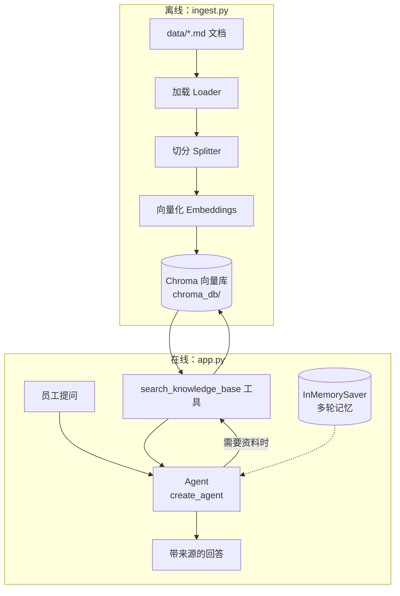
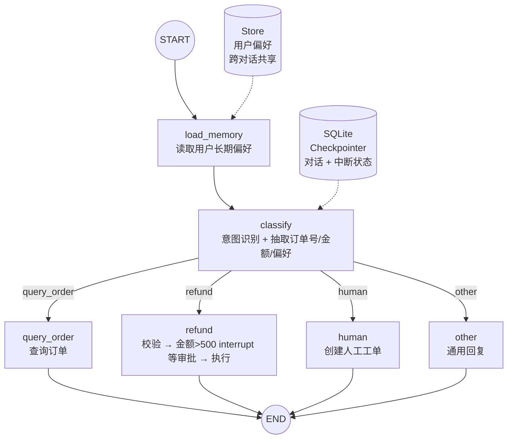
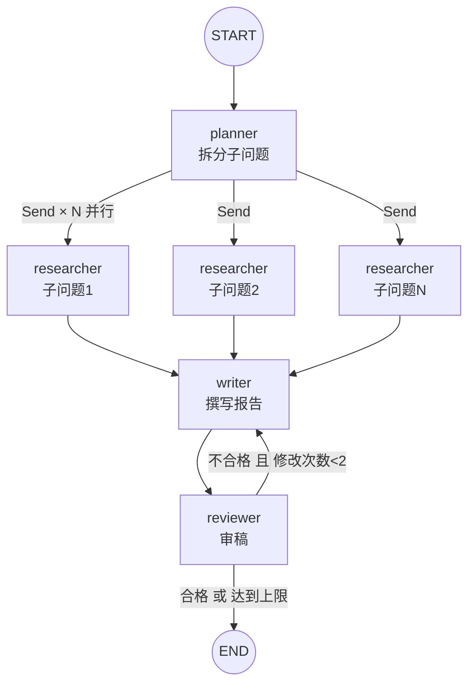

# 11 · 实战项目

> **本章目标**：把前面学到的知识串起来，从零完成三个贴近真实业务的完整项目：
> 1. **企业知识库问答助手**（LangChain：RAG + Agent + 记忆）
> 2. **智能客服工单系统**（LangGraph：路由 + 人工审批 + 持久化 + 长期记忆）
> 3. **多 Agent 研究报告生成器**（LangGraph：规划 + 并行调研 + 撰写 + 审稿循环 + 流式进度）
>
> **前置知识**：完成第 00 ~ 10 章。至少要熟悉 [06 RAG](./06-RAG检索增强生成.md)、[07 Agent](./07-Agent智能体-create_agent.md)、[08](./08-LangGraph核心概念.md)、[09](./09-LangGraph持久化-记忆与人机协同.md)、[10](./10-LangGraph高级模式-流式子图多Agent.md) 章。

三个项目难度递进，涉及的知识点：

| 知识点 | 项目一 | 项目二 | 项目三 |
|---|:-:|:-:|:-:|
| 文档加载 / 切分 / 向量化 | ✅ | | |
| 自定义工具 `@tool` | ✅ | | ✅ |
| `create_agent` + 短期记忆 | ✅ | | |
| 结构化输出 | | ✅ | ✅ |
| StateGraph + 条件路由 | | ✅ | ✅ |
| `interrupt` 人工审批 | | ✅ | |
| SQLite 持久化 | | ✅ | |
| Store 长期记忆 | | ✅ | |
| `Send` 并行 Map-Reduce | | | ✅ |
| 循环（审稿-修改） | | | ✅ |
| 流式进度输出 | ✅ | | ✅ |

> 💡 **学习建议**：不要只复制粘贴运行。先看需求和架构图，自己尝试写一遍，卡住了再对照代码。跑通后，至少完成一个"扩展方向"。

---

## 项目一：企业知识库问答助手

### 1.1 需求

公司有一批内部文档（员工手册、报销制度、IT 指南……），员工经常在群里问重复的问题。做一个问答助手：

- 员工用自然语言提问，助手**基于内部文档**回答
- 回答**必须注明来源**，文档里没有的内容要明确说"不知道"，不能编造
- 支持**多轮追问**（"那出差呢？"能联系上一句的语境）
- 文档更新后，重新运行入库脚本即可生效

> 🎯 **应用场景**：企业内部知识库、产品帮助中心、新员工入职助手、技术文档问答。这是大模型在企业中落地最多的形态。

### 1.2 架构

我们采用 **Agentic RAG**（智能体式 RAG）：不是每个问题都固定先检索，而是把"检索知识库"做成工具，由 Agent 判断**是否需要检索、用什么关键词检索、要不要换个关键词再搜一次**。

> 📖 **术语**：**Agentic RAG**——把检索作为 Agent 的一个工具。相比"每次都先检索"的固定 RAG 链，它能处理闲聊（不检索）、复杂问题（多次检索），代价是多一次模型调用。



### 1.3 目录结构

```
kb-assistant/
├── .env
├── data/                 # 知识库原始文档
│   ├── 员工手册.md
│   └── 报销制度.md
├── kb_config.py          # 公共配置：Embedding 与向量库
├── ingest.py             # 入库脚本
└── app.py                # 问答助手
```

### 1.4 安装依赖

```bash
uv init kb-assistant --python 3.12 && cd kb-assistant
uv add langchain langchain-deepseek langchain-huggingface sentence-transformers langchain-community \
       langchain-text-splitters langchain-chroma python-dotenv
```

> 💡 DeepSeek 不提供 Embedding 模型，这里用本地免费的 BGE 中文模型（首次运行自动下载约 100MB，`sentence-transformers` 会连带安装 PyTorch）。也可以换成通义千问等 Embedding API，见 `kb_config.py` 中的注释。

### 1.5 准备示例文档

`data/员工手册.md`：

```markdown
# 员工手册

## 考勤制度
工作时间为周一至周五 9:30-18:30，午休 12:00-13:30。每月允许迟到 3 次，每次不超过 15 分钟。

## 年假
入职满 1 年享有 5 天年假，满 3 年享有 10 天，满 10 年享有 15 天。年假需提前 3 个工作日在 OA 系统申请，当年未休完可顺延至次年 3 月 31 日。

## 远程办公
每周可申请 1 天远程办公，需直属上级审批。试用期员工不适用。
```

`data/报销制度.md`：

```markdown
# 报销制度

## 差旅报销
一线城市住宿标准每晚不超过 600 元，其他城市不超过 400 元。高铁二等座、飞机经济舱可全额报销。出差餐补每天 100 元，无需发票。

## 报销流程
费用发生后 30 天内在 OA 提交报销单，附电子发票。2000 元以下由部门负责人审批，2000 元以上需财务总监加签。每月 25 日前提交的报销单当月发放。
```

`kb_config.py`：

```python
from dotenv import load_dotenv
from langchain_chroma import Chroma
from langchain_huggingface import HuggingFaceEmbeddings

load_dotenv()

CHROMA_DIR = "./chroma_db"
COLLECTION = "company_kb"


def get_embeddings():
    return HuggingFaceEmbeddings(model_name="BAAI/bge-small-zh-v1.5")
    # API 替代示例（阿里云百炼 OpenAI 兼容接口，需 uv add langchain-openai）：
    # import os
    # from langchain_openai import OpenAIEmbeddings
    # return OpenAIEmbeddings(
    #     model="text-embedding-v4",
    #     base_url="https://dashscope.aliyuncs.com/compatible-mode/v1",
    #     api_key=os.environ["DASHSCOPE_API_KEY"],
    #     check_embedding_ctx_length=False,  # 兼容接口不支持 token 数组输入，必须关闭
    # )


def get_vector_store():
    return Chroma(
        collection_name=COLLECTION,
        embedding_function=get_embeddings(),
        persist_directory=CHROMA_DIR,  # 持久化到本地目录，重启后数据仍在
    )
```

> ⚠️ **注意**：入库和查询**必须使用同一个 Embedding 模型**。换了 Embedding 模型，就要删除 `chroma_db/` 重新入库，否则检索结果会完全错乱。

### 1.6 入库脚本 ingest.py

```python
from langchain_community.document_loaders import DirectoryLoader, TextLoader
from langchain_text_splitters import RecursiveCharacterTextSplitter

from kb_config import get_vector_store


def main():
    # 1. 加载 data/ 下所有 Markdown 文档
    loader = DirectoryLoader(
        "data",
        glob="**/*.md",
        loader_cls=TextLoader,
        loader_kwargs={"encoding": "utf-8"},
    )
    docs = loader.load()
    print(f"📄 加载文档 {len(docs)} 篇")

    # 2. 切分：中文文档要把中文标点加入分隔符
    splitter = RecursiveCharacterTextSplitter(
        chunk_size=300,
        chunk_overlap=50,
        separators=["\n## ", "\n\n", "\n", "。", "！", "？", "；", " ", ""],
        add_start_index=True,
    )
    chunks = splitter.split_documents(docs)
    print(f"✂️  切分为 {len(chunks)} 个片段")

    # 3. 写入向量库：先清空旧数据，避免重复入库
    store = get_vector_store()
    store.reset_collection()
    store.add_documents(chunks)
    print("✅ 入库完成")


if __name__ == "__main__":
    main()
```

运行：

```bash
uv run ingest.py
```

> 💡 PDF、Word 文档可以分别换用 `PyPDFLoader`、`Docx2txtLoader`（需安装 `pypdf`、`docx2txt`），其余流程不变，详见第 06 章。

### 1.7 问答助手 app.py

```python
import uuid
from pathlib import Path

from dotenv import load_dotenv
from langchain.agents import create_agent
from langchain.tools import tool
from langgraph.checkpoint.memory import InMemorySaver

from kb_config import get_vector_store
from langchain.chat_models import init_chat_model

load_dotenv()

vector_store = get_vector_store()


@tool(response_format="content_and_artifact")
def search_knowledge_base(query: str):
    """检索公司内部知识库（员工手册、报销制度等）。
    回答任何关于公司制度、流程、福利的问题前都必须先调用本工具。
    query 应为简洁的检索关键词，例如“年假天数”“住宿报销标准”。"""
    docs = vector_store.similarity_search(query, k=4)
    content = "\n\n".join(
        f"[来源：{Path(d.metadata['source']).name}]\n{d.page_content}" for d in docs
    )
    # 第一个返回值给模型看，第二个返回值（原始文档）留给程序使用，不进入模型上下文
    return content, docs


SYSTEM_PROMPT = """你是公司内部的知识库助手，用中文回答员工的问题。

规则：
1. 涉及公司制度、流程、福利的问题，必须先调用 search_knowledge_base 检索，只能依据检索到的内容回答。
2. 检索结果不足以回答时，可以换个关键词再检索一次；仍然找不到，就明确回答“知识库中没有找到相关规定，建议咨询人事或行政部门”，绝不编造。
3. 回答末尾用“📎 来源：”列出引用的文档名。
4. 闲聊或与公司无关的问题，礼貌简短地回应，无需检索。"""

agent = create_agent(
    model=init_chat_model("deepseek:deepseek-flash", extra_body={"thinking": {"type": "disabled"}}),
    tools=[search_knowledge_base],
    system_prompt=SYSTEM_PROMPT,
    checkpointer=InMemorySaver(),  # 多轮记忆
)


def chat():
    config = {"configurable": {"thread_id": str(uuid.uuid4())}}
    print("🤖 知识库助手已启动，输入 q 退出\n")
    while True:
        question = input("👤 你：").strip()
        if question.lower() in {"q", "quit", "exit"}:
            break
        if not question:
            continue

        print("🤖 助手：", end="", flush=True)
        for token, metadata in agent.stream(
            {"messages": [{"role": "user", "content": question}]},
            config=config,
            stream_mode="messages",
        ):
            # 只输出模型节点生成的文字，跳过工具返回的内容
            if metadata["langgraph_node"] == "model" and token.text:
                print(token.text, end="", flush=True)
        print("\n")


if __name__ == "__main__":
    chat()
```

### 1.8 运行效果

```bash
uv run app.py
```

```
👤 你：我入职两年了，有几天年假？
🤖 助手：根据员工手册，入职满 1 年享有 5 天年假，满 3 年才增加到 10 天。你入职两年，目前享有 5 天年假。
年假需要提前 3 个工作日在 OA 系统申请，当年没休完可以顺延到次年 3 月 31 日。
📎 来源：员工手册.md

👤 你：那去上海出差住酒店能报多少？
🤖 助手：上海属于一线城市，住宿标准为每晚不超过 600 元……
📎 来源：报销制度.md

👤 你：公司有健身房吗？
🤖 助手：知识库中没有找到相关规定，建议咨询人事或行政部门。
```

注意第二个问题"那去上海出差……"——"那"字依赖上文，多轮记忆让 Agent 能正确理解。

### 1.9 扩展方向

| 方向 | 做法 | 相关章节 |
|---|---|---|
| 提升检索质量 | 加入 Rerank 重排序、混合检索（关键词 + 向量）、查询改写 | 06 章 |
| 支持更多格式 | PDF、Word、Confluence、飞书文档加载器 | 06 章 |
| 权限控制 | 入库时写入 `metadata["department"]`，检索时按用户部门过滤 | 06 章 |
| 持久化对话 | `InMemorySaver` 换成 `SqliteSaver` / `PostgresSaver` | 09 章 |
| 长对话 | 加 `SummarizationMiddleware` 自动压缩历史 | 07 章 |
| 效果评估 | 准备"问题-标准答案"数据集，用 LangSmith 评估 | 12 章 |
| 提供 Web 服务 | 用 FastAPI 暴露接口，见本章末尾 | 12 章 |

---

## 项目二：智能客服工单系统

### 2.1 需求

电商平台的售后客服机器人：

- 自动识别用户意图：**查询订单 / 申请退款 / 转人工 / 其他咨询**
- **查询订单**：根据订单号返回物流状态
- **申请退款**：校验订单和金额；**退款超过 500 元需要人工审批**，审批通过才执行
- **转人工**：生成工单号
- **记住用户偏好**（如"以后叫我王先生""回答简短一点"），**下次新对话也生效**
- 服务重启后，**进行中的对话和待审批的退款不能丢**

> 🎯 **为什么用 LangGraph 而不是 create_agent？** 这里的流程有明确业务规则（金额阈值、必须审批），需要**确定性**：退款必须走校验 → 审批 → 执行的固定步骤，不能交给模型"自由发挥"。LangGraph 让我们把规则写死在图里，模型只负责理解意图和生成回复。

### 2.2 架构



| 记忆类型 | 实现 | 保存内容 | 作用范围 |
|---|---|---|---|
| 短期记忆 | `SqliteSaver`（Checkpointer） | 对话消息、待审批的中断状态 | 同一个 `thread_id` |
| 长期记忆 | `InMemoryStore`（Store） | 用户称呼、回答风格偏好 | 同一个 `user_id` 的所有对话 |

### 2.3 目录结构与依赖

```
cs-agent/
├── .env
├── mock_db.py        # 模拟订单数据库
├── graph.py          # 客服流程图
└── main.py           # 命令行交互 + 人工审批
```

```bash
uv init cs-agent --python 3.12 && cd cs-agent
uv add langchain langchain-deepseek langgraph-checkpoint-sqlite python-dotenv
```

### 2.4 模拟数据 mock_db.py

```python
ORDERS = {
    "A1001": {"item": "无线降噪耳机", "amount": 899.0, "status": "已签收", "logistics": "顺丰 SF1234567890，10 月 15 日已签收"},
    "A1002": {"item": "机械键盘", "amount": 359.0, "status": "运输中", "logistics": "中通 ZT9876543210，当前位于杭州转运中心"},
    "A1003": {"item": "保温杯", "amount": 89.0, "status": "待发货", "logistics": "商家备货中，预计 48 小时内发货"},
}

REFUNDED: set[str] = set()


def get_order(order_id: str) -> dict | None:
    return ORDERS.get(order_id)


def execute_refund(order_id: str, amount: float) -> str:
    REFUNDED.add(order_id)
    return f"RF{order_id}{int(amount)}"
```

### 2.5 流程图 graph.py

```python
import sqlite3
import uuid
from dataclasses import dataclass
from typing import Literal

from dotenv import load_dotenv
from langchain.chat_models import init_chat_model
from langchain.messages import AIMessage, SystemMessage
from langgraph.checkpoint.sqlite import SqliteSaver
from langgraph.graph import END, START, MessagesState, StateGraph
from langgraph.runtime import Runtime
from langgraph.store.memory import InMemoryStore
from langgraph.types import interrupt
from pydantic import BaseModel, Field

from mock_db import REFUNDED, execute_refund, get_order

load_dotenv()

model = init_chat_model("deepseek:deepseek-flash", extra_body={"thinking": {"type": "disabled"}}, temperature=0)

REFUND_APPROVAL_THRESHOLD = 500


# ---------- 运行上下文：每次调用时传入，不进入状态 ----------
@dataclass
class Context:
    user_id: str


# ---------- 状态 ----------
class State(MessagesState):
    intent: str
    order_id: str | None
    refund_amount: float | None
    user_profile: dict


# ---------- 结构化输出：意图识别结果 ----------
class IntentResult(BaseModel):
    intent: Literal["query_order", "refund", "human", "other"] = Field(
        description="query_order=查订单/物流；refund=退款退货；human=要求人工或投诉；other=其他"
    )
    order_id: str | None = Field(default=None, description="订单号，如 A1001，没有则为空")
    refund_amount: float | None = Field(default=None, description="用户要求的退款金额，没提则为空")
    preference: str | None = Field(
        default=None,
        description="用户明确表达的长期偏好，如称呼、回答风格；没有则为空",
    )


classifier = model.with_structured_output(IntentResult)


# ---------- 工具函数：结合用户偏好生成回复 ----------
def reply(state: State, facts: str) -> dict:
    prefs = "；".join(state.get("user_profile", {}).get("preferences", [])) or "无"
    system = SystemMessage(
        "你是电商平台的售后客服，语气亲切专业，用中文回复。"
        f"\n用户偏好：{prefs}\n请严格依据以下业务处理结果回复，不要编造信息：\n{facts}"
    )
    response = model.invoke([system, *state["messages"]])
    return {"messages": [AIMessage(response.text)]}


# ---------- 节点 ----------
def load_memory(state: State, runtime: Runtime[Context]):
    item = runtime.store.get(("users", runtime.context.user_id), "profile")
    return {"user_profile": item.value if item else {"preferences": []}}


def classify(state: State, runtime: Runtime[Context]):
    result = classifier.invoke(
        [SystemMessage("识别用户最新一条消息的意图，并结合上下文抽取订单号和金额。"), *state["messages"]]
    )

    # 写入长期记忆：同一用户的所有对话共享
    profile = state["user_profile"]
    if result.preference and result.preference not in profile["preferences"]:
        profile = {"preferences": [*profile["preferences"], result.preference]}
        runtime.store.put(("users", runtime.context.user_id), "profile", profile)

    return {
        "intent": result.intent,
        # 本轮没提订单号时沿用上一轮的，支持“那这个能退吗”这类追问
        "order_id": result.order_id or state.get("order_id"),
        "refund_amount": result.refund_amount,
        "user_profile": profile,
    }


def route(state: State) -> Literal["query_order", "refund", "human", "other"]:
    return state["intent"]


def query_order(state: State):
    order_id = state.get("order_id")
    if not order_id:
        return reply(state, "用户没有提供订单号，请礼貌地询问订单号。")
    order = get_order(order_id)
    if not order:
        return reply(state, f"订单 {order_id} 不存在，请用户核对订单号。")
    return reply(state, f"订单 {order_id}：商品 {order['item']}，状态 {order['status']}，物流 {order['logistics']}")


def refund(state: State):
    order_id = state.get("order_id")
    order = get_order(order_id) if order_id else None
    if not order:
        return reply(state, "缺少有效订单号，请询问用户要退款的订单号。")
    if order_id in REFUNDED:
        return reply(state, f"订单 {order_id} 已经退款过，不能重复退款。")

    amount = state.get("refund_amount") or order["amount"]
    if amount > order["amount"]:
        return reply(state, f"申请金额 {amount} 元超过订单实付 {order['amount']} 元，无法受理。")

    if amount > REFUND_APPROVAL_THRESHOLD:
        # 暂停流程，等待人工审批。恢复时 interrupt() 返回审批结果，节点会从头重新执行
        decision = interrupt({
            "type": "refund_approval",
            "order_id": order_id,
            "item": order["item"],
            "amount": amount,
            "question": f"订单 {order_id} 申请退款 {amount} 元，是否批准？",
        })
        if not decision.get("approved"):
            note = decision.get("note") or "未说明原因"
            return reply(state, f"退款申请经人工审核未通过，原因：{note}。可建议用户转人工进一步沟通。")

    # 有副作用的操作放在 interrupt 之后，避免恢复执行时重复退款
    refund_id = execute_refund(order_id, amount)
    return reply(state, f"退款已受理，退款单号 {refund_id}，金额 {amount} 元，预计 1-3 个工作日原路退回。")


def human(state: State):
    ticket_id = f"T{uuid.uuid4().hex[:8].upper()}"
    return reply(state, f"已创建人工工单 {ticket_id}，人工客服将在 30 分钟内联系用户。")


def other(state: State):
    return reply(state, "这是一般咨询，可以简要回答；如果超出售后范围，引导用户提供订单号或转人工。")


# ---------- 组装 ----------
def build_graph():
    builder = StateGraph(State, context_schema=Context)
    builder.add_node("load_memory", load_memory)
    builder.add_node("classify", classify)
    builder.add_node("query_order", query_order)
    builder.add_node("refund", refund)
    builder.add_node("human", human)
    builder.add_node("other", other)

    builder.add_edge(START, "load_memory")
    builder.add_edge("load_memory", "classify")
    builder.add_conditional_edges("classify", route)
    for node in ["query_order", "refund", "human", "other"]:
        builder.add_edge(node, END)

    conn = sqlite3.connect("cs_checkpoints.db", check_same_thread=False)
    checkpointer = SqliteSaver(conn)
    # 演示用内存 Store；生产环境换成 PostgresStore 等持久化实现
    store = InMemoryStore()
    return builder.compile(checkpointer=checkpointer, store=store)


graph = build_graph()
```

> ⚠️ **注意**：
> 1. `interrupt()` 之前的代码在恢复时会**重新执行一遍**，所以"真正退款"这种副作用必须放在 `interrupt()` **之后**。
> 2. `InMemoryStore` 在进程重启后会丢失长期记忆。本项目为了少装依赖用它演示；生产环境应换成 `PostgresStore` 等持久化 Store，代码其他部分不变。
> 3. 使用 `SqliteSaver` 后，即使程序在"等待审批"时崩溃，重启后用同一个 `thread_id` 依然可以继续审批。

### 2.6 交互入口 main.py

```python
import uuid

from langgraph.types import Command

from graph import Context, graph


def run_turn(user_input, config, context):
    result = graph.invoke(
        {"messages": [{"role": "user", "content": user_input}]},
        config=config,
        context=context,
    )
    # 处理人工审批中断：可能连续多次，用 while 循环
    while "__interrupt__" in result:
        payload = result["__interrupt__"][0].value
        print(f"\n🛑 【人工审批】{payload['question']}（商品：{payload['item']}）")
        approved = input("   审批人输入 y 批准 / n 拒绝：").strip().lower() == "y"
        note = "" if approved else input("   拒绝原因：").strip()
        result = graph.invoke(
            Command(resume={"approved": approved, "note": note}),
            config=config,
            context=context,
        )
    return result["messages"][-1].text


def main():
    user_id = input("请输入用户 ID（默认 u001）：").strip() or "u001"
    context = Context(user_id=user_id)
    thread_id = str(uuid.uuid4())
    config = {"configurable": {"thread_id": thread_id}}
    print(f"🤖 客服已接入（会话 {thread_id[:8]}），输入 new 开启新会话，q 退出\n")

    while True:
        text = input("👤 用户：").strip()
        if text == "q":
            break
        if text == "new":
            config = {"configurable": {"thread_id": str(uuid.uuid4())}}
            print("🔄 已开启新会话（短期记忆清空，长期偏好保留）\n")
            continue
        if text:
            print(f"🤖 客服：{run_turn(text, config, context)}\n")


if __name__ == "__main__":
    main()
```

### 2.7 运行效果

```
👤 用户：以后叫我王先生，回答简短点。我的订单 A1002 到哪了？
🤖 客服：王先生您好，A1002 机械键盘运输中，目前在杭州转运中心。

👤 用户：A1001 的耳机我想退款
🛑 【人工审批】订单 A1001 申请退款 899.0 元，是否批准？（商品：无线降噪耳机）
   审批人输入 y 批准 / n 拒绝：y
🤖 客服：王先生，退款已受理，单号 RFA1001899，1-3 个工作日原路退回。

👤 用户：new
🔄 已开启新会话（短期记忆清空，长期偏好保留）

👤 用户：A1003 什么时候发货
🤖 客服：王先生您好，A1003 保温杯正在备货，预计 48 小时内发货。
```

新会话中仍然称呼"王先生"且回答简短——这就是 Store 长期记忆的效果。

### 2.8 扩展方向

| 方向 | 做法 |
|---|---|
| 真实审批流 | 中断时把审批请求推送到企业微信/飞书/后台管理页，审批人点击后调用接口 `Command(resume=...)` 恢复 |
| 对接真实系统 | 把 `mock_db` 换成订单服务 API，给节点配 `RetryPolicy`（第 10 章） |
| 更多意图 | 增加"修改地址""催发货"等分支，只需加节点和路由 |
| 复杂咨询 | 把 `other` 节点换成一个带知识库工具的 `create_agent` 子图（结合项目一） |
| 质量监控 | 用 LangSmith 统计各意图的占比、转人工率，发现识别错误的对话 |
| 生产存储 | `SqliteSaver` → `PostgresSaver`，`InMemoryStore` → `PostgresStore` |

---

## 项目三：多 Agent 研究报告生成器

### 3.1 需求

用户输入一个研究主题（如"2026 年 AI 编程助手的发展趋势"），系统自动：

1. **规划**：把主题拆成 3~5 个子问题
2. **并行调研**：每个子问题由一个"研究员"同时搜索资料并总结
3. **撰写**：主笔根据所有调研结果写一份结构化报告，附参考来源
4. **审稿**：审稿人检查报告质量，不合格就退回修改，最多修改 2 轮
5. **实时进度**：整个过程在终端显示进度，撰写时显示打字机效果

> 🎯 **应用场景**：行业调研、竞品分析、技术选型报告、文献综述、尽职调查初稿。

### 3.2 架构



| 角色 | 实现方式 | 用到的知识点 |
|---|---|---|
| 规划者 | 节点 + 结构化输出 | `with_structured_output` |
| 研究员 | 被 `Send` 动态分发的节点 | Map-Reduce、Reducer |
| 主笔 | 节点，流式输出 | `messages` 流模式 |
| 审稿人 | 节点 + 结构化输出 + 条件边 | 循环、条件路由 |
| 进度播报 | `get_stream_writer` | `custom` 流模式 |

> 💡 这里的"多 Agent"指多个**分工不同的 AI 角色**。它们各自是一个节点，流程是固定的（规划 → 调研 → 撰写 → 审稿），因此用 StateGraph 编排比"主管自由调度"更稳定、更可控。如果研究员需要自主决定搜索几次、换什么关键词，可以把 `researcher` 节点替换成一个 `create_agent` 子 Agent。

### 3.3 目录结构与依赖

```
research-agent/
├── .env
├── search.py      # 搜索工具（模拟，可替换为真实搜索）
└── research.py    # 研究流程图 + 运行入口
```

```bash
uv init research-agent --python 3.12 && cd research-agent
uv add langchain langchain-deepseek python-dotenv
```

### 3.4 搜索工具 search.py

```python
def web_search(query: str, max_results: int = 3) -> list[dict]:
    """模拟搜索引擎，返回标题、链接和摘要。"""
    return [
        {
            "title": f"{query} —— 行业观察 {i}",
            "url": f"https://example.com/{abs(hash(query)) % 10000}/{i}",
            "content": f"这是一篇关于「{query}」的模拟文章摘要 {i}：包含若干数据、观点和案例。",
        }
        for i in range(1, max_results + 1)
    ]
```

> 💡 **替换为真实搜索**：推荐 [Tavily](https://tavily.com)（专为 AI 应用设计的搜索 API，有免费额度）。
>
> ```bash
> uv add langchain-tavily   # 并在 .env 中配置 TAVILY_API_KEY
> ```
>
> ```python
> from langchain_tavily import TavilySearch
>
> _tavily = TavilySearch(max_results=3)
>
> def web_search(query: str, max_results: int = 3) -> list[dict]:
>     response = _tavily.invoke({"query": query})
>     return [{"title": r["title"], "url": r["url"], "content": r["content"]} for r in response["results"]]
> ```
>
> 保持函数签名和返回结构不变，`research.py` 无需任何修改。其他可选服务：Bing / Google 搜索 API、博查、SerpAPI 等。

### 3.5 研究流程 research.py

```python
import operator
from pathlib import Path
from typing import Annotated, Literal, TypedDict

from dotenv import load_dotenv
from langchain.chat_models import init_chat_model
from langgraph.config import get_stream_writer
from langgraph.graph import END, START, StateGraph
from langgraph.types import Send
from pydantic import BaseModel, Field

from search import web_search

load_dotenv()

model = init_chat_model("deepseek:deepseek-flash", extra_body={"thinking": {"type": "disabled"}})
fast_model = init_chat_model("deepseek:deepseek-flash", extra_body={"thinking": {"type": "disabled"}})  # 调研摘要用更快更便宜的模型

MAX_REVISIONS = 2


# ---------- 状态 ----------
class Finding(TypedDict):
    question: str
    summary: str
    sources: list[str]


class ResearchState(TypedDict):
    topic: str
    sub_questions: list[str]
    findings: Annotated[list[Finding], operator.add]  # 并行研究员的结果自动合并
    report: str
    feedback: str
    revisions: int
    approved: bool


class ResearchTask(TypedDict):
    """单个研究员收到的任务。"""
    question: str


# ---------- 结构化输出 ----------
class Plan(BaseModel):
    sub_questions: list[str] = Field(description="3 到 5 个互不重叠、可独立调研的子问题")


class Review(BaseModel):
    approved: bool = Field(description="报告是否达到可交付标准")
    feedback: str = Field(description="不合格时给出具体、可执行的修改意见；合格时简要说明理由")


# ---------- 节点 ----------
def planner(state: ResearchState):
    writer = get_stream_writer()
    writer({"stage": "plan", "msg": f"🧭 正在拆解主题：{state['topic']}"})
    plan = model.with_structured_output(Plan).invoke(
        f"你是研究规划专家。请把研究主题拆解为 3~5 个子问题，覆盖现状、关键因素、案例和趋势。\n主题：{state['topic']}"
    )
    for i, q in enumerate(plan.sub_questions, 1):
        writer({"stage": "plan", "msg": f"   {i}. {q}"})
    return {"sub_questions": plan.sub_questions, "revisions": 0}


def dispatch_research(state: ResearchState):
    return [Send("researcher", {"question": q}) for q in state["sub_questions"]]


def researcher(task: ResearchTask):
    writer = get_stream_writer()
    question = task["question"]
    writer({"stage": "research", "msg": f"🔍 开始调研：{question}"})

    results = web_search(question)
    materials = "\n\n".join(f"[{r['title']}]({r['url']})\n{r['content']}" for r in results)
    summary = fast_model.invoke(
        f"根据以下资料，用 150 字以内回答问题，只使用资料中的信息。\n问题：{question}\n资料：\n{materials}"
    ).text

    writer({"stage": "research", "msg": f"✅ 完成调研：{question}"})
    return {"findings": [{"question": question, "summary": summary, "sources": [r["url"] for r in results]}]}


def writer_node(state: ResearchState):
    writer = get_stream_writer()
    is_revision = bool(state.get("feedback"))
    writer({"stage": "write", "msg": "✍️  根据审稿意见修改报告…" if is_revision else "✍️  开始撰写报告…"})

    materials = "\n\n".join(
        f"### {f['question']}\n{f['summary']}\n来源：{', '.join(f['sources'])}" for f in state["findings"]
    )
    prompt = (
        f"你是资深行业分析师。请基于调研材料，就主题「{state['topic']}」撰写一份 Markdown 研究报告。\n"
        "结构：摘要、分章节正文（每章对应一个子问题）、结论与建议、参考来源（列出链接）。\n"
        "要求：只使用材料中的信息，观点后标注来源编号。\n\n"
        f"调研材料：\n{materials}"
    )
    if is_revision:
        prompt += f"\n\n上一版报告：\n{state['report']}\n\n审稿意见（请逐条落实）：\n{state['feedback']}"

    report = model.invoke(prompt).text
    return {"report": report, "revisions": state["revisions"] + (1 if is_revision else 0)}


def reviewer(state: ResearchState):
    writer = get_stream_writer()
    writer({"stage": "review", "msg": "🧐 审稿中…"})
    review = model.with_structured_output(Review).invoke(
        "你是严格的报告审稿人。检查以下报告：结构是否完整、论点是否有材料支撑、是否标注来源、"
        "是否有空洞套话。\n\n" + state["report"]
    )
    writer({"stage": "review", "msg": f"{'✅ 审稿通过' if review.approved else '↩️  退回修改'}：{review.feedback}"})
    return {"approved": review.approved, "feedback": "" if review.approved else review.feedback}


def after_review(state: ResearchState) -> Literal["writer", "__end__"]:
    if state["approved"] or state["revisions"] >= MAX_REVISIONS:
        return END
    return "writer"


# ---------- 组装 ----------
builder = StateGraph(ResearchState)
builder.add_node("planner", planner)
builder.add_node("researcher", researcher)
builder.add_node("writer", writer_node)
builder.add_node("reviewer", reviewer)

builder.add_edge(START, "planner")
builder.add_conditional_edges("planner", dispatch_research, ["researcher"])
builder.add_edge("researcher", "writer")  # 所有研究员完成后才进入 writer
builder.add_edge("writer", "reviewer")
builder.add_conditional_edges("reviewer", after_review)
graph = builder.compile()


# ---------- 运行入口：流式展示进度 + 打字机效果 ----------
def main():
    topic = input("请输入研究主题：").strip() or "2026 年 AI 编程助手的发展趋势"
    final_state = None
    for mode, data in graph.stream(
        {"topic": topic, "findings": []},
        stream_mode=["custom", "messages", "values"],
        config={"recursion_limit": 30},  # 兜底：防止审稿循环异常时无限运行
    ):
        if mode == "custom":
            print(f"\n{data['msg']}", flush=True)
        elif mode == "messages":
            token, metadata = data
            if metadata["langgraph_node"] == "writer" and token.text:
                print(token.text, end="", flush=True)
        elif mode == "values":
            final_state = data  # 最后一次 values 就是最终状态

    Path("report.md").write_text(final_state["report"], encoding="utf-8")
    print("\n\n🎉 报告生成完毕，已保存到 report.md")


if __name__ == "__main__":
    main()
```

> 💡 三种流模式各司其职：`custom` 显示进度，`messages` 实现撰写时的打字机效果，`values` 用来拿到最终状态保存文件。

### 3.6 运行效果

```
请输入研究主题：2026 年 AI 编程助手的发展趋势

🧭 正在拆解主题：2026 年 AI 编程助手的发展趋势
   1. 当前主流 AI 编程助手的产品形态与市场格局
   2. 从代码补全到自主 Agent 的关键技术演进
   3. 企业采用 AI 编程助手的典型案例与效果
   4. 面临的挑战：安全、质量与开发者技能
🔍 开始调研：当前主流 AI 编程助手的产品形态与市场格局
🔍 开始调研：从代码补全到自主 Agent 的关键技术演进
🔍 开始调研：企业采用 AI 编程助手的典型案例与效果
🔍 开始调研：面临的挑战：安全、质量与开发者技能
✅ 完成调研：……（4 个研究员并行完成，顺序不固定）

✍️  开始撰写报告…
# 2026 年 AI 编程助手发展趋势研究报告
## 摘要
……（打字机效果逐字输出）

🧐 审稿中…
↩️  退回修改：第三章缺少具体数据支撑；结论部分过于笼统……

✍️  根据审稿意见修改报告…
……

🧐 审稿中…
✅ 审稿通过：结构完整，论据充分……

🎉 报告生成完毕
```

注意 4 个"开始调研"几乎同时出现——这就是 `Send` 带来的并行效果，总耗时约等于最慢的那个研究员，而不是 4 个相加。

### 3.7 扩展方向

| 方向 | 做法 | 相关章节 |
|---|---|---|
| 研究员更智能 | 把 `researcher` 换成带搜索工具的 `create_agent`，自主决定搜索几轮 | 07、10 章 |
| 人工确认大纲 | 在 `planner` 之后加 `interrupt`，让用户确认或修改子问题再开始调研 | 09 章 |
| 断点续跑 | 加 Checkpointer，长任务中途失败可从最近一步恢复 | 09 章 |
| 搜索失败重试 | 给 `researcher` 节点配置 `RetryPolicy` | 10 章 |
| 导出 PDF | 把保存的 `report.md` 用 Pandoc 等工具转为 PDF/Word | — |
| 质量评估 | 用 LLM-as-Judge 对报告打分，在 LangSmith 中对比不同 Prompt 的效果 | 12 章 |
| 超长任务 | 改用 Deep Agents（自带规划、文件系统、子 Agent） | 10 章 |

---

## 附：用 FastAPI 把项目变成 Web 服务

命令行只适合演示，真实产品需要提供 HTTP 接口给前端调用。以项目一为例，最简版本如下：

```bash
uv add fastapi uvicorn
```

```python
# server.py（放在 kb-assistant/ 目录下）
from fastapi import FastAPI
from fastapi.responses import StreamingResponse
from pydantic import BaseModel

from app import agent  # 复用项目一中创建好的 agent

api = FastAPI()


class ChatRequest(BaseModel):
    thread_id: str
    message: str


@api.post("/chat")
async def chat(req: ChatRequest):
    async def event_stream():
        async for token, metadata in agent.astream(
            {"messages": [{"role": "user", "content": req.message}]},
            config={"configurable": {"thread_id": req.thread_id}},
            stream_mode="messages",
        ):
            if metadata["langgraph_node"] == "model" and token.text:
                yield f"data: {token.text}\n\n"
        yield "data: [DONE]\n\n"

    return StreamingResponse(event_stream(), media_type="text/event-stream")
```

```bash
uv run uvicorn server:api --reload
```

> 📖 **术语**：**SSE（Server-Sent Events，服务器推送事件）**——服务器通过一个长连接持续向浏览器推送数据，格式为 `data: 内容\n\n`。ChatGPT 类产品的流式输出大多基于 SSE。

这只是最小示例。生产环境还需要考虑：用户鉴权、`thread_id` 与用户的绑定（防止越权读取别人的对话）、持久化 Checkpointer、超时与限流、错误处理、日志监控、Docker 部署等，这些都在 [12 调试评估与生产部署](./12-调试评估与生产部署.md) 中详细展开。

---

## 本章小结

- **项目一（Agentic RAG）**：离线入库（加载 → 切分 → 向量化 → Chroma）+ 在线问答（检索工具 + `create_agent` + `InMemorySaver`）。关键在系统提示词约束"只依据资料回答、注明来源、不知道就说不知道"。
- **项目二（LangGraph 客服）**：业务规则写进图里保证确定性；结构化输出做意图识别；`interrupt` 实现大额退款审批，副作用放在中断之后；`SqliteSaver` 保存会话，Store 保存跨会话的用户偏好。
- **项目三（多角色研究）**：结构化输出做规划，`Send` 并行调研，Reducer 合并结果，条件边实现审稿循环并设置修改上限，`custom` + `messages` 流模式展示进度和打字机效果。
- 三个项目都能通过 FastAPI + SSE 对外提供服务。

## 练习

1. **项目一**：往 `data/` 加一份你自己的文档（比如某开源项目的 README），重新入库并提问；再故意问一个文档中没有的问题，检查它是否会编造。
2. **项目一**：用 `response_format="content_and_artifact"` 返回的原始文档，在回答后额外打印每个片段的 `start_index`，实现"精确定位原文位置"。
3. **项目二**：新增"修改收货地址"意图——仅"待发货"状态的订单可以修改，其他状态要拒绝并说明原因。
4. **项目二**：在审批中断时退出程序，重新运行 `main.py` 并使用同一个 `thread_id`（需改造为可输入 `thread_id`），验证待审批状态没有丢失。
5. **项目三**：在 `planner` 后加入 `interrupt`，让用户可以增删子问题后再开始调研（需要加 Checkpointer）。
6. **综合**：把项目一的知识库 Agent 作为工具，接入项目二的 `other` 分支，让客服能回答退换货政策等问题。

---

**上一章** ← [10 LangGraph 高级模式](./10-LangGraph高级模式-流式子图多Agent.md) ｜ **下一章** → [12 调试评估与生产部署](./12-调试评估与生产部署.md)
