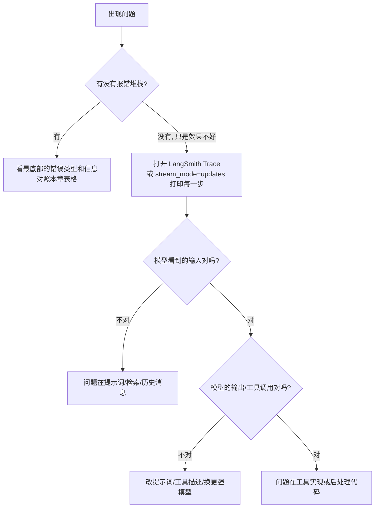
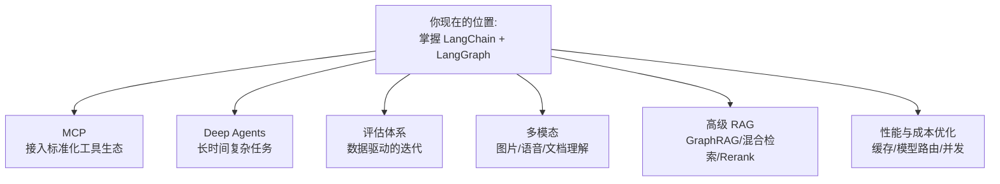

# 14 · FAQ 与学习资源

> **本章目标**：遇到报错知道怎么排查；看到旧教程知道怎么改成新写法；面对选型问题能做出判断；知道接下来该去哪里继续深入。
>
> **前置知识**：本章供随时查阅，不需要按顺序读。

---

## 一、常见报错与排查

### 1.1 安装与环境

| 报错 / 现象 | 原因 | 解决 |
|---|---|---|
| `ModuleNotFoundError: No module named 'langchain_deepseek'`（或 `langchain_openai` 等） | 没装对应的模型接入包 | `uv add langchain-deepseek`；注意包名用中划线，导入时用下划线 |
| DeepSeek 返回 `400`，提示 `reasoning_content` 相关错误 | 开启了思考模式（DeepSeek 默认开启）又使用了工具调用，而 `langchain-deepseek` 不会回传推理内容 | 创建模型时加 `extra_body={"thinking": {"type": "disabled"}}`，见 [01 章 4.1 节](./01-环境准备.md#41-deepseek本教程默认) |
| DeepSeek 提示模型不存在 | `deepseek-chat` / `deepseek-reasoner` 已于 2026-07 停用 | 改用 `deepseek-flash` 或 `deepseek-v4-pro` |
| `create_agent(model="deepseek:...")` 能聊天，但一调用工具就报错 | 字符串写法无法关闭思考模式 | 传入 `init_chat_model(..., extra_body=...)` 创建的模型实例 |
| `ModuleNotFoundError: No module named 'langchain_community'` | 社区集成包需要单独安装 | `uv add langchain-community` |
| `ImportError: cannot import name 'LLMChain'`（或 `ConversationChain`、`RetrievalQA` 等） | 0.x 的旧组件在 1.x 已移出主包 | 改为新写法（见第二节）；实在要跑旧代码，装 `langchain-classic` |
| `ImportError: cannot import name 'create_react_agent' from 'langchain.agents'` | 旧 API | 使用 `from langchain.agents import create_agent` |
| 安装时提示 Python 版本不满足 | Python < 3.10 | `uv init --python 3.12` 重建环境 |
| 明明装了包，运行还是找不到 | 运行脚本用的不是项目虚拟环境 | 用 `uv run xxx.py`；或者在编辑器里选择 `.venv` 解释器 |
| `pydantic` 相关的奇怪报错 | 还在用 `langchain_core.pydantic_v1` 等旧导入 | 直接 `from pydantic import BaseModel` |

### 1.2 模型调用

| 报错 / 现象 | 原因 | 解决 |
|---|---|---|
| `AuthenticationError` / `401` | Key 错误、未加载、环境变量名写错 | 检查 `.env`、是否调用了 `load_dotenv()`、变量名是否正确 |
| `Unable to infer model provider` | 模型字符串缺少提供商前缀 | 写成 `"deepseek:deepseek-flash"` 或额外传 `model_provider="deepseek"` |
| `NotFoundError` / `404 model not found` | 模型名写错或该账号无权限 | 到服务商控制台核对模型 ID |
| `RateLimitError` / `429` | 请求太频繁或余额不足 | 降低并发、加 `InMemoryRateLimiter`、充值或申请提额 |
| `APITimeoutError` / 连接超时 | 网络不通或模型响应慢 | 检查网络；设置 `timeout`、`max_retries`；国内网络优先使用国内模型 |
| `400 ... context length` / `prompt is too long` | 输入超过上下文窗口 | 减少 RAG 检索数量、截断工具结果、对历史消息做摘要（`SummarizationMiddleware`） |
| 输出被截断 | `max_tokens` 太小 | 调大 `max_tokens` |
| 中文乱码 / `中` | `json.dumps` 默认转义 | `json.dumps(data, ensure_ascii=False)` |

### 1.3 结构化输出与工具

| 报错 / 现象 | 原因 | 解决 |
|---|---|---|
| `OutputParserException` / Pydantic `ValidationError` | 模型输出不符合 Schema | 优先用 `with_structured_output`（使用模型原生能力）而不是让模型"自由输出 JSON"；字段加清晰的 `description`；降低 temperature |
| 模型不调用工具，直接瞎编答案 | 工具描述不清楚，或者模型不支持工具调用 | 重写 docstring，写清"什么时候该用这个工具"；换支持工具调用的模型；系统提示词中强调"需要实时数据时必须调用工具" |
| 模型传给工具的参数格式不对 | 参数说明不足 | 参数用类型注解 + `Field(description=...)`，写清格式（如"日期格式 YYYY-MM-DD"） |
| 工具报错导致整个 Agent 崩溃 | 工具内部异常未处理 | 工具内部 `try/except` 并返回可读的错误信息，让模型知道失败了可以换个方式重试 |
| 小模型/本地模型工具调用效果很差 | 模型能力不足 | Agent 场景使用能力较强的云端模型 |

### 1.4 Agent 与 LangGraph

| 报错 / 现象 | 原因 | 解决 |
|---|---|---|
| `GraphRecursionError: Recursion limit of 25 reached` | Agent 循环次数超过上限，通常是在"绕圈子" | 先看 Trace 找原因（工具总是失败？提示词矛盾？）；确实需要更多步数时设置 `config={"recursion_limit": 50}` |
| 多轮对话"失忆" | 没配 checkpointer，或每次请求的 thread_id 不同 | 配置 `checkpointer`；同一个会话使用同一个 `thread_id` |
| 配了 checkpointer 却报错缺少 `thread_id` | 调用时没有传 config | `config={"configurable": {"thread_id": "xxx"}}` |
| 服务重启后对话记录丢失 | 使用的是 `InMemorySaver` | 生产环境使用 `PostgresSaver` 等持久化方案 |
| 状态里的列表被覆盖而不是追加 | 字段没有配置 reducer | 使用 `Annotated[list, operator.add]`；消息列表使用 `add_messages` / `MessagesState` |
| `InvalidUpdateError: ... Can receive only one value per step` | 并行节点同时写同一个没有 reducer 的字段 | 给该字段加 reducer |
| `interrupt` 后恢复，节点里的前半段代码又执行了一遍 | 恢复时**整个节点从头重新执行**，这是设计如此 | 把有副作用的操作放到 `interrupt` 之后或单独的节点中 |
| `interrupt` 不生效、直接跳过 | 被宽泛的 `try/except Exception` 捕获了 | 不要用宽泛的异常捕获包住 `interrupt()` |
| 恢复后流程从头开始 | 恢复时用了新的 thread_id | 必须使用中断时的同一个 thread_id |
| 流式输出没有逐字效果 | `stream_mode` 选错，或者被 Nginx/代理缓冲 | 使用 `stream_mode="messages"`；SSE 响应头加 `X-Accel-Buffering: no` |

### 1.5 RAG

| 现象 | 可能原因 | 解决 |
|---|---|---|
| 回答"资料中没有相关信息"，但文档里明明有 | 检索没召回 | 打印检索结果；调整 chunk 大小和重叠；增大 `k`；换更适合中文的 Embedding 模型；加入关键词检索做混合检索 |
| 检索到了，但回答还是不对 | chunk 太碎、上下文不完整 | 增大 chunk；检索后补充相邻段落；改进提示词 |
| 回答编造了资料中没有的内容 | 提示词约束不够 | 明确要求"只根据资料回答，没有就说不知道"，并要求标注出处；降低 temperature |
| 换了 Embedding 模型后检索结果很差 | 向量库里是旧模型生成的向量 | **换 Embedding 模型必须重建索引**，不同模型的向量不能混用 |
| PDF 解析出的文字乱序、表格错乱 | PDF 本身结构复杂 | 换解析工具（如 PyMuPDF、Unstructured、专门的文档解析服务），或者先转换成 Markdown |

### 1.6 排查问题的通用步骤



> 💡 **一句话心法**：AI 应用的大部分问题，都是因为**模型没看到你以为它看到的东西**。先看模型的完整输入，再下结论。

---

## 二、0.x 旧写法 → 1.x 新写法对照

LangChain 在 2025 年发布 1.0 时做了大规模精简：主包只保留最核心、最常用的功能，大量旧组件移入 `langchain-classic`。网上很多教程是 0.x 时代写的，照抄会报错。

> 📖 **术语**：**`langchain-classic`**：存放 0.x 时代旧组件（`LLMChain`、`ConversationChain`、`RetrievalQA`、旧版 Memory 等）的兼容包，**仅用于让老项目平滑迁移**，新项目不建议使用。

### 2.1 速查表

| 0.x 旧写法 | 1.x 新写法 | 说明 |
|---|---|---|
| `from langchain.llms import OpenAI` | `init_chat_model("openai:...")` | 统一使用聊天模型 |
| `ChatOpenAI(...)` 从 `langchain.chat_models` 导入 | `from langchain_openai import ChatOpenAI` 或 `init_chat_model` | 模型集成都在独立包中 |
| `LLMChain(llm=llm, prompt=prompt)` | `prompt \| model` 或直接 `model.invoke(...)` | LCEL 管道 |
| `chain.run(...)` / `chain(...)` | `chain.invoke(...)` | 统一的 Runnable 接口 |
| `SequentialChain` / `SimpleSequentialChain` | `a \| b \| c`，或 LangGraph | |
| `ConversationChain` + `ConversationBufferMemory` | `create_agent(..., checkpointer=InMemorySaver())` + `thread_id` | 记忆由 checkpointer 管理 |
| `ConversationSummaryMemory` | `SummarizationMiddleware` | |
| `initialize_agent(...)` / `AgentExecutor` | `create_agent(...)` | |
| `langgraph.prebuilt.create_react_agent` | `langchain.agents.create_agent` | 功能更强，支持中间件 |
| `RetrievalQA.from_chain_type(...)` | 自己写 RAG 链（第 06 章），或把检索器包装成工具交给 Agent（Agentic RAG） | |
| `PydanticOutputParser` + 格式说明 | `model.with_structured_output(Schema)` | 使用模型原生的结构化输出能力 |
| `langchain_core.pydantic_v1` | 直接使用 `pydantic`（v2） | |
| `message.text()`（方法） | `message.text`（属性） | 1.x 中改为属性 |
| `from langchain.vectorstores import Chroma` | `from langchain_chroma import Chroma` | 向量库集成在独立包中 |
| `from langchain.document_loaders import ...` | `from langchain_community.document_loaders import ...` | |
| `from langchain.text_splitter import ...` | `from langchain_text_splitters import ...` | |

### 2.2 示例：带记忆的对话

**旧写法（0.x）**：

```python
# ❌ 1.x 中已不可用
from langchain.chains import ConversationChain
from langchain.memory import ConversationBufferMemory
from langchain_openai import ChatOpenAI

chain = ConversationChain(llm=ChatOpenAI(), memory=ConversationBufferMemory())
chain.run("我叫小明")
chain.run("我叫什么？")
```

**新写法（1.x）**：

```python
from dotenv import load_dotenv
from langchain.agents import create_agent
from langgraph.checkpoint.memory import InMemorySaver
from langchain.chat_models import init_chat_model

load_dotenv()

agent = create_agent(
    model=init_chat_model("deepseek:deepseek-flash", extra_body={"thinking": {"type": "disabled"}}),
    tools=[],
    checkpointer=InMemorySaver(),
)

config = {"configurable": {"thread_id": "user-1"}}
agent.invoke({"messages": [{"role": "user", "content": "我叫小明"}]}, config)
result = agent.invoke({"messages": [{"role": "user", "content": "我叫什么？"}]}, config)
print(result["messages"][-1].content)  # 你叫小明
```

### 2.3 示例：工具 Agent

**旧写法（0.x）**：

```python
# ❌ 1.x 中已不可用
from langchain.agents import initialize_agent, AgentType

agent = initialize_agent(tools, llm, agent=AgentType.ZERO_SHOT_REACT_DESCRIPTION)
agent.run("北京天气怎么样")
```

**新写法（1.x）**：

```python
from langchain.agents import create_agent
from langchain.chat_models import init_chat_model

agent = create_agent(model=init_chat_model("deepseek:deepseek-flash", extra_body={"thinking": {"type": "disabled"}}), tools=tools)
result = agent.invoke({"messages": [{"role": "user", "content": "北京天气怎么样"}]})
```

### 2.4 示例：RAG 问答

**旧写法（0.x）**：

```python
# ❌ 1.x 中已不可用
from langchain.chains import RetrievalQA

qa = RetrievalQA.from_chain_type(llm=llm, retriever=vectorstore.as_retriever())
qa.run("年假有几天？")
```

**新写法一：固定 RAG 链（每次都检索）**

```python
from langchain_core.prompts import ChatPromptTemplate

prompt = ChatPromptTemplate.from_template(
    "只根据以下资料回答问题，资料中没有就说不知道。\n\n资料：\n{context}\n\n问题：{question}"
)
retriever = vectorstore.as_retriever(search_kwargs={"k": 4})


def answer(question: str) -> str:
    docs = retriever.invoke(question)
    context = "\n\n".join(d.page_content for d in docs)
    return (prompt | model).invoke({"context": context, "question": question}).content
```

**新写法二：Agentic RAG（由模型决定是否检索、检索几次）**

```python
from langchain.agents import create_agent
from langchain.tools import tool
from langchain.chat_models import init_chat_model


@tool
def search_handbook(query: str) -> str:
    """在公司员工手册中检索与问题相关的内容。"""
    docs = vectorstore.similarity_search(query, k=4)
    return "\n\n".join(d.page_content for d in docs)


agent = create_agent(
    model=init_chat_model("deepseek:deepseek-flash", extra_body={"thinking": {"type": "disabled"}}),
    tools=[search_handbook],
    system_prompt="你是 HR 助手。回答制度相关问题前必须先检索员工手册，并注明依据。",
)
```

### 2.5 快速判断一篇教程是不是旧的

看到以下关键词，基本可以判定是 0.x 时代的写法：`LLMChain`、`ConversationChain`、`initialize_agent`、`AgentExecutor`、`AgentType`、`ConversationBufferMemory`、`RetrievalQA`、`chain.run(`、`from langchain.llms`、`pydantic_v1`。

---

## 三、选型问答

### Q1：LangChain、LangGraph、直接用模型 SDK，该怎么选？

| 场景 | 推荐 |
|---|---|
| 只调用一次模型，比如翻译、总结、分类 | **直接使用官方 SDK** 或 LangChain 模型组件都可以。如果以后可能切换模型厂商，用 LangChain 更灵活 |
| 标准的工具调用 Agent、RAG 问答 | **LangChain**（`create_agent` + 组件） |
| 流程中有明确的分支、循环、并行，需要精确控制每一步 | **LangGraph** |
| 需要人工审批、断点续跑、长时间运行的任务 | **LangGraph**（checkpointer + `interrupt`） |
| 多个 Agent 分工协作 | **LangGraph** |

> 💡 **经验法则**：先用 `create_agent` 实现；当你发现需要"在某一步强制做某事""根据条件走不同路线""某一步需要人工确认"，而中间件又无法优雅实现时，再切换到 LangGraph 自定义图。两者可以混用——`create_agent` 生成的 Agent 本身就可以作为 LangGraph 中的一个节点。

### Q2：LangChain 和 LlamaIndex 有什么区别？

> 📖 **术语**：**LlamaIndex**：另一个流行的 LLM 应用框架，早期专注于 RAG（数据接入、索引、检索）。

| | LangChain / LangGraph | LlamaIndex |
|---|---|---|
| 强项 | Agent、工作流编排、通用集成 | RAG、文档解析（LlamaParse）、索引策略 |
| 生态 | 最大，社区资料最多 | 在 RAG 领域很深入 |
| 适合 | 以 Agent 和流程为核心的应用 | 以复杂文档检索为核心的应用 |

两者并不互斥：可以用 LlamaIndex 做文档解析和检索，再把它包装成工具交给 LangGraph Agent 使用。

### Q3：LangChain.js 和 Vercel AI SDK 怎么选？

见 [13 章 第十节](./13-JS-TS版本速查.md#十与-vercel-ai-sdk-的选型对比)。简单说：**简单聊天 UI 选 AI SDK，复杂流程选 LangGraph，两者可以结合使用**。

### Q4：向量数据库选哪个？

| 场景 | 推荐 | 说明 |
|---|---|---|
| 学习、Demo | `InMemoryVectorStore`、Chroma、FAISS | 零配置，本地即可运行 |
| 已经在用 PostgreSQL | **pgvector** | 不需要新增基础设施，数据量在百万级以内表现良好，**中小项目首选** |
| 数据量大、需要高性能和高级功能 | Milvus、Qdrant、Weaviate | 专业向量数据库 |
| 不想运维 | Pinecone、Zilliz Cloud、各大云厂商的向量检索服务 | 全托管 |
| 已经在用 Elasticsearch / OpenSearch | 直接使用其向量检索能力 | 还能方便地做关键词 + 向量的混合检索 |

### Q5：Embedding 模型选哪个？

| 场景 | 推荐 |
|---|---|
| 中文为主 | 智源 `bge` 系列（如 `BAAI/bge-m3`，可本地部署）、阿里 `text-embedding-v3` 等 |
| 中英文混合、通用 | OpenAI `text-embedding-3-small`/`-large`、Voyage AI 等 |
| 数据不能出内网 | 本地部署开源模型（`bge`、`gte` 等） |

> ⚠️ **注意**：入库和查询**必须使用同一个 Embedding 模型**，换模型就要重建索引。

### Q6：大模型选哪个？

| 任务 | 选择思路 |
|---|---|
| 学习阶段（本教程） | `deepseek-flash`，需要更强推理时用 `deepseek-v4-pro` |
| 复杂 Agent、代码、长文档分析 | 各家旗舰/均衡模型（DeepSeek V4 Pro、Claude Sonnet / Opus、GPT 旗舰等） |
| 分类、抽取、路由、摘要等简单任务 | 小而快的模型（DeepSeek Flash、Claude Haiku、各家 mini/flash 系列） |
| 国内网络、成本敏感 | DeepSeek、通义千问、Kimi、智谱 GLM 等 |
| 数据必须本地处理 | Ollama / vLLM 部署开源模型（Qwen、Llama、DeepSeek 开源版） |

> 💡 **不要凭感觉选模型**：准备一份评估数据集（第 12 章），用几个候选模型跑一遍，看效果、速度、成本，用数据做决定。

### Q7：需要微调（Fine-tuning）吗？

大多数情况下**不需要**。推荐的优化顺序：

1. 优化提示词（写清楚任务、给示例）
2. 用 RAG 补充知识
3. 用工具补充实时能力
4. 换更强的模型
5. 以上都试过，仍然无法满足特定的格式、风格或领域要求时，再考虑微调

---

## 四、面试与进阶常见问题

<details>
<summary><b>1. LangChain 中的 Runnable 是什么？LCEL 有什么好处？</b></summary>

Runnable 是 LangChain 所有组件（提示词、模型、解析器、检索器、链）都实现的统一接口，提供 `invoke`/`stream`/`batch` 及对应的异步方法。LCEL 用 `|` 把 Runnable 串成管道，好处是：组合出来的链自动具备流式、批处理、异步、并行、重试、降级（fallbacks）等能力，并且能被 LangSmith 自动追踪。

</details>

<details>
<summary><b>2. Chain 和 Agent 的区别？</b></summary>

Chain 的执行路径由开发者写死，可预测、成本可控；Agent 由模型在运行时决定调用哪些工具、调用几次、何时结束，更灵活但不确定性更高、成本更难控制。实践中常常组合使用：确定的部分用 Chain 或固定节点，需要灵活判断的部分交给 Agent。

</details>

<details>
<summary><b>3. 什么是 ReAct？</b></summary>

Reasoning + Acting：模型交替进行"思考 → 调用工具 → 观察结果"的循环，直到可以给出最终答案。现代模型通过原生的工具调用（Tool Calling）能力实现这个循环，`create_agent` 就是这个模式的标准实现。

</details>

<details>
<summary><b>4. LangGraph 的 State、Node、Edge、Reducer 分别是什么？</b></summary>

State 是在整个图中共享的数据；Node 是接收 State、返回部分更新的函数；Edge 决定下一步执行哪个节点（普通边或条件边）；Reducer 决定一个字段的新值如何与旧值合并（默认覆盖，`add_messages` 是追加并按 ID 去重/更新）。

</details>

<details>
<summary><b>5. Checkpointer 和 Store 的区别？</b></summary>

Checkpointer 按 `thread_id` 保存图在每一步的状态快照，用于短期记忆（单个会话的上下文）、断点续跑、人机协同、时间旅行；Store 是跨线程的键值存储，按命名空间（例如用户 ID）组织，用于长期记忆（用户偏好、历史事实），不同会话之间可以共享。

</details>

<details>
<summary><b>6. 如何实现 Human-in-the-loop？</b></summary>

在节点中调用 `interrupt(payload)` 暂停执行（必须配置 checkpointer），调用方会收到中断信息；人工处理后用 `Command(resume=value)` 和同一个 `thread_id` 恢复执行，`interrupt()` 的返回值就是 `value`。在 `create_agent` 中可以直接使用 `HumanInTheLoopMiddleware` 对指定工具开启审批。注意：恢复时节点会从头重新执行。

</details>

<details>
<summary><b>7. RAG 效果不好，你会怎么优化？</b></summary>

先通过评估定位问题出在"检索"还是"生成"。检索侧：调整切分策略（大小、重叠、按标题结构切分）、更换 Embedding 模型、混合检索（关键词 + 向量）、重排序（Rerank）、查询改写/多查询、元数据过滤。生成侧：优化提示词、要求引用出处、控制上下文长度和顺序。也可以引入 Agentic RAG，让模型自己决定是否检索、是否换关键词再次检索。

</details>

<details>
<summary><b>8. 长对话导致上下文过长怎么办？</b></summary>

对历史消息进行裁剪（只保留最近 N 轮）或摘要（`SummarizationMiddleware`）；把需要长期保留的关键信息存入 Store 作为长期记忆，需要时再检索；截断或压缩工具返回的结果；必要时清理旧的工具调用结果（`ContextEditingMiddleware`）。

</details>

<details>
<summary><b>9. 多 Agent 有哪些常见架构？</b></summary>

Supervisor（主管）模式：一个主 Agent 负责分派任务给多个专业子 Agent，常用"把子 Agent 包装成工具"的方式实现；Handoff（交接）模式：Agent 之间直接移交控制权；层级式：多层 Supervisor。不要为了"多 Agent"而多 Agent——单个 Agent 加上好的工具通常更简单、更便宜，只有当工具过多、领域差异大、需要独立上下文时才拆分。

</details>

<details>
<summary><b>10. 如何保证 Agent 应用的安全？</b></summary>

权限最小化（工具只做必要的事，用户身份由后端注入而不是由模型决定）、高危操作人工审批、隔离外部内容以防御 Prompt Injection、PII 脱敏、输出校验、限制循环次数和费用、密钥只放在服务端。详见第 12 章。

</details>

<details>
<summary><b>11. 如何评估一个 LLM 应用？</b></summary>

建立数据集（输入 + 参考输出），选择评估器（规则判断、LLM-as-judge、人工评审），每次修改后跑实验对比分数；对 Agent 还要评估工具选择、步数和安全性；上线后收集用户反馈，把差评案例补充进数据集，形成闭环。

</details>

<details>
<summary><b>12. 流式输出在 LangGraph 中有哪几种模式？</b></summary>

`values`（每一步之后的完整状态）、`updates`（每一步的增量更新）、`messages`（模型输出的逐 token 片段及元数据）、`custom`（节点内通过 `get_stream_writer()` 发出的自定义数据）、`debug`（详细调试事件），可以同时订阅多种模式。

</details>

---

## 五、学习资源清单

### 5.1 官方文档（首选）

| 资源 | 地址 | 说明 |
|---|---|---|
| LangChain / LangGraph 文档总站 | https://docs.langchain.com | Python 与 JS 文档、教程、概念说明，**以此为准** |
| LangChain Python 概览 | https://docs.langchain.com/oss/python/langchain/overview | |
| LangGraph Python 概览 | https://docs.langchain.com/oss/python/langgraph/overview | |
| LangChain JS 概览 | https://docs.langchain.com/oss/javascript/langchain/overview | 前端同学看这里 |
| LangSmith 文档 | https://docs.langchain.com/langsmith/home | 追踪、评估、部署 |
| API 参考 | https://reference.langchain.com | 查具体类和函数的参数 |
| v1 迁移指南 | https://docs.langchain.com/oss/python/migrate/langchain-v1 | 从 0.x 升级时必读 |

### 5.2 免费课程

| 资源 | 地址 | 说明 |
|---|---|---|
| LangChain Academy | https://academy.langchain.com | 官方免费课程，**"Introduction to LangGraph"强烈推荐**，系统讲解 LangGraph 各个概念 |
| DeepLearning.AI 短课程 | https://www.deeplearning.ai/short-courses | 有多门与 LangChain 官方合作的短课程（Agent、RAG、评估等），每门 1~2 小时 |

### 5.3 代码仓库

| 仓库 | 地址 | 说明 |
|---|---|---|
| langchain | https://github.com/langchain-ai/langchain | Python 主仓库 |
| langgraph | https://github.com/langchain-ai/langgraph | 含大量示例 |
| langchainjs | https://github.com/langchain-ai/langchainjs | JS 版 |
| langgraphjs | https://github.com/langchain-ai/langgraphjs | JS 版 LangGraph |
| deepagents | https://github.com/langchain-ai/deepagents | 复杂长任务 Agent 框架 |
| openevals | https://github.com/langchain-ai/openevals | 开源评估器 |
| 官方模板与示例 | https://github.com/langchain-ai （组织主页） | 搜索 `template`、`agent`、`chat` 等关键词，有可直接部署的项目模板 |

### 5.4 工具与平台

| 工具 | 地址 | 用途 |
|---|---|---|
| LangSmith | https://smith.langchain.com | 追踪、评估、Prompt 管理、部署 |
| LangGraph Studio | 通过 `langgraph dev` 启动 | 可视化调试图 |
| Ollama | https://ollama.com | 本地运行开源模型 |
| MCP 官方文档 | https://modelcontextprotocol.io | 了解 MCP 协议 |

### 5.5 学习建议

1. **以官方文档为准**：社区文章（包括本教程）都可能随版本更新过时，遇到 API 疑问，优先查官方文档和 API 参考。
2. **一定要动手**：每个概念至少写一个最小可运行示例。
3. **开着 LangSmith 学**：看 Trace 是理解 Agent 行为最快的方式。
4. **做一个自己真正会用的项目**：比如"我的笔记问答助手""公司周报生成器"，比做十个 Demo 更有收获。
5. **阅读源码**：`create_agent` 的源码不长，读一遍就能理解 Agent 循环和中间件机制的实现。

---

## 六、后续进阶方向



### 6.1 MCP（Model Context Protocol）

> 📖 **术语**：**MCP**：Anthropic 发起的开放协议，统一了"AI 应用如何连接外部工具和数据源"的方式。工具开发者只需写一个 MCP Server，任何支持 MCP 的应用（Claude Desktop、Cursor、你的 LangChain Agent 等）都能直接使用。

> 💡 **通俗理解**：在 MCP 出现之前，每个 AI 应用接入每个工具都要单独适配；MCP 就像 USB-C 接口，统一了插口标准。

> 🎯 **应用场景**：直接复用社区现成的 MCP Server（GitHub、数据库、浏览器、文件系统、飞书、Notion 等），几行代码就能让你的 Agent 拥有这些能力。

LangChain 通过 `langchain-mcp-adapters` 包把 MCP 工具转换成 LangChain 工具：

```python
import asyncio

from langchain.agents import create_agent
from langchain_mcp_adapters.client import MultiServerMCPClient
from langchain.chat_models import init_chat_model


async def main():
    client = MultiServerMCPClient(
        {
            "filesystem": {
                "command": "npx",
                "args": ["-y", "@modelcontextprotocol/server-filesystem", "/tmp"],
                "transport": "stdio",
            },
        }
    )
    tools = await client.get_tools()  # MCP 工具 → LangChain 工具
    agent = create_agent(model=init_chat_model("deepseek:deepseek-flash", extra_body={"thinking": {"type": "disabled"}}), tools=tools)
    result = await agent.ainvoke({"messages": [{"role": "user", "content": "列出 /tmp 下的文件"}]})
    print(result["messages"][-1].content)


asyncio.run(main())
```

### 6.2 Deep Agents

> 📖 **术语**：**Deep Agents**：LangChain 官方在 LangGraph 之上构建的"重型" Agent 框架，内置任务规划（待办列表）、虚拟文件系统（存放中间结果，避免撑爆上下文）、子 Agent 委派、上下文摘要等能力。

> 🎯 **应用场景**：深度调研报告、大型代码改造、需要几十上百步才能完成的复杂任务。这类任务用普通 Agent 容易"迷路"或撑爆上下文。

```python
from deepagents import create_deep_agent
from langchain.chat_models import init_chat_model

agent = create_deep_agent(
    model=init_chat_model("deepseek:deepseek-flash", extra_body={"thinking": {"type": "disabled"}}),
    tools=[web_search],
    system_prompt="你是一名资深研究员，负责撰写深度调研报告。",
)
```

### 6.3 评估体系

从"感觉变好了"进阶到"数据证明变好了"：建立持续扩充的数据集、线上监控与反馈闭环、对 Agent 轨迹（tool 调用序列）做评估、把评估接入 CI。详见第 12 章。

### 6.4 多模态

现代模型能直接理解图片、PDF，部分还支持音频。在 LangChain 中通过**内容块（content blocks）**传入：

```python
from langchain.chat_models import init_chat_model

model = init_chat_model("deepseek:deepseek-flash", extra_body={"thinking": {"type": "disabled"}})

message = {
    "role": "user",
    "content": [
        {"type": "text", "text": "这张截图里的报错是什么原因？"},
        {"type": "image", "url": "https://example.com/error.png"},
        # 本地图片可以用 base64：{"type": "image", "base64": "...", "mime_type": "image/png"}
    ],
}
print(model.invoke([message]).content)
```

> 🎯 **应用场景**：发票/票据识别、截图报错诊断、UI 设计稿转代码、图表数据提取、商品图片审核。

### 6.5 其他值得关注的方向

- **高级 RAG**：GraphRAG（知识图谱 + 检索）、混合检索、Rerank、查询改写、父子文档检索。
- **模型路由**：根据问题难度自动选择大模型或小模型，兼顾效果与成本。
- **Agent 记忆工程**：如何设计长期记忆的结构、何时写入、何时遗忘。
- **安全与合规**：Prompt Injection 防御、数据脱敏、审计日志。

---

## 本章小结

- 遇到问题先看报错类型对照表；效果类问题先看模型的完整输入（LangSmith Trace）。
- 看到 `LLMChain`、`initialize_agent`、`ConversationBufferMemory`、`RetrievalQA` 等写法，说明是旧教程，需要换成 1.x 新写法。
- 选型的核心原则：**能简单就简单**——直接调用 → LangChain 组件 → `create_agent` → LangGraph 自定义图，按需逐级升级。
- 以官方文档为准，配合 LangChain Academy 系统学习，用真实项目巩固。

🎉 **恭喜你完成了全部教程！** 接下来最好的学习方式，就是挑一个你身边真实存在的问题，用学到的知识把它解决掉。

---

**上一章** ← [13 JS/TS 版本速查](./13-JS-TS版本速查.md) ｜ **回到目录** → [README](./README.md)
