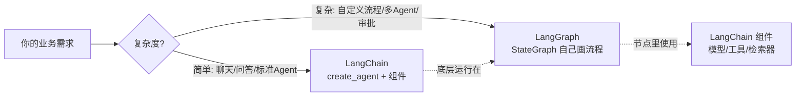
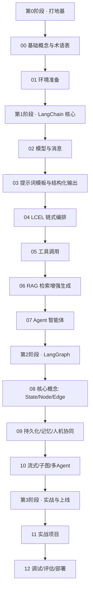

# LangChain & LangGraph 从入门到进阶

> 一套写给**零基础读者**的中文教程：从"大模型是什么"讲起，一路到能独立搭建 RAG 知识库问答、带记忆的智能体（Agent）、多 Agent 协作系统，并部署上线。

- **适用版本**：Python ≥ 3.10，`langchain` 1.x（编写时 1.4），`langgraph` 1.x（编写时 1.2）
- **编写时间**：2026 年 10 月
- **语言**：Python 为主线；前端同学可参考 [13 章 JS/TS 速查](./13-JS-TS版本速查.md)

> ⚠️ LangChain 生态更新很快。网上大量教程用的是 0.x 时代的旧写法（`LLMChain`、`initialize_agent`、`ConversationBufferMemory` 等），**这些在 1.x 已废弃或移到了 `langchain-classic`**。本教程全部采用 1.x 推荐写法，遇到旧教程请以本教程和[官方文档](https://docs.langchain.com)为准。

---

## 一、先用一分钟搞懂这俩是什么

| | LangChain | LangGraph |
|---|---|---|
| **一句话** | 搭建大模型应用的"零件库 + 快速组装器" | 编排复杂 AI 流程的"流程图引擎" |
| **类比** | 乐高积木：模型、提示词、工具、检索器……拿来就能拼 | 地铁线路图：哪一站做什么、什么条件换乘、能不能回头，全都画清楚 |
| **擅长** | 快速做出聊天、问答、RAG、标准 Agent | 多步骤、有分支、有循环、要暂停等人审批、要长期记忆、多 Agent 协作 |
| **关系** | LangChain 1.x 的 `create_agent` **底层就是用 LangGraph 实现的** | LangGraph 可以单独用，也常和 LangChain 的组件搭配 |



**结论**：先学 LangChain 把"零件"和"标准 Agent"玩明白，再学 LangGraph 掌握"自定义流程"。这也是本教程的顺序。

---

## 二、学习路线图



## 三、目录

| 章节 | 内容 | 你将学会 | 建议用时 |
|---|---|---|---|
| [00 基础概念与术语表](./00-基础概念与术语表.md) | LLM、Token、Prompt、Embedding、RAG、Agent 等 | 看懂后面所有章节的"行话" | 1 小时 |
| [01 环境准备](./01-环境准备.md) | Python 环境、API Key、国内模型配置、LangSmith | 跑通第一个 Hello World | 1 小时 |
| [02 模型与消息](./02-模型与消息.md) | `init_chat_model`、消息类型、invoke/stream/batch | 和大模型"说上话" | 1.5 小时 |
| [03 提示词模板与结构化输出](./03-提示词模板与结构化输出.md) | `ChatPromptTemplate`、`with_structured_output` | 让模型稳定输出 JSON | 1.5 小时 |
| [04 LCEL 链式编排](./04-LCEL与Runnable链式编排.md) | `\|` 管道、Runnable、并行、容错 | 把多个步骤串成流水线 | 2 小时 |
| [05 工具调用](./05-工具调用.md) | `@tool`、`bind_tools`、工具调用循环 | 让模型"动手"查数据、调接口 | 2 小时 |
| [06 RAG 检索增强生成](./06-RAG检索增强生成.md) | 文档加载、切分、向量化、检索、优化 | 做一个企业知识库问答 | 3 小时 |
| [07 Agent 智能体](./07-Agent智能体-create_agent.md) | `create_agent`、记忆、中间件 | 做一个能自主决策的助手 | 3 小时 |
| [08 LangGraph 核心概念](./08-LangGraph核心概念.md) | State、Node、Edge、条件分支、循环 | 自己画 AI 工作流 | 3 小时 |
| [09 持久化、记忆与人机协同](./09-LangGraph持久化-记忆与人机协同.md) | Checkpointer、Store、`interrupt`、时间旅行 | 让流程可暂停、可审批、可回溯 | 3 小时 |
| [10 高级模式](./10-LangGraph高级模式-流式子图多Agent.md) | 流式输出、子图、Map-Reduce、多 Agent | 搭建复杂协作系统 | 3 小时 |
| [11 实战项目](./11-实战项目.md) | 3 个完整项目 | 从 0 到 1 完成真实应用 | 6 小时+ |
| [12 调试评估与生产部署](./12-调试评估与生产部署.md) | LangSmith、评估、FastAPI、安全、成本 | 把应用安全地推上线 | 3 小时 |
| [13 JS/TS 版本速查](./13-JS-TS版本速查.md) | Python ↔ TS 对照 | 在 Node/Next.js 里用起来 | 1 小时 |
| [14 FAQ 与学习资源](./14-FAQ与学习资源.md) | 常见报错、选型问答、资料清单 | 遇到问题知道去哪找答案 | 随查 |

## 四、三种学习路径

- **🚀 极速路径（1 天，只想快速了解）**：00 → 01 → 02 → 05 → 07 → 08，每章只看"通俗理解"和第一个示例。
- **📘 标准路径（1~2 周，想能上手干活）**：按顺序通读 00 ~ 12，每章跑通代码、做完练习。
- **🎯 目标导向路径**：
  - 想做**知识库问答** → 00 → 01 → 02 → 03 → 06 → 07 → 11（项目一）
  - 想做**智能客服 / 助手** → 00 → 01 → 02 → 05 → 07 → 09 → 11（项目二）
  - 想做**复杂工作流 / 多 Agent** → 先完成标准路径前 7 章 → 08 → 09 → 10 → 11（项目三）

## 五、阅读约定

文中会反复出现以下几种提示框：

> 💡 **通俗理解**：用生活化的比喻解释一个概念。

> 📖 **术语**：专业词汇的解释，第一次出现时给出。

> 🎯 **应用场景**：这个知识点在真实项目里用在哪。

> ⚠️ **注意**：常见坑、易错点、版本差异。

代码约定：

- 所有示例都是**完整可运行**的 Python 脚本，复制到 `.py` 文件即可运行（需先完成 [01 环境准备](./01-环境准备.md)）。
- **学习阶段统一使用 DeepSeek**，默认模型写作 `init_chat_model("deepseek:deepseek-flash", extra_body={"thinking": {"type": "disabled"}})`。为什么要关闭思考模式、如何换成其他模型，详见 [01 章 · 配置模型](./01-环境准备.md#四配置大模型)。
- RAG 相关章节的 Embedding（DeepSeek 不提供）统一使用本地免费的 BGE 中文模型，见 [06 章](./06-RAG检索增强生成.md)。

## 六、配套练习目录建议

```
my-langchain-lab/
├── .env                 # DEEPSEEK_API_KEY 等（不要提交到 Git）
├── pyproject.toml       # 依赖管理（uv 自动生成）
├── ch02_model.py        # 每章一个练习文件
├── ch05_tools.py
├── ...
└── data/                # RAG 用的文档
```
